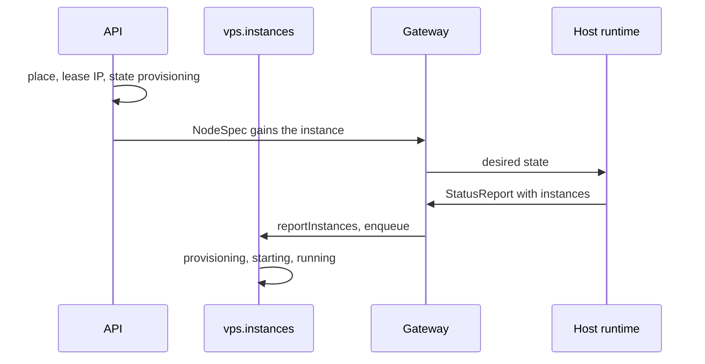
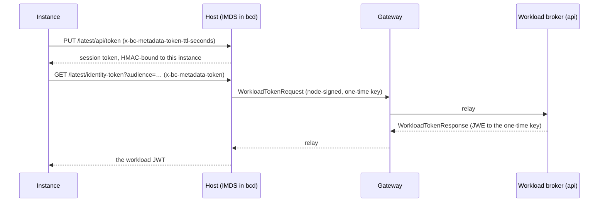

An <Term id="instance">instance</Term> is a VM in a VPS <Term id="pool">pool</Term>. You ask for one with a
<Term id="flavor">flavor</Term>, an image and SSH keys; after that you only change what you want it to be
(`running`, `stopped` or `deleted`). The `vps.instances` <Term id="reconciler">reconciler</Term> works out how to
get there, from what the host's runtime reports in a hosted pool or from what the provider answers in a provider
pool.

This page assumes you registered `vps()` and have a VPS pool with at least one flavor; see [VPS](/docs/guides/vps)
and [flavors](/docs/guides/vps/flavors).

Some instances belong to [sandboxes](/docs/guides/vps/sandboxes): the instance a sandbox drives, and the warm
instances a sandbox template keeps ready. Those can be read but not moved with the methods on this page; see
[sandbox and warm instances](#sandbox-and-warm-instances).

## Create an instance

```ts title="server.ts"
const instance = await compute.api.instances.create(
  { token },
  {
    tenantId: 'acme',
    poolId: 'pool_01jz…',
    flavor: 'g1.small',
    imageId: 'ubuntu-24.04',
    sshKeys: ['ssh-ed25519 AAAAC3NzaC1lZDI1NTE5AAAA… alice@laptop'],
    idempotencyKey: 'build-agent-7',
  },
);
// Hosted pool: { id: 'inst_…', state: 'provisioning', desiredState: 'running',
//                nodeId: 'node_…', addresses: ['10.0.0.2'], … }
// Provider pool: { id: 'inst_…', state: 'scheduling', … }
```

From a browser or another service, the typed client strips the credential, and every method is also a plain HTTP
route:

<Tabs items={['Client', 'HTTP', 'CLI']}>
  <Tab value="Client">

```ts
import { createComputeClient } from 'better-compute/client';

const client = createComputeClient<typeof compute>({ baseURL, token: () => session.getToken() });
await client.instances.create({ tenantId: 'acme', poolId, flavor: 'g1.small', imageId: 'ubuntu-24.04', idempotencyKey: 'build-agent-7' });
```

  </Tab>
  <Tab value="HTTP">

```http
POST /api/compute/instances/create
Authorization: Bearer <token>
Content-Type: application/json

{ "tenantId": "acme", "poolId": "pool_01jz…", "flavor": "g1.small", "imageId": "ubuntu-24.04", "idempotencyKey": "build-agent-7" }
```

  </Tab>
  <Tab value="CLI">

```bash
better-compute api instances.create tenantId=acme poolId=pool_01jz… flavor=g1.small \
  imageId=ubuntu-24.04 'sshKeys[]=ssh-ed25519 AAAAC3Nza… alice@laptop' idempotencyKey=build-agent-7
```

  </Tab>
</Tabs>

<TypeTable
  type={{
    tenantId: { type: 'string', description: 'The tenant the instance belongs to.', required: true },
    poolId: { type: 'string', description: 'A vps-host or provider pool the tenant owns or is offered, and not archived.', required: true },
    flavor: { type: 'string', description: 'A flavor name of that pool, such as g1.small.', required: true },
    imageId: { type: 'string', description: 'Up to 200 characters of letters, digits and . _ @ : / -, starting with a letter or digit. Hosted pools resolve it with vps({ images }); provider pools pass it to the provider as is.', required: true },
    sshKeys: { type: 'string[]', description: 'Up to 32 OpenSSH public key lines: ssh-ed25519, ssh-rsa, ecdsa-sha2-nistp256/384/521 or sk-ssh-ed25519@openssh.com.', default: '[]' },
    userData: { type: 'string', description: 'Your own cloud-init, at most 32 KiB, or a reference to it. When given it is used as is, and sshKeys are not added to it. A reference must be secret://<tenantId>/<id>, a secret this tenant wrote with secrets.put (a secret_refs row), since the guest reads it; a platform-minted secret, a fleet secret (secrets.put with scope fleet), the sealed user data of another instance, or any other secret://, vault:// or env:// value is INVALID_INPUT. A reference also needs compute:secrets:manage (see the decision below).' },
    desiredState: { type: "'running' | 'stopped'", description: 'Where the instance should end up.', default: "'running'" },
    projectId: { type: 'string', description: 'A prj_ id, for usage tags and policies.' },
    idempotencyKey: { type: 'string', description: '1 to 128 of letters, digits and . _ : -. Retrying with the same key returns the same instance.', required: true },
    wait: { type: '{ timeoutMs: number }', description: '0 to 30000. Holds the answer until the instance has started or failed; see waiting for the instance below. Not part of the request hash.' },
  }}
/>

Unknown fields are `INVALID_INPUT`. The API reference has the route and action:
[instances.create](/docs/reference/api/instances#create).

### How a create is admitted

`instances.create` follows the same request-as-resource <Term id="admission">admission</Term> as
[reservations](/docs/guides/capacity/reservations): the instance exists as a <Term id="draft">draft</Term> before
anyone decides on it, so policies can read what is being asked for.

<Steps>
<Step>

### Transaction 1: the draft

The instance id is derived from the tenant, the caller's identity and the idempotency key. If a finished instance
already has that id, the call returns it (a replay). If the stored request differs from this one, the call fails
with `CONFLICT` and `details.instanceId`. Otherwise vps checks that the pool is visible and is a VPS pool, that the
flavor exists and is not archived, and, in a hosted pool, that the image resolves for the tenant. It then writes the
draft and its authorization row.

</Step>
<Step>

### The decision

Better IAM decides `compute:instances:create` on `compute-instance/<draft id>`. The row's parent is the pool, its
owner is the caller, and it carries the attributes policies can test: `vcpu`, `memoryGiB`, `gpus`, `imageId`,
`imageVerified` and `projectId`. A refusal deletes the draft, so a later retry is decided afresh. An agent under
[delegated confirmation](/docs/guides/iam/delegated-confirmation) gets `CONFIRMATION_REQUIRED` and retries with the
same key once a person approves.

When `userData` is a `secret://` reference, the admission check first decides `compute:secrets:manage` on
`compute-tenant/<tenantId>` with the caller's own credential, and in the root tenant also on `compute-fleet/global`,
whose secrets share the root tenant's store: user data is handed to the guest, which reads it, while secrets are
otherwise write-only, so `compute:instances:create` alone must not be enough to read one. A call without a caller
credential is `ACCESS_DENIED` with `details.reason: 'credential-required'`. The decision uses the deployment's IAM
type prefix (`ModuleContext.typePrefix`).

Still outside any transaction, the pool's budget check runs, the same `budgetAdmissionCheck` as for
[reservations](/docs/guides/capacity/reservations): when the pool's policy sets `admission.budgetCheck: 'meter'`, or
the tenant's offer has `onBudgetExceeded: 'stop-new'` or `'drain'`, it calls Better IAM's `billing.check` for the
caller, and a spent budget answers [`SPEND_LIMIT_REACHED`](/docs/reference/errors#spend_limit_reached). The draft
stays, so the same key is decided again once the budget's window resets. See
[budgets](/docs/guides/iam/billing-and-usage#budgets).

</Step>
<Step>

### Transaction 2: admission and scheduling

The draft becomes an instance in `scheduling`. In a **hosted pool**, capacity places it at once and vps leases an IP
address, so the answer is already `provisioning` with a `nodeId`. When no host fits, the answer is `scheduling` with
an `Unschedulable` condition (reason `NoFit`), and the reconciler tries again every 30 seconds. In a **provider
pool**, vps charges the flavor's shape to the tenant's quota and returns `scheduling`; the reconciler creates the
machine.

</Step>
</Steps>

A policy can bound what tenants create, for example only small VMs from signed images:

```json title="policy statement"
{
  "sid": "SmallVerifiedVms",
  "effect": "allow",
  "actions": ["compute:instances:create"],
  "resources": ["compute-instance/*"],
  "conditions": {
    "Bool": { "resource.imageVerified": true },
    "NumericLessThanEquals": { "resource.vcpu": 8, "resource.gpus": 0 }
  }
}
```

`imageVerified` comes from the image resolver. In a provider pool without `vps({ images })` it is `false`.

### Errors

| Code                    | When                                                                                                                                 |
| ----------------------- | ------------------------------------------------------------------------------------------------------------------------------------ |
| `INVALID_INPUT`         | A field fails validation, the pool is not of class `vps-host` or `provider`, or `userData` names a secret the tenant did not put with `secrets.put`, or a fleet secret (`scope: 'fleet'`, aac73a1). |
| `NOT_FOUND`             | The pool is not owned by or offered to the tenant, or is archived; the flavor is missing or archived; a hosted pool's image does not resolve. |
| `CONFLICT`              | The idempotency key was used for a different request.                                                                                |
| `ACCESS_DENIED`         | Better IAM refused. The draft is gone. Also a `secret://` user data without `compute:secrets:manage`, or without a caller credential. |
| `CONFIRMATION_REQUIRED` | A delegated session needs a person to approve.                                                                                       |
| `SPEND_LIMIT_REACHED`   | The pool checks budgets and a Better IAM budget covering the caller is spent. The draft stays.                                      |
| `QUOTA_EXCEEDED`        | The tenant's quota in the pool is too small. `details` names `resource`, `requested`, `max` and `used`.                             |
| `CAPACITY_UNAVAILABLE`  | Hosted pool: the pool's IP range has no free address.                                                                                |
| `INVALID_CONFIG`        | Hosted pool, but `vps()` was registered without `images`.                                                                            |
| `INVALID_STATE`         | Provider pool without a provider account.                                                                                            |

Every resource an instance uses needs a quota row in the pool: `vcpu`, `memoryGiB`, `diskGiB`, and `gpu` for GPU
flavors. [pools.offer](/docs/reference/api/pools#offer) sets them for a tenant. A pool's owner gets only a `gpu`
quota by default, so give the owner `ownerQuota` for the scalar resources before it creates instances in its own
pool. See [quotas and usage](/docs/guides/capacity/quotas-and-usage).

### Waiting for the instance

`create` is async-with-wait (PLAN.md section 9.1). Without `wait` it answers as soon as transaction 2 commits, with
the instance in `scheduling` or `provisioning`. With `wait: { timeoutMs }` the server holds the answer while the
instance is `pending`, `scheduling`, `provisioning` or `starting`, re-reading its row in read-only transactions
(backing off from 50 ms to 1 s), and returns as soon as it reaches any other state (`running`, `stopped`, `error`,
…), `timeoutMs` passes (at most 30 seconds), or the request is aborted. A timeout is not an error: the answer is the
instance as last read.

```ts
const instance = await client.instances.create({ ...input, wait: { timeoutMs: 20_000 } });
if (instance.state !== 'running') {
  // Still starting, or failed: read it again later with instances.get, or watch instance.* events.
}
```

`wait` is kept out of the request hash, so a retry with the same key and a different `wait` replays the stored
instance instead of failing with `CONFLICT`. The MCP `create_instance` tool sends `wait` from its `waitSeconds`
(default 20).

## Read and list

[instances.get](/docs/reference/api/instances#get) returns one instance of the tenant, deleted ones included, and
sandbox and warm instances too. Drafts and other tenants' instances are `NOT_FOUND`.

[instances.list](/docs/reference/api/instances#list) returns `{ items, cursor? }`, newest first. It lists the
instances sandboxes drive, but never the warm instances of sandbox templates:

<TypeTable
  type={{
    tenantId: { type: 'string', description: 'The tenant.', required: true },
    scope: { type: "'mine' | 'all'", description: "mine: the caller's own instances, filtered in SQL. all: every instance of the tenant, each checked with compute:instances:read.", default: "'mine'" },
    state: { type: 'InstanceState', description: 'Only instances in this state.' },
    poolId: { type: 'string', description: 'Only instances in this pool.' },
    limit: { type: 'number', description: '1 to 200.', default: '50' },
    cursor: { type: 'string', description: 'The cursor of the previous page (an instance id).' },
  }}
/>

## Start, stop and delete

[start](/docs/reference/api/instances#start) and [stop](/docs/reference/api/instances#stop)
(`compute:instances:update`) set `desiredState` to `running` or `stopped`, and
[delete](/docs/reference/api/instances#delete) (`compute:instances:delete`) sets it to `deleted`. Each returns the
instance at once, before anything has happened, and wakes the reconciler; a hosted instance's node also gets a new
NodeSpec. Watch `state`, or the `instance.*` [events](/docs/guides/events), to see the change land.

- `start`, `stop` and `delete` (and `resize`) on a sandbox's instance or a warm instance are `INVALID_STATE`; see
  [sandbox and warm instances](#sandbox-and-warm-instances).
- `start` or `stop` on an instance that is being deleted is `INVALID_STATE`.
- `start` on an instance in `error` that has a host or a provider machine retries it: it moves to `starting` and the
  runtime or provider is asked again. An instance that failed before it was placed stays in `error`; delete it and
  create a new one.
- `delete` is idempotent. A deleted instance stays readable with `state: 'deleted'`; deleting it again returns it.
- Deletion releases everything the instance held: the capacity allocation, the IP lease and the quota, and its
  authorization row.
- When the IAM tenant is deleted, `vps().tenantDeleted` drops the tenant's drafts and sets every live instance,
  sandboxes' and warm ones included, to `desiredState: 'deleted'` (up to 100 per call), answering `SYNC_AGAIN` until
  all are `deleted`. Hosted instances hold inline allocations, which capacity's own teardown does not reach.

A hosted instance is `deleted` only once its runtime has dropped it: the next complete report from the host no
longer lists it. If the host is `lost`, or the instance was never placed, deletion finishes without waiting. A
provider instance is `deleted` once the provider's `delete` succeeds or finds nothing to delete.

## Resize

[instances.resize](/docs/reference/api/instances#resize) moves a stopped hosted instance to another flavor of its pool,
on the same host. It exists so a tenant can grow a VM without rebuilding it.

```ts
await compute.api.instances.stop({ token }, { tenantId: 'acme', instanceId });
// … wait until state is 'stopped' …
await compute.api.instances.resize({ token }, { tenantId: 'acme', instanceId, flavor: 'g1.large' });
```

The call charges the growth to quota first, then resizes the allocation in place on the node, then refunds any
shrinkage. It is all or nothing: if the host lacks room, the quota charge is undone.

| Code                   | When                                                                         |
| ---------------------- | ---------------------------------------------------------------------------- |
| `UNSUPPORTED`          | The instance is in a provider pool, or the new flavor has a different GPU count. |
| `INVALID_STATE`        | The instance is not stopped (both `state` and `desiredState`), holds no allocation, or belongs to a sandbox or a warm pool. |
| `NOT_FOUND`            | The flavor is missing or archived.                                           |
| `QUOTA_EXCEEDED`       | The growth does not fit the tenant's quota.                                  |
| `CAPACITY_UNAVAILABLE` | The host has no room; `details.resource` names what ran out.                 |

The instance passes through `resizing` and is `stopped` again when the call returns, with its policy attributes
updated. See [flavors](/docs/guides/vps/flavors) for how shapes become claims.

## Sandbox and warm instances

[Sandboxes](/docs/guides/vps/sandboxes) (v0.5) are built on instances, and migration `vps/0004_sandboxes` marks the
instances they own with two columns, never both set:

| Column | The instance is | Created by |
| --- | --- | --- |
| `instances.sandbox_id` | The one instance a sandbox drives | `sandboxes.create` (a cold create), or a warm claim that moves it here |
| `instances.warm_template_id` | A warm instance of a sandbox template, not claimed yet | The `vps.sandboxes` reconciler, owned by the template's author |

Such an instance is admitted, placed, charged to quota, addressed, metered and deleted exactly like one from
`instances.create`, but only its sandbox or its template moves it. `instances.start`, `stop`, `resize` and `delete`
refuse it with `INVALID_STATE` ("Instance … is managed by sandbox …" or "… is a warm instance of sandbox template
…"); use `sandboxes.delete` or `sandboxTemplates.update` instead. `instances.get` returns both kinds, and
`instances.list` returns a sandbox's instance but hides warm instances. The `Instance` view does not name the sandbox;
the sandbox's `instanceId` points the other way. The instance events vps publishes for them carry `data.sandboxId`
or `data.warmTemplateId`.

`tunnels.open` refuses both kinds too, for every op, with `INVALID_STATE` and `details.reason: 'sandbox-managed'`,
so `compute:instances:exec` on the instance cannot bypass the sandbox's own decision. The way into a sandbox is
[`sandboxes.exec`](/docs/guides/vps/sandboxes#run-code-inside), decided as `compute:sandboxes:exec` on the sandbox;
a warm instance takes no tunnels at all.

### Paused instances

`paused` is an instance state and a desired state (v0.5): vCPUs stopped, memory resident, the host and allocation
kept. No API method asks for it; only warm pools do, on runtimes whose `RuntimeTraits.pause` is true. The lifecycle
converges it like the other settled states: from `provisioning` it walks through `starting` and `running`, then
pauses (`pause`); from `paused` it resumes to `running` (`resume`) or stops. A host reports it as
`InstanceObservedState.PAUSED`, and a `lost` instance can recover to `paused`. A runtime without `pause` treats a
desired `paused` as `stopped`, and vps never asks one for it: warm pools on such runtimes stay `stopped`.

## The reconciler

`vps.instances` runs one instance per work item, keyed by the instance id. Every API change, every host report that
changes something and every provider answer enqueues it again, and it schedules its own next look:

| Situation                                  | Next look       |
| ------------------------------------------ | --------------- |
| Nothing fits a hosted instance yet         | 30 s            |
| Transitional state (waiting on a runtime)  | 10 s            |
| Steady provider instance (drift polling)   | 60 s            |
| Provider call failed and will be retried   | 30 s            |
| Settled hosted instance, error, deleted    | Only when woken |

### Hosted pools

The API never calls a runtime. The reconciler changes the database, and the host acts on its NodeSpec:



Each hosted node's `instances` section lists every live instance placed on it (not `pending`, `scheduling` or
`deleted`) with its runtime, flavor, image (`url`, `sha256`, `format`), its user data as a `secret://` reference,
the GPU atoms and id of its allocation (`allocationId`), and one NIC (`nics`): the host bridge (`br0`, or
`vps({ hostNetwork })`), a stable locally administered MAC derived from the instance id, and its IPAM address in CIDR
form. NIC order is the guest's interface order and is kept. An instance being deleted is sent with
`desiredState: 'deleted'`.

User data never travels in the spec. At admission in a hosted pool, vps renders the cloud-config (the hostname from
the instance id and `sshKeys`, unless you passed `userData`), seals it through the secret broker and keeps only its
`secret://` reference (`instances.user_data_sealed`, migration `vps/0002_sealed_user_data`); a tenant's own reference
(one it wrote with `secrets.put` with the default `tenant` scope, checked in the create transaction; a fleet secret
is refused) is kept as it is, and only a sealed one is
deleted with the instance. The host fetches the value with a node-signed
`SecretRequest` naming the instance's allocation, and the broker releases it only when the secret belongs to the
instance's own tenant. The guest gets no join token, no `bcd` and no IAM key.

From the reports, the reconciler moves the instance:

- When the reported state equals `desiredState`, it walks `state` there: `provisioning` to `starting` to `running`,
  `running` to `stopped` and back, or `running` to `paused` and back for warm instances. Each step publishes
  `instance.<state>`.
- A reported `error` moves it to `error` with a `RuntimeError` condition and publishes `instance.failed`.
- While the report and `desiredState` disagree, it waits and looks again in 10 seconds.

<Callout type="warn" title="The host side is not written yet">
bcd's node agent is built and tested but not released. It has the `instances` converger (the FakeHypervisor's
rules, user data fetched with a `SecretRequest` bound to the allocation, every domain in its status reports, the
instance network policy as host nftables rules), but a real host build has no built-in runtime yet. It can run
instances through a runtime a bcx plugin serves, and no such plugin is written, so without one a non-empty
`instances` section fails with `this host runs no instance runtime` and no VM boots on real hardware. fakehw builds
run instances on a file-backed stand-in runtime named `libvirt-kvm`; see [delivery](/docs/daemon/delivery#instances). The TypeScript FakeDaemon plays a VPS host on a fake hypervisor (domains, overlay disks, NoCloud seeds, taps), fetching
user data through the broker, and `tests/e2e/vps.test.ts` runs hosted instances through the real server and gateway
with it.
</Callout>

### Provider pools

There is no node. Each round is three steps, so no network call ever runs inside a database transaction:

1. **Plan** in a short transaction: lock the instance, start deletion if `desiredState` is `deleted`, and read the
   provider account.
2. **Call** the account's `ProviderImpl` with the instance id as the idempotency key.
3. **Apply** the answer in a second transaction, only if the instance's `version` has not moved; otherwise try again
   at once.

| Instance                                                    | Provider call                     |
| ----------------------------------------------------------- | --------------------------------- |
| `scheduling`, no machine yet                                | `create` with the flavor's `offerId`, the `imageId`, rendered user data and the instance id as name |
| `running`, wanted `stopped`, reported running                | `power(id, 'graceful-off')`, then `get` |
| `stopped`, wanted `running`, reported stopped                | `power(id, 'on')`, then `get`     |
| `deleting` with a machine                                   | `delete` (`NOT_FOUND` counts as done) |
| Anything else with a machine                                | `get`                             |

The machine's `id` becomes `externalId`, its addresses replace `addresses`, and its state maps to `running`,
`stopped`, `error` or, for `deleted`, absent. The first answer moves `scheduling` to `provisioning` and publishes
`instance.provisioning`.

A failed call records a `ProviderError` condition with the error code as reason and the message (up to 500
characters). `UNSUPPORTED`, `INVALID_STATE` and `INVALID_CONFIG` move the instance to `error`; anything else,
`RATE_LIMITED` and `PROVIDER_ERROR` included, is retried in 30 seconds. A machine that `get` no longer finds makes the
instance `lost`, and the reconciler stops polling it; delete it to refund its quota.

## Reports from hosts

The gateway hands each node's coalesced `StatusReport` to `instanceStatusHandler`, inside its ingest transaction. The
report's `instances` lists every VM the host's runtimes hold, managed or not:

- States map from `InstanceObservedState`: `RUNNING`, `STOPPED`, `PAUSED` and `ERROR`. `UNSPECIFIED` entries are
  skipped.
- Only instances placed on the reporting node are touched, so one node can never move another node's instances.
- Reported addresses are added to the instance's `addresses`.
- With `instancesComplete: true` the list is the whole inventory: a placed instance missing from it is marked
  absent. That is how deletion completes. An empty, incomplete report changes nothing.

You can call the same seam yourself, which is what the tests and the churn acceptance do to emulate hosts:

```ts
import { reportInstances } from '@better-compute/vps';

// `work` is the runtime's work queue (ModuleContext['work']): changed instances are enqueued on it.
await db.transaction((tx) =>
  reportInstances(tx, work, nodeId, [{ id: instanceId, state: 'running', addresses: ['fe80::1'] }], {
    complete: true,
  }),
);
// → { updated: 1, orphans: [] }
```

### Orphans and leak alerts

An instance the runtime holds that no live row places on that node is an orphan: a leaked VM, overlay or tap, or one
reported by the wrong host. `reportInstances` returns orphan ids sorted, and never changes anything for them.

`instanceStatusHandler({ events })` publishes `instance.orphaned` with subject `node/<id>` and
`data: { nodeId, instanceIds }` (up to 100 ids). It announces a node's orphan set only when the set changes; hosts
report about once a second and leaks persist. The last announced set is kept in memory, so a restarted process
announces current leaks once more. Without `events`, orphans go to `log` (default `console.warn`).
`vpsInstanceStatusHandler` is the handler with no event publisher.

The v0.3 acceptance checks the other direction too: after 200 instances churn on 3 emulated hosts, every runtime
domain is a live placed instance and every allocation, IP lease, scalar claim and quota counter matches the live
instances (`tests/vps-churn.test.ts`).

## Lost hosts

A host becomes `lost` only when its `vps-host` pool sets `policy.lostAfter`: the liveness controller then marks it
`lost` that long after it became unreachable (see [operating nodes](/docs/guides/nodes/operating-nodes)). Without
`lostAfter` a host stays `unreachable` and its instances wait for it. When a hosted instance's node becomes `lost`,
the instance moves to `lost` and `instance.lost` is published with the `nodeId`. The reconciler then looks every 60
seconds:

- If the node reconnects and reports the instance `running`, `stopped` or `paused`, it recovers to that state
  (`instance.recovered`).
- If the pool's policy has `recreateOnHostLoss: true`, the instance releases its allocation and IP lease, goes back to
  `scheduling` (`instance.recreating`) and is placed again, on a host that is still schedulable, where it boots
  from its image.

`recreateOnHostLoss` is read from the pool's stored `policy` document; it is not part of the `PoolPolicy` type yet,
so a typed caller setting it through `pools.create` or `pools.update` needs a cast.

## Runtimes

A runtime is the driver that runs VMs on a host, under the `runtime` driver kind that importing `@better-compute/vps`
adds to `DriverKinds`. It runs on the node (`runsOn: 'node'`), and every operation is idempotent by instance id:

```ts title="@better-compute/vps"
interface RuntimeDriver {
  readonly traits: RuntimeTraits; // isolation 'vm' | 'microvm' | 'container', multiTenant, gpuPassthrough, imageFormats
  list(): Promise<RuntimeInstanceStatus[]>; // everything it holds, so leaks are found by diffing
  apply(spec: InstanceSpec): Promise<RuntimeInstanceStatus>; // cache the image, build the overlay and NoCloud seed, start/stop/resize
  reboot(instanceId: string): Promise<void>;
  remove(instanceId: string): Promise<void>; // an absent instance counts as removed
  console?(instanceId: string): Promise<DuplexStream>; // the serial console, for tunnels
  // v0.5, for sandboxes: warm pools and snapshots
  pause?(instanceId: string): Promise<void>; // vCPUs stopped, memory resident
  resume?(instanceId: string): Promise<void>;
  snapshot?(instanceId: string, target: RuntimeSnapshotTarget): Promise<RuntimeSnapshotResult>;
}
```

`pause` and `resume` serve [sandbox warm pools](/docs/guides/vps/sandboxes#warm-pools): a runtime that implements
them sets `pause: true` in its `RuntimeTraits`, and `builtinRuntimeTraits` does so for `libvirt-kvm`,
`cloud-hypervisor` and `firecracker` (not `containerd`). vps then keeps warm instances `paused` on that runtime; see
[paused instances](#paused-instances). `snapshot` and `InstanceSpec.restoreFrom` serve
[sandbox snapshots](/docs/guides/vps/sandboxes#snapshots-and-restore): `sandboxes.snapshot` sends the host an
`instance.snapshot` command, and `sandboxes.create({ fromSnapshot })` boots a new instance from one. A runtime that
implements `snapshot` sets `snapshot: true` in its `RuntimeTraits` (the three built-in VM runtimes do); on any other,
`sandboxes.snapshot` is `UNSUPPORTED` up front. No `instances.*` method snapshots a plain instance.

`libvirt-kvm` and `cloud-hypervisor` are planned as runtimes built into bcd for v0.3, and neither is implemented yet:
bcd's `instances` converger drives them through its `Runtime` interface, and today only fakehw builds provide one, a
file-backed stand-in named `libvirt-kvm`.
Out-of-process runtimes are served too: on `bcd node`, a bcx plugin whose driver lists the kind `runtime` becomes a
runtime (`list`, `apply(spec)`, `remove(id)` over `Invoke`; no snapshots), selected by pools like any other. No such
plugin (a Kata runtime is PLAN.md's walkthrough 4) is written yet; see
[walkthrough 4](/docs/extending/walkthroughs#walkthrough-4-a-kata-runtime-over-bcx). `vps({ runtimes })` only names the ids: the first one is recorded on every new
hosted instance and sent in its spec.

The control plane already places plugin runtimes correctly: an instance whose runtime is not one of bcd's built-ins
(`bcdBuiltinRuntimes`: `libvirt-kvm`, `cloud-hypervisor`) is placed only on hosts carrying the node label
`bc.dev/driver.<runtime>`, in any version (`runtimeNodeLabels`). The gateway writes that label from the drivers a
daemon advertises in `Hello`; see [placement](/docs/guides/capacity/placement#eligibility-filters).

## Events

Instance events have subject `instance/<id>` and carry `state`, `desiredState` and `poolId` (plus `sandboxId` or
`warmTemplateId` for [sandbox and warm instances](#sandbox-and-warm-instances), and `reason: 'tenant deleted'` on
`instance.deleting` during a tenant teardown):

| Event                                                           | When                                                  |
| --------------------------------------------------------------- | ----------------------------------------------------- |
| `instance.created`                                              | The create was admitted.                              |
| `instance.scheduled`                                            | A hosted instance was placed (`data.nodeId`).         |
| `instance.provisioning`                                         | A provider machine exists (`data.externalId`).        |
| `instance.starting`, `instance.stopping`, `instance.deleting`   | `start`, `stop` or `delete` was called.               |
| `instance.running`, `instance.stopped`, …                       | The reconciler moved `state` (named after the new state). |
| `instance.resized`                                              | A resize finished (`data.flavor`).                    |
| `instance.failed`                                               | The instance entered `error` (`data.reason`).         |
| `instance.lost`, `instance.recovered`, `instance.recreating`    | Host or machine loss, and what followed.              |
| `instance.deleted`                                              | Everything it held was released.                      |
| `instance.orphaned`                                             | A host holds instances no row places there (subject `node/<id>`). |

## Access to an instance

Exec, SSH and TCP port forwards into a hosted instance go through a <Term id="tunnel">tunnel</Term> (`console` is
for nodes, and an instance refuses it with `INVALID_INPUT`): `tunnels.open({ tenantId, instanceId, op })` with `op`
`exec`, `ssh` or `tcp` (plus a `port`) is decided as `compute:instances:exec` and returns a single-use
<Term id="exec-ticket">exec ticket</Term> for the instance's node. The instance must be `running` and its node
connected; provider instances are `UNSUPPORTED`, since no platform agent runs next to them. The method is registered
only when the deployment configures tunnels. See [tunnels](/docs/guides/access/tunnels) and
[SSH](/docs/guides/access/ssh).

## Workload identity

A hosted instance can prove who it is to a third party (Better IAM's `sts/assumeRoleWithWebIdentity`, a cloud STS)
with a short-lived OIDC token, `sub = "t:<tenantId>:instance:<instanceId>"`, that it fetches from its host's
metadata service (IMDS). This is v0.5 and optional: the control plane half is built and tested end to end against
the FakeDaemon (`tests/e2e/imds.test.ts`). `bcd node` has both host halves: the session half (`RequestWorkloadToken`:
a node-signed `WorkloadTokenRequest` with a one-time key, the sealed answer opened and checked against the instance
and request id) and the metadata service, served on `[imds] listen` in its `config.toml` (for example
`169.254.169.254:80` on the instances' bridge). It resolves the caller as the running instance whose address is the
request's source. Since only fakehw builds of bcd run instances yet, no real VM reaches it; its Go tests cover it.



- **The metadata service.** The host serves each instance on its own interface and knows the instance from where
  the request arrived, never from a request field. `PUT /latest/api/token` with `x-bc-metadata-token-ttl-seconds`
  (1 to 21,600) returns a session token bound to that instance; `GET /latest/identity-token?audience=…` with
  `x-bc-metadata-token` returns the token. A session token from one instance fails for any other, and requests with
  `X-Forwarded-For` or `Forwarded` are refused, which blocks the usual SSRF relays.
- **The host holds no signing key.** It sends a `WorkloadTokenRequest` over its session, signed by its node key, and
  gets the token sealed to a one-time key, so the gateway only relays ciphertext.
- **The broker mints only when** the request is signed by the node's current certificate of role `node` (never
  `node-tenant`, a ramdisk, a site agent or a kind-restricted certificate) naming the session's node; the instance
  is live, placed on that node, with its live allocation there; its pool has `policy.workloadIdentity: true`; its
  tenant is neither suspended nor deleted (otherwise `disabled`, recorded with the reason `tenant-suspended` or
  `tenant-deleted`); the audience is the issuer's default or a configured one; the request id is new; and the instance is within its rate
  (30 tokens a minute by default). Tokens live at most 15 minutes.
- **Refusals are answers**, not errors: `not-bound`, `disabled`, `audience`, `rate-limited`, `access-denied` or
  `unavailable`. Each one publishes `security.workload.refused` (rate-limited per reason); each token issued writes
  the audit row `workload.token.issued` with its `jti`, never the token.

Turn it on with a workload issuer from `@better-compute/pki` and the pools that should use it:

```ts title="compute.ts"
import { createWorkloadIssuer } from '@better-compute/pki';

export const compute = betterCompute({
  // …
  workloadIdentity: {
    issuer: createWorkloadIssuer({
      issuer: 'https://compute.example.com/workload', // https on 443
      defaultAudience: 'https://iam.example.com',
    }),
    audiences: ['sts.example.com'], // besides the default
    ttlSeconds: 900, // default and maximum
    perInstancePerMinute: 30,
  },
});
```

`better-compute serve` publishes the issuer's discovery document and JWKS under the issuer URL's path, so relying
parties can verify the tokens. See [workload identity](/docs/operations/pki#workload-identity) for the keys and
their rotation.
