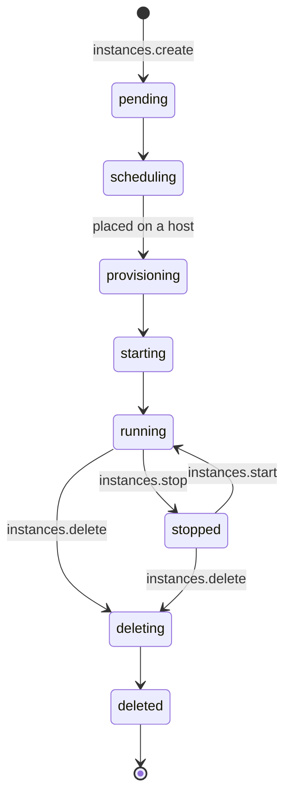

import { Cpu, Instance, KeyRound, Route } from '@/lib/icons';

A sandbox is a short-lived, isolated place to run code you do not fully trust: a build, a test suite, an AI agent's
tool call, a customer's notebook. Better Compute runs sandboxes as <Term id="instance">VPS instances</Term>. Each one
is its own VM, sized by a <Term id="flavor">flavor</Term> of vCPUs, memory and disk, with or without GPUs, and it goes
through the same admission, quotas, metering and audit trail as a GPU reservation.

<Callout type="info" title="What exists today, and what is planned">
There is no separate sandbox API: a sandbox is an instance, created with `instances.create` and removed with
`instances.delete`. The control plane for instances is built and tested (v0.3, beta). Provider pools run the VMs on
Hetzner Cloud or Proxmox VE. The hosted runtimes that run VMs on your own servers, `libvirt-kvm` and
`cloud-hypervisor`, are planned inside bcd for v0.3 and are not built yet, and a Kata runtime plugin is planned for
v0.5. A dedicated sandbox API is decided (D24 in PLAN.md) and being planned, but not built yet: its shape is a
`sandboxes` group layered on `vps()` (templates, a time-to-live with auto-delete, snapshots, warm pools, a microVM
runtime) that reuses instances' admission, quota, IPAM, tunnels and IMDS. See the
[roadmap](/docs/reference/roadmap#sandboxes).
</Callout>

## Why a VM

A sandbox has to hold up when the code inside is hostile. An instance gives it these properties, each enforced in the
control plane:

| Property | How |
| --- | --- |
| Its own kernel | A VM (or microVM) per instance. Each runtime declares its isolation as a trait, `vm`, `microvm` or `container`, and a container pool must be single-tenant (`doctor` warns `vps.pools.single-tenant` otherwise). |
| Nothing of the platform inside | The guest gets no <Term id="join-token">join token</Term>, no `bcd` and no IAM key. No platform agent ever runs in a tenant VM. |
| Tenant-bound boot data | User data is rendered at admission, sealed through the secret broker and kept only as a `secret://` reference. The host fetches it with a node-signed request, and the broker releases it only to the instance's own tenant. |
| Bounded resources | The flavor's `vcpu`, `memoryGiB` and `diskGiB` are claimed on the host and charged to the tenant's quota; GPUs are whole atoms passed through VFIO, never overcommitted. |
| Audited access | Exec, SSH and TCP port forwards go through a single-use <Term id="exec-ticket">exec ticket</Term> from `tunnels.open`, decided as `compute:instances:exec`. |
| Clean teardown | Deleting releases the allocation, the IP lease and the sealed user data, and publishes `instance.deleted`. |

## Size sandboxes with flavors

A flavor is a named shape in one pool: 1 to 1024 vCPUs, 1 to 16,384 GiB of memory, 1 to 65,536 GiB of disk, and 0 to
16 GPUs. CPU-only sandboxes use `gpus: 0` (the default), in a pool that needs no GPU model.

```ts title="flavors.ts"
await compute.api.flavors.create(cred, {
  tenantId: 'root',
  poolId: sandboxPool,
  name: 'sbx.small',
  vcpu: 2,
  memoryGiB: 4,
  diskGiB: 20,
});

await compute.api.flavors.create(cred, {
  tenantId: 'root',
  poolId: gpuSandboxPool,
  name: 'g1.h100x1',
  vcpu: 16,
  memoryGiB: 120,
  diskGiB: 200,
  gpus: 1,
});
```

On a hosted pool, capacity places the flavor on one host: a host fits when `allocated + claim` stays within
`floor(allocatable × ratio)` for every scalar, where `ratio` is that host's overcommit for CPU and memory. The same
shape counts against the tenant's quota, and hosted instances are metered as `vps.vcpu.hours`,
`vps.memory.gib.hours` and, for GPU flavors, `gpu.<model>.hours`. See [flavors](/docs/guides/vps/flavors) for the
details, including a current limit: nothing fills in a host's capacity rows from its inventory yet.

## Start a sandbox

```ts title="sandbox.ts"
const sandbox = await client.instances.create({
  tenantId: 'acme',
  poolId: sandboxPool,
  flavor: 'sbx.small',
  imageId: 'ubuntu-24.04',
  idempotencyKey: `sandbox-${jobId}`,
});
// { id: 'inst_…', state: 'provisioning' (hosted) or 'scheduling' (provider), desiredState: 'running', … }
```

The call is one IAM decision on the draft (`compute:instances:create`), so policies can bound what a caller may start:
the flavor's vCPUs, memory and GPUs, the pool, the image and whether it is verified. An agent working under a
delegated session can be held back for a person's confirmation, like any other admission; see
[delegated confirmation](/docs/guides/iam/delegated-confirmation).

The instance then walks the state table as the `vps.instances` reconciler converges it:



Watch it with [events](/docs/guides/events/watch) (`instance.running`, `instance.failed`, `instance.deleted`) rather
than polling. The full table, including `error`, `lost` and recreation after a host loss, is in
[instances](/docs/guides/vps/instances).

## Run code inside

A sandbox has no API of its own inside it. To run something, open a tunnel into it: `exec` for a command session,
`ssh`, or `tcp` with a `port` to reach a service the sandbox listens on (`console` is for nodes, not instances):

```ts
const { ticket } = await client.tunnels.open({ tenantId: 'acme', instanceId: sandbox.id, op: 'exec' });
```

The ticket is single-use and valid for 60 seconds, bound to that instance's node, and re-verified by the daemon. Tunnels work
for hosted instances whose node is connected; provider instances answer `UNSUPPORTED`, because no platform agent runs
next to them (use SSH keys from `instances.create` there). See [tunnels](/docs/guides/access/tunnels).

For code that must call other services as the sandbox, a hosted instance can fetch a short-lived workload identity
token from its host's metadata service; see [workload identity](/docs/guides/vps/instances#workload-identity).

## Tear it down

```ts
await client.instances.delete({ tenantId: 'acme', instanceId: sandbox.id });
```

`delete` sets `desiredState: 'deleted'`. The reconciler stops the VM, removes it through the runtime (or the
provider), releases the allocation and the IP lease, deletes the sealed user data and publishes `instance.deleted`.
A sandbox that must not outlive its job is deleted by the caller: there is no time-to-live on instances yet.

## Let an agent manage sandboxes

The [MCP server](/docs/guides/clients/mcp) gives AI agents the whole lifecycle as tools, each calling the instance
method as the agent: `create_instance` (`instances.create`, with an idempotency key and delegated confirmation),
`list_instances` (its own by default, or `scope: 'all'`), `get_instance`, `start_instance`, `stop_instance` and
`delete_instance`. The MCP gate lets any authenticated agent call the last five; compute decides each on the instance
itself, so an agent can only touch sandboxes its policies allow. `stop_instance` and `delete_instance` are marked
destructive, so many MCP hosts ask the person before calling them. Running code inside a sandbox is not an MCP tool:
agents open [tunnels](/docs/guides/access/tunnels) through the API.

## Sandboxes and GPU reservations

Both come out of the same pools and the same database, so neither can take what the other holds:

| | GPU reservation | Sandbox (instance) |
| --- | --- | --- |
| What you get | GPU atoms on a node, as CDI devices for your own workload manager | A VM with its own kernel, vCPUs, memory, disk and optional GPUs |
| Booked by | `reservations.create` | `instances.create` |
| Time | A window (`duration`), extendable | Open-ended until deleted |
| Who runs code | Your scheduler on the node (Kubernetes, Slurm, containerd) | The guest, reached through tunnels or SSH |
| Isolation | The node's, per workload | A VM per sandbox; nothing of the platform inside |

<Cards>
  <Card title="Instances" href="/docs/guides/vps/instances" icon={<Instance />}>
    The lifecycle, reports, lost hosts, runtimes and workload identity.
  </Card>
  <Card title="Flavors" href="/docs/guides/vps/flavors" icon={<Cpu />}>
    Shapes, scalar claims, overcommit, quota and metering.
  </Card>
  <Card title="Tunnels" href="/docs/guides/access/tunnels" icon={<Route />}>
    Exec, SSH and TCP through single-use tickets.
  </Card>
  <Card title="Policies" href="/docs/guides/iam/policies" icon={<KeyRound />}>
    Bound what callers may start with conditions on the draft.
  </Card>
</Cards>
