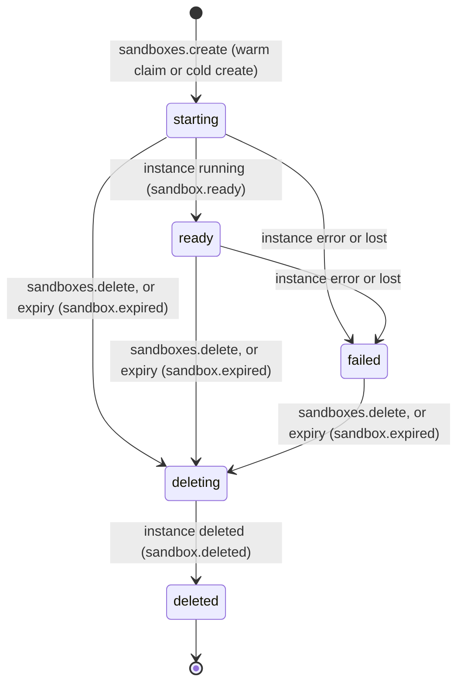

import { Cpu, Instance, KeyRound, Route } from '@/lib/icons';

A sandbox is a short-lived, isolated place to run code you do not fully trust: a build, a test suite, an AI agent's
tool call, a customer's notebook. In Better Compute a sandbox is one hosted <Term id="instance">VPS instance</Term>
made from a per-tenant **template**, with a **lifetime** after which it is deleted, and optionally started from a
**warm pool** of instances the template keeps booted. It has no placement, quota or tenancy path of its own: the
instance it drives is admitted, placed, charged, addressed, metered and deleted exactly as one from
`instances.create`, so the guarantees of [instances](/docs/guides/vps/instances) hold unchanged. It is its own VM
sized by a <Term id="flavor">flavor</Term>, with no <Term id="join-token">join token</Term>, no `bcd` and no IAM key
inside, and its boot data sealed through the secret broker.

`vps()` serves two API groups for it (v0.5, beta): [sandboxTemplates](/docs/reference/api/sandbox-templates) and
[sandboxes](/docs/reference/api/sandboxes). Migration `vps/0004_sandboxes` adds their tables, and the `vps.sandboxes`
reconciler expires sandboxes and keeps warm pools filled.

<Callout type="warn" title="The control plane is done; the host runtime is not">
Sandboxes run only on hosted (`vps-host`) pools, and a hosted instance is booted by a runtime inside `bcd` on its
host. bcd now has the `instances` converger, but a real host build has no runtime yet (`libvirt-kvm` and
`cloud-hypervisor` are not written): a non-empty `instances` section fails with `this host runs no instance runtime`,
and the host sends no instance reports. So VMs still do not boot on real hardware: a sandbox's instance is placed
and holds its allocation and IP lease, but never boots, and the sandbox stays `starting`. Only fakehw builds of bcd
run instances, on a file-backed stand-in runtime. The tests drive everything
against emulated host reports (`tests/vps-sandboxes.test.ts`), and the TypeScript FakeDaemon's `FakeHypervisor`
implements `pause`, `resume` and restore for the end-to-end suites. See [where sandboxes run today](#where-sandboxes-run-today).
</Callout>

## What is built and what is not

| Built (v0.5) | Planned, not served |
| --- | --- |
| `sandboxTemplates.create`, `list`, `get`, `update`, `delete` | `sandboxes.snapshot` and restoring with `create({ fromSnapshot })` |
| `sandboxes.create`, `list`, `get`, `extend`, `delete` | `sandboxes.exec` (a tunnel ticket plus a short-lived SSH certificate) |
| TTL expiry by the `vps.sandboxes` reconciler, as an ordinary instance delete | Template `env` (`secret://` references) and `network` (`egress`, `none`, `private`) |
| Warm pools, `paused` when the runtime can pause and `stopped` otherwise | The `vps.sandbox.warm` meter for idle warm capacity |
| The instance guard: instance methods refuse sandbox and warm instances | The `sandbox.snapshot.ready` event (and, a gap today, `sandbox.*` in the events catalog) |
| Tenant teardown of templates, sandboxes and warm instances | MCP tools for sandboxes, and `tests/e2e/sandboxes.test.ts` (the v0.5 exit) |

The generated reference lists 12 methods: the 10 on the left are registered, and `snapshot` and `exec` are planned.

## Templates

A template belongs to one tenant and fixes what its sandboxes run. Create one with
[sandboxTemplates.create](/docs/reference/api/sandbox-templates#create) (`compute:sandboxes:manage` on the tenant):

```ts title="template.ts"
const template = await client.sandboxTemplates.create({
  tenantId: 'acme',
  name: 'py-small',
  poolId: sandboxPool, // a hosted (vps-host) pool offered to the tenant
  flavor: 'sbx.small',
  imageId: 'ubuntu-24.04',
  userData: '#cloud-config\n…', // optional
  defaultTtlSeconds: 1800, // default 3600
  maxTtlSeconds: 7200, // default 86400
  warm: { min: 2, max: 4 }, // default: no warm pool
});
// { id: 'sbxt_…', runtime: 'cloud-hypervisor', warm: { min: 2, max: 4 }, version: 1, … }
```

<TypeTable
  type={{
    name: { type: 'string', description: "1 to 63 of a-z 0-9 . _ -, starting with a letter or digit; unique among the tenant's live templates (CONFLICT otherwise). A deleted template's name is free again.", required: true },
    poolId: { type: 'string', description: 'A vps-host pool the tenant owns or is offered, not archived. A provider pool is INVALID_INPUT: sandboxes run on hosted pools.', required: true },
    flavor: { type: 'string', description: 'A flavor of that pool, not archived (NOT_FOUND otherwise).', required: true },
    imageId: { type: 'string', description: 'Resolved with vps({ images }) for the tenant (NOT_FOUND when it does not resolve; INVALID_CONFIG without images).', required: true },
    runtime: { type: 'string', description: "Optional. When given it must equal the pool's runtime (INVALID_INPUT otherwise). The template always stores the pool's runtime, checked once here.", default: "the pool's" },
    userData: { type: 'string', description: 'At most 32 KiB of cloud-init, or secret://<tenantId>/<id> for a secret of this tenant; any other URI is INVALID_INPUT. update takes null to remove it.' },
    defaultTtlSeconds: { type: 'number', description: 'A sandbox lifetime when create gives none. 60 s to 30 days.', default: '3600' },
    maxTtlSeconds: { type: 'number', description: 'The longest lifetime, extensions included. 60 s to 30 days, at least defaultTtlSeconds.', default: 'max(86400, defaultTtlSeconds)' },
    warm: { type: '{ min: number; max?: number }', description: 'Warm instances to keep, 0 to 64 each; max defaults to min and must be at least min.', default: '{ min: 0, max: 0 }' },
  }}
/>

The checks are those of a hosted `instances.create`: the pool must be visible to the tenant, its runtime must boot
the image's format and pass through the flavor's GPUs. Unknown fields are `INVALID_INPUT`, so `env` and `network`,
which PLAN.md section 3.7 describes, are refused until they are built.

[update](/docs/reference/api/sandbox-templates#update) changes the flavor, image, user data, TTL bounds or warm pool
and raises `version`; the pool, name and runtime stay, and a new flavor or image is checked again, including that the
pool still runs the template's runtime. Existing sandboxes keep their instances, and warm instances already created
stay claimable with the shape they were made with.
[delete](/docs/reference/api/sandbox-templates#delete) hides the template from `get`, `list`, `update` and
`sandboxes.create` and frees its name; its sandboxes live on until they end, and the reconciler deletes its warm
instances. [list](/docs/reference/api/sandbox-templates#list) returns the tenant's live templates ordered by name,
and [get](/docs/reference/api/sandbox-templates#get) one of them. None of these publishes an event.

## Create a sandbox

```ts title="sandbox.ts"
const sandbox = await client.sandboxes.create({
  tenantId: 'acme',
  templateId: template.id,
  ttlSeconds: 900, // default: the template's defaultTtlSeconds
  idempotencyKey: `job-${jobId}`,
  wait: { timeoutMs: 20_000 }, // optional: hold the answer until it leaves 'starting' (at most 30 s)
});
// { id: 'sbx_…', state: 'ready', instanceId: 'inst_…', warm: true, expiresAt: 1790000000000, … }
```

The same call is `POST /api/compute/sandboxes/create`, or
`better-compute api sandboxes.create tenantId=acme templateId=sbxt_… idempotencyKey=job-42` from the CLI. See
[sandboxes.create](/docs/reference/api/sandboxes#create).

### How a create is admitted

A sandbox is admitted like an instance: it exists as a <Term id="draft">draft</Term> before anyone decides on it.

<Steps>
<Step>

### Transaction 1: the draft

The sandbox id (`sbx_` and 52 characters) derives from the tenant, the caller's identity and the idempotency key. An
admitted sandbox with that id is returned as it is (a replay); a different request under the same key is `CONFLICT`
with `details.sandboxId`. `wait` is not part of the compared request. vps reads the template (`NOT_FOUND` when it is
missing or deleted), bounds `ttlSeconds` by its `maxTtlSeconds` (`INVALID_INPUT`), checks that its flavor still
exists (`INVALID_STATE`), and writes the draft and its authorization row.

</Step>
<Step>

### The decision

Better IAM decides `compute:sandboxes:create` on `compute-sandbox/<draft id>`. The row's parent is the template's
pool, its owner is the caller, and it carries `templateId`, `vcpu`, `memoryGiB`, `gpus` (the template's flavor),
`ttlSeconds` and `warm` (true when the template keeps a warm pool). A refusal deletes the draft; an agent under
[delegated confirmation](/docs/guides/iam/delegated-confirmation) gets `CONFIRMATION_REQUIRED` and retries with the
same key. After an allow, the pool's budget check runs outside any transaction, as for `instances.create`: a spent
Better IAM budget answers `SPEND_LIMIT_REACHED` and keeps the draft. See
[budgets](/docs/guides/iam/billing-and-usage#budgets).

</Step>
<Step>

### Transaction 2: claim or create

vps looks for the template's oldest warm instance that has settled (`stopped` or `paused`, not being deleted) with
`FOR UPDATE SKIP LOCKED`, so concurrent creates never wait on each other. A claimed instance moves to the sandbox:
its owner becomes the caller, `desiredState` becomes `running`, and `instance.starting` is published. Nothing new is
placed or charged; it was placed and charged when it was warmed. Without a claimable instance, vps creates one from
the template and schedules it with the decision's admission context, exactly like a hosted `instances.create`:
placement, quota (`QUOTA_EXCEEDED`), an IP lease (`CAPACITY_UNAVAILABLE`) and sealed user data. When no host fits it
waits in `scheduling` and the sandbox stays `starting`.

The TTL starts here, at admission: `expiresAt` is now plus `ttlSeconds`, whether the instance was warm or cold, so
boot time counts against it. `sandbox.created` is published with `warm` and `expiresAt`.

</Step>
</Steps>

`wait: { timeoutMs }` makes the call async-with-wait: the server re-reads the sandbox until it leaves `starting` and
answers with the last read when the time runs out, which is not an error. The answer's `warm` says which path was
taken. A template whose warm instances have not settled yet (still `provisioning`) gets a cold create.

A policy can bound what callers start, for example short CPU-only sandboxes:

```json title="policy statement"
{
  "sid": "ShortCpuSandboxes",
  "effect": "allow",
  "actions": ["compute:sandboxes:create", "compute:sandboxes:update"],
  "resources": ["compute-sandbox/*"],
  "conditions": {
    "NumericLessThanEquals": { "resource.ttlSeconds": 3600, "resource.gpus": 0 }
  }
}
```

## The sandbox

<TypeTable
  type={{
    id: { type: 'string', description: 'sbx_ and 52 characters.', required: true },
    state: { type: "'starting' | 'ready' | 'failed' | 'deleting' | 'deleted'", description: 'Derived from the instance: ready while it runs, failed in error or lost, deleting once delete or expiry asked, deleted when the instance is gone; starting otherwise.', required: true },
    instanceState: { type: 'InstanceState', description: "The instance's own state.", required: true },
    instanceId: { type: 'string', description: 'The instance it drives.', required: true },
    templateId: { type: 'string', description: 'The template it was made from.', required: true },
    poolId: { type: 'string', description: "The template's pool.", required: true },
    addresses: { type: 'string[]', description: "The instance's addresses.", required: true },
    nodeId: { type: 'string', description: 'The host it is placed on.' },
    ttlSeconds: { type: 'number', description: 'The lifetime: as asked, then from createdAt to the new expiry after an extend.', required: true },
    expiresAt: { type: 'number', description: 'Epoch ms; deleted then unless extended.', required: true },
    warm: { type: 'boolean', description: "Claimed from the template's warm pool.", required: true },
    readyAt: { type: 'number', description: 'When the reconciler first saw the instance run.' },
    expiredAt: { type: 'number', description: 'Set when the sandbox ended by reaching expiresAt.' },
    ownerIdentityId: { type: 'string', description: 'Who created it; list defaults to these.', required: true },
    idempotencyKey: { type: 'string', description: 'The key of the create.', required: true },
    createdAt: { type: 'number', description: 'Epoch ms.', required: true },
  }}
/>



A `failed` sandbox is not replaced; it ends with its TTL or a delete. If its pool sets `recreateOnHostLoss`, a lost
instance is recreated like any other and the sandbox goes back to `starting`.

## Read, extend and delete

- [get](/docs/reference/api/sandboxes#get) returns one sandbox of the tenant, deleted ones included; drafts and other
  tenants' sandboxes are `NOT_FOUND`.
- [list](/docs/reference/api/sandboxes#list) returns `{ items, cursor? }`, newest first. `scope` is `mine` (the
  default, the caller's own) or `all`, and each item is then checked for `compute:sandboxes:read`. Deleted sandboxes
  appear only with `deleted: true`; `templateId` filters by template; `limit` is 1 to 200 (default 50), and `cursor`
  is the last sandbox id of the previous page.
- [extend](/docs/reference/api/sandboxes#extend) moves `expiresAt` later. Give exactly one of `until` (the new expiry,
  epoch ms) or `by` (added to the current expiry: `30m`, `8h`, `7d`, or milliseconds, at most 30 days). It is decided
  as `compute:sandboxes:update` with a pending `ttlSeconds` equal to the whole lifetime after the change, counted from
  `createdAt`, so a policy that caps `ttlSeconds` caps extensions too and cannot be bypassed in small steps. The
  handler then refuses a lifetime above the template's `maxTtlSeconds` (`INVALID_INPUT`), even for a template deleted
  since. An `until` not later than the current expiry returns the sandbox unchanged without a decision; a repeated
  `by` extends again. A sandbox being deleted is `INVALID_STATE`. It publishes `sandbox.extended`.
- [delete](/docs/reference/api/sandboxes#delete) marks the sandbox `deleting`, sets its instance's `desiredState` to
  `deleted` (publishing `instance.deleting` with `sandboxId`) and wakes the reconciler. It is idempotent. The
  `vps.instances` reconciler releases the allocation, IP lease, quota and sealed user data as for any instance.

```ts
await client.sandboxes.extend({ tenantId: 'acme', sandboxId: sandbox.id, by: '30m' });
await client.sandboxes.delete({ tenantId: 'acme', sandboxId: sandbox.id });
```

## The reconciler

`vps.sandboxes` runs every 15 seconds (`shardBy: 'none'`, one worker at a time), and `sandboxes.delete` wakes it.
Each pass does four things:

1. **Expiry.** Up to 100 sandboxes whose `expiresAt` has passed and whose deletion has not started are locked with
   `SKIP LOCKED`. Each gets `expiredAt`, publishes `sandbox.expired`, and then goes through an ordinary instance delete,
   the same as `sandboxes.delete`. A sandbox can outlive its `expiresAt` by up to one period.
2. **Ready.** A sandbox whose instance is `running` for the first time gets `readyAt` and publishes `sandbox.ready`.
3. **Deleted.** A sandbox whose instance is `deleted` (or gone) is marked deleted, leaves the authorization
   projection and publishes `sandbox.deleted` with `expired` telling whether expiry ended it.
4. **Warm pools**, below.

### Warm pools

For each live template with `warm.min > 0`, the reconciler keeps `warm.min` warm instances. It creates at most 4 per
template per pass, each in its own transaction, owned by the template's author (`instances.warm_template_id` set).
Each is placed and charged to the tenant's quota when it is created, like any instance, and publishes
`instance.created` with `warmTemplateId`. Refills are best effort: a quota refusal, a flavor or image that is gone,
or no fitting host stops that template's refill for the pass, logs `vps: warm sandbox instance not created`, and the
next pass tries again.

A warm instance's `desiredState` depends on the runtime its template stores:

| Runtime `RuntimeTraits.pause` | Warm instance | A claim then |
| --- | --- | --- |
| `true` (`libvirt-kvm`, `cloud-hypervisor`, `firecracker` in `builtinRuntimeTraits`) | Booted, then `paused`: vCPUs stopped, memory resident | Resumes it (`paused` to `running`) |
| absent or `false` (`containerd`, or a runtime you declare without it) | `stopped` | Starts it (`stopped` to `starting` to `running`) |

The lifecycle walks a paused warm instance `provisioning`, `starting`, `running`, then `paused` as the host reports
each; it becomes claimable only once it is `paused` (or `stopped`). See
[paused instances](/docs/guides/vps/instances#paused-instances).

Instances beyond `warm.max`, and all instances of a deleted template, are drained: set to `desiredState: 'deleted'`,
newest first, since claims take the oldest. Warm instances are hidden from `instances.list`, refused by instance
methods, and metered by `vps.usage` like any hosted instance; the dedicated `vps.sandbox.warm` meter PLAN.md describes
is not built.

## The instance behind a sandbox

`instances.sandbox_id` marks the instance a sandbox drives and `instances.warm_template_id` a warm one; never both.

- `instances.start`, `stop`, `resize` and `delete` refuse both with `INVALID_STATE` ("managed by sandbox …" or "is a
  warm instance of sandbox template …"). Only the sandbox and its template move them.
- `instances.get` returns both; `instances.list` shows a sandbox's instance and hides warm instances.
- Everything else is the instance's: placement, quota, IPAM, sealed user data, host loss and recreation, the leak
  diff, `vps.usage` metering, and [workload identity](/docs/guides/vps/instances#workload-identity) when the pool
  enables it.

See [sandbox and warm instances](/docs/guides/vps/instances#sandbox-and-warm-instances).

## Run code inside

`sandboxes.exec` is planned. Until then, open a <Term id="tunnel">tunnel</Term> to the sandbox's instance: the
instance guard does not cover `tunnels.open`, which only needs the instance `running` and its node connected.

```ts
const { ticket } = await client.tunnels.open({ tenantId: 'acme', instanceId: sandbox.instanceId, op: 'exec' });
```

It is decided as `compute:instances:exec` on `compute-instance/<instanceId>`, whose owner is the sandbox's owner.
`ssh` and `tcp` (with a `port`) need a host daemon advertising `tunnel.instance-dial`. From a terminal,
`better-compute exec --instance …` and `better-compute forward --instance … --port 8888` do the same; see
[tunnels](/docs/guides/access/tunnels) and [the CLI](/docs/guides/clients/cli#interactive-access). The instance
behind a sandbox is created without SSH keys, so for `ssh` put your public key into the template's `userData`. bcd
dials instance `ssh` and `tcp` tunnels to the instance's own address and advertises `tunnel.instance-dial` only when
it runs an instance runtime (today a fakehw build's stand-in); it refuses `exec` into a guest, which needs a guest
agent. The FakeDaemon answers every op in tests.

## Events

Sandbox events have subject `sandbox/<id>` and carry `templateId`, `instanceId` and `poolId`:

| Event | When | Extra `data` |
| --- | --- | --- |
| `sandbox.created` | `create` admitted it | `warm`, `expiresAt` |
| `sandbox.ready` | Its instance first ran | `warm` |
| `sandbox.extended` | `extend` moved the expiry | `expiresAt` |
| `sandbox.expired` | The reconciler found `expiresAt` passed | `expiresAt` |
| `sandbox.deleted` | Its instance is gone | `expired` |

The instance publishes its own `instance.*` events alongside, with `sandboxId` or `warmTemplateId` in `data`.
`sandbox.*` is in the events catalog, so webhooks can subscribe to it like any other family. The catalog also
declares `sandbox.snapshot.ready` and `sandbox.snapshot.failed` for the planned snapshots. See
[event types](/docs/guides/events#event-types).

## Authorization

| Method | Action | Decided on |
| --- | --- | --- |
| `sandboxTemplates.create` | `compute:sandboxes:manage` | `compute-tenant` |
| `sandboxTemplates.list` | `compute:sandboxes:read` | `compute-tenant` + items |
| `sandboxTemplates.get` | `compute:sandboxes:read` | `compute-sandbox-template` |
| `sandboxTemplates.update`, `delete` | `compute:sandboxes:manage` | `compute-sandbox-template` |
| `sandboxes.create` | `compute:sandboxes:create` | `compute-sandbox` (the draft) |
| `sandboxes.list` | `compute:sandboxes:read` | `compute-tenant` + items |
| `sandboxes.get` | `compute:sandboxes:read` | `compute-sandbox` |
| `sandboxes.extend` | `compute:sandboxes:update` | `compute-sandbox` |
| `sandboxes.delete` | `compute:sandboxes:delete` | `compute-sandbox` |
| `sandboxes.snapshot` (planned) | `compute:sandboxes:update` | `compute-sandbox` |
| `sandboxes.exec` (planned) | `compute:sandboxes:exec` | `compute-sandbox` |

A `compute-sandbox` has the pool as its parent, so pool relations apply. The catalog also declares `fromSnapshot` on
it, which nothing writes until restore exists. The example `StopWhenOverBudget` statement denies
`compute:sandboxes:create` and `compute:sandboxes:update` once the caller's budget is spent. See
[actions and resources](/docs/guides/iam/actions-and-resources) and [policies](/docs/guides/iam/policies).

## Tenant teardown

When an IAM tenant is deleted, the built-in `tenancy` reconciler calls `vps().tenantDeleted` until it answers `DONE`.
In one transaction per call it deletes the tenant's templates (their warm pools drain), marks its open sandboxes
`deleting`, drops sandbox and instance drafts, and sets up to 100 live instances, sandboxes' and warm ones included, to
`desiredState: 'deleted'`, each publishing `instance.deleting` with `reason: 'tenant deleted'`. It answers
`SYNC_AGAIN` until every instance of the tenant is `deleted`; the `vps.sandboxes` reconciler then publishes each
sandbox's `sandbox.deleted`. See [tenancy](/docs/guides/iam/tenancy).

## Where sandboxes run today

| Layer | State |
| --- | --- |
| API, admission, TTL, warm pools, guard, teardown | Built and tested against PGlite with emulated host reports (`tests/vps-sandboxes.test.ts`, 10 tests) |
| Paused instances in the lifecycle and host reports | Built: `desiredState: 'paused'`, `InstanceObservedState.PAUSED`, `RuntimeTraits.pause` |
| FakeDaemon `FakeHypervisor` | Boots then pauses on a desired `PAUSED`, resumes without a reboot, verifies `restoreFrom`, snapshots deterministically |
| Runtimes in bcd (`libvirt-kvm`, `cloud-hypervisor`) | Not written. bcd's `instances` converger exists and runs on fakehw builds over a file-backed stand-in runtime; a real host build has no runtime |
| Provider pools | Not allowed for sandboxes |

On a real host running today's bcd (a host build, which has no runtime), a sandbox's instance is placed but never
reported, so it stays `provisioning` and the sandbox `starting`. Expiry and `delete` still set it to `deleting`, but a hosted instance finishes deleting only when
a complete host report no longer lists it or the host is declared `lost`.

## Not built yet

These parts of PLAN.md section 3.7 are planned and not served:

- **Snapshots.** `sandboxes.snapshot` would send the host an `instance.snapshot` command whose runtime writes disk
  (and optionally memory) state to a presigned URL as a tenant-private snapshot image; `create({ fromSnapshot })`
  would boot from it through `InstanceSpec.restoreFrom` on a host with the same runtime and `bc.dev/cpu.model`. The
  protocol messages (`InstanceSnapshotRequest`, `InstanceSnapshotResult`, `restore_from`) and
  `RuntimeDriver.snapshot` exist; the method, the command kind and the images do not. `create` refuses
  `fromSnapshot` as an unknown field.
- **Exec.** `sandboxes.exec` would return a tunnel ticket and a short-lived SSH certificate from a tenant sandbox CA
  that templates trust, with SDK helpers for commands and files. Use tunnels on the instance meanwhile.
- **Template `env` and `network`**, and the **`vps.sandbox.warm`** meter.
- **The exit test** `tests/e2e/sandboxes.test.ts`: 500 sandboxes expiring on emulated hosts with no leaks, a warm
  claim without a placement, a snapshot round trip, a refused cross-tenant snapshot, and the instance guard.

See the [roadmap](/docs/reference/roadmap#sandboxes).

## Lower level: instances directly

Anything a sandbox does not cover yet, such as provider pools or a VM without a lifetime, is an instance:

```ts
const vm = await client.instances.create({
  tenantId: 'acme',
  poolId: sandboxPool,
  flavor: 'sbx.small',
  imageId: 'ubuntu-24.04',
  sshKeys: ['ssh-ed25519 AAAA… ci@runner'],
  idempotencyKey: `vm-${jobId}`,
  wait: { timeoutMs: 20_000 },
});
// … and delete it yourself: instances have no time-to-live.
await client.instances.delete({ tenantId: 'acme', instanceId: vm.id });
```

It is decided as `compute:instances:create`, runs in a hosted or a provider pool, and the
[MCP server](/docs/guides/clients/mcp) exposes it to agents as `create_instance` and friends, which have no sandbox
counterparts yet. See [instances](/docs/guides/vps/instances).

## Sandboxes and GPU reservations

Both come out of the same pools and the same database, so neither can take what the other holds:

| | GPU reservation | Sandbox |
| --- | --- | --- |
| What you get | GPU atoms on a node, as CDI devices for your own workload manager | A VM with its own kernel, vCPUs, memory, disk and optional GPUs |
| Booked by | `reservations.create` | `sandboxes.create` |
| Time | A window (`duration`), extendable | A TTL from the template, extendable up to `maxTtlSeconds` |
| Who runs code | Your scheduler on the node (Kubernetes, Slurm, containerd) | The guest, reached through tunnels |
| Isolation | The node's, per workload | A VM per sandbox; nothing of the platform inside |

<Cards>
  <Card title="Instances" href="/docs/guides/vps/instances" icon={<Instance />}>
    The lifecycle, paused instances, the sandbox guard, runtimes and workload identity.
  </Card>
  <Card title="Flavors" href="/docs/guides/vps/flavors" icon={<Cpu />}>
    Shapes, scalar claims, overcommit, quota and metering.
  </Card>
  <Card title="Tunnels" href="/docs/guides/access/tunnels" icon={<Route />}>
    Exec, SSH and TCP through single-use tickets.
  </Card>
  <Card title="Policies" href="/docs/guides/iam/policies" icon={<KeyRound />}>
    Bound sandbox shapes and lifetimes with conditions on the draft.
  </Card>
</Cards>
