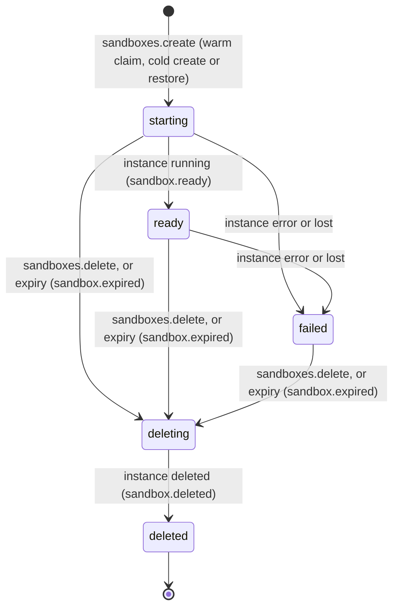
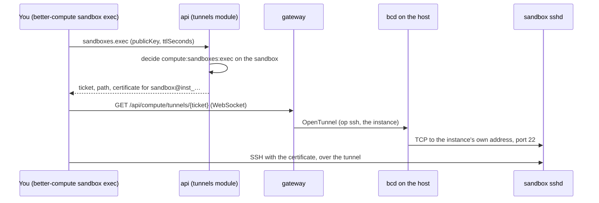
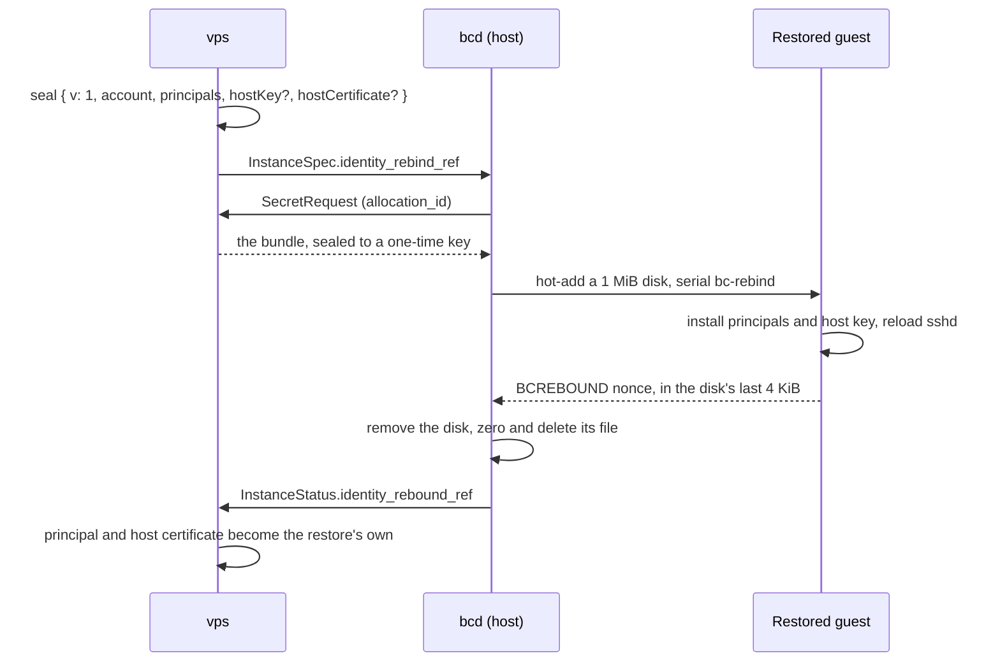

import { Cpu, Instance, KeyRound, Route, SquareTerminal } from '@/lib/icons';

A sandbox is a short-lived, isolated place to run code you do not fully trust: a build, a test suite, an AI agent's
tool call, a customer's notebook. In Better Compute a sandbox is one hosted <Term id="instance">VPS instance</Term>
made from a per-tenant **template**, with a **lifetime** after which it is deleted, optionally started from a **warm
pool** of instances the template keeps booted. It has no placement, quota or tenancy path of its own: the instance
it drives is admitted, placed, charged, addressed, metered and deleted exactly as one from `instances.create`, so the
guarantees of [instances](/docs/guides/vps/instances) hold unchanged. It is its own VM sized by a
<Term id="flavor">flavor</Term>, with no <Term id="join-token">join token</Term>, no `bcd` and no IAM key inside, and
its boot data sealed through the secret broker.

`vps()` serves three API groups for it (v0.5, beta): [sandboxTemplates](/docs/reference/api/sandbox-templates),
[sandboxes](/docs/reference/api/sandboxes), whose `exec` method the tunnels module contributes, and
[sandboxSnapshots](/docs/reference/api/sandbox-snapshots). All 15 methods are served. Since 2a09202 a fourth group,
[sandboxVolumes](/docs/reference/api/sandbox-volumes) (v1.1, agent memory), keeps persistent disks that sandboxes
attach across runs; see [volumes](#volumes). Migrations `vps/0004_sandboxes` to `vps/0020_volumes` add their tables,
columns and indexes, the `vps.sandboxes` reconciler expires sandboxes, keeps warm pools filled and settles snapshots,
and `vps.volumes` finishes volume deletions.

<Callout type="warn" title="The control plane is done; the host runtime is untested on real hardware">
Sandboxes run only on hosted (`vps-host`) pools, and a hosted instance is booted by a runtime inside `bcd` on its
host. bcd has the `instances` converger, `instance.snapshot`, `restore_from` and the template `network` rules, and a
host build runs the built-in `libvirt-kvm` runtime when `virsh` is installed (362317c) and `cloud-hypervisor` when
the `cloud-hypervisor` binary is (2598f0a), each with pause and resume, snapshots with memory, and restores. Both
have been tested only against fake tools (a fake `virsh`, a fake cloud-hypervisor API, a fake `qemu-img`): no sandbox
has booted through either on a real KVM host yet. A host with neither and without a bcx runtime plugin fails a non-empty `instances` section with `this host runs no instance runtime`, so there a sandbox's instance is
placed and holds its allocation and IP lease, but never boots, and the sandbox stays `starting`. fakehw builds of bcd
run instances on a file-backed runtime, and the TypeScript FakeDaemon's `FakeHypervisor` implements pause, resume,
snapshots and restores for the end-to-end suites. See [where sandboxes run today](#where-sandboxes-run-today).
</Callout>

The examples on this page use a `cloud-hypervisor` pool, the microVM runtime PLAN.md pairs with sandboxes. Security
review 12 of that runtime was fixed in 933c51b: a sandbox's taps are created on their bridge before its VMM starts,
so a guest reboot never takes them out of the template's `network` rules; each VMM runs in its own confined
`bcd-ch-<id>.service` unit that sees only its instance directory and base image; tenant images and restored
snapshots that name a backing file or an external data file are refused on both runtimes; and a memory snapshot
restores only into a sandbox of the same vCPUs and memory. See [the runtimes](/docs/daemon/delivery#the-runtimes).

## Templates

A template belongs to one tenant and fixes what its sandboxes run. Create one with
[sandboxTemplates.create](/docs/reference/api/sandbox-templates#create) (`compute:sandboxes:manage` on the tenant):

```ts title="template.ts"
const template = await client.sandboxTemplates.create({
  tenantId: 'acme',
  name: 'py-small',
  poolId: sandboxPool, // a hosted (vps-host) pool offered to the tenant
  flavor: 'sbx.small',
  imageId: 'ubuntu-24.04',
  userData: '#cloud-config\n…', // optional
  env: { OPENAI_API_KEY: 'secret://acme/sec_01k…' }, // secret references only
  network: 'private', // default 'egress'
  defaultTtlSeconds: 1800, // default 3600
  maxTtlSeconds: 7200, // default 86400
  warm: { min: 2, max: 4 }, // default: no warm pool
});
// { id: 'sbxt_…', runtime: 'cloud-hypervisor', network: 'private', warm: { min: 2, max: 4 }, version: 1, … }
```

<TypeTable
  type={{
    name: { type: 'string', description: "1 to 63 of a-z 0-9 . _ -, starting with a letter or digit; unique among the tenant's live templates (CONFLICT otherwise). A deleted template's name is free again.", required: true },
    poolId: { type: 'string', description: 'A vps-host pool the tenant owns or is offered, not archived. A provider pool is INVALID_INPUT: sandboxes run on hosted pools.', required: true },
    flavor: { type: 'string', description: 'A flavor of that pool, not archived (NOT_FOUND otherwise).', required: true },
    imageId: { type: 'string', description: 'Resolved with vps({ images }) for the tenant (NOT_FOUND when it does not resolve; INVALID_CONFIG without images).', required: true },
    runtime: { type: 'string', description: "Optional. When given it must equal the pool's runtime (INVALID_INPUT otherwise). The template always stores the pool's runtime, checked once here.", default: "the pool's" },
    userData: { type: 'string', description: 'At most 32 KiB of cloud-init, or secret://<tenantId>/<id> for a secret of this tenant; any other URI is INVALID_INPUT. With vps({ sandboxExec }), a secret:// reference needs the secret broker (INVALID_CONFIG otherwise), since vps resolves it into the user data it renders. update takes null to remove it.' },
    env: { type: 'Record<string, string>', description: 'Up to 64 variables, named A-Z 0-9 _ (not starting with a digit, at most 64 characters), each a secret://<tenantId>/<id> reference to a secret this tenant wrote with secrets.put; a value is never accepted, and a platform-minted secret is INVALID_INPUT. Needs the secret broker (INVALID_CONFIG otherwise). update replaces the whole map.', default: '{}' },
    network: { type: "'egress' | 'private' | 'none'", description: "What the sandbox's NICs may reach: anything the pool's network allows, the pool's IPAM subnet and the host, or the host only. private and none need the pool's IP range (INVALID_STATE otherwise).", default: "'egress'" },
    defaultTtlSeconds: { type: 'number', description: 'A sandbox lifetime when create gives none. 60 s to 30 days.', default: '3600' },
    maxTtlSeconds: { type: 'number', description: 'The longest lifetime, extensions included. 60 s to 30 days, at least defaultTtlSeconds.', default: 'max(86400, defaultTtlSeconds)' },
    warm: { type: '{ min: number; max?: number }', description: 'Warm instances to keep, 0 to 64 each; max defaults to min and must be at least min.', default: '{ min: 0, max: 0 }' },
    volumes: { type: '{ volumeId | name, mountPath, readOnly? }[]', description: "Up to 8 sandbox volumes each sandbox attaches, in order. Resolved to ids when written: the tenant's own, in the same pool, ready. A template with volumes keeps no warm pool. See Volumes below.", default: '[]' },
  }}
/>

The checks are those of a hosted `instances.create`: the pool must be visible to the tenant, and its runtime must boot
the image's format and pass through the flavor's GPUs. Unknown fields are `INVALID_INPUT`. A sandbox takes its
flavor's [placement](/docs/guides/vps/flavors#placement) with the rest of its shape (9d55b36): huge-page-backed memory,
a NUMA node, pinned vCPUs.

A template that names secrets, in `env` or as a `secret://` user data, hands them to every sandbox's guest, which can
read them, while secrets are otherwise write-only. So those references must be secrets the tenant wrote itself with
`secrets.put` (never platform-minted ones such as join tokens, BMC credentials or sealed user data, which are
`INVALID_INPUT`), nor fleet secrets (`secrets.put` with `scope: 'fleet'`, recorded in `secret_refs.scope`; also
`INVALID_INPUT`). `create` and `update` also decide `compute:secrets:manage` on the tenant, with the caller's own
credential, before the write (`ACCESS_DENIED` with `reason: 'credential-required'` without one). In the root tenant,
where fleet secrets written before `core/0025_secret_scope` still read `tenant`, naming any secret also decides
`compute:secrets:manage` on the fleet (`compute-fleet/global`). An `update` that changes what the guest runs (flavor,
image, user data, `env` or `network`) is decided on the resulting template's secrets even when it names none itself,
since it hands them to new code. Creating an instance from a template checks its secrets against `secret_refs` again,
so a template written before the rule never resolves a platform-minted secret. The decisions use the deployment's IAM
type prefix (`ModuleContext.typePrefix`), falling back to `vps({ typePrefix })`.

[update](/docs/reference/api/sandbox-templates#update) changes the flavor, image, user data, `env`, `network`, TTL
bounds or warm pool and raises `version`; the pool, name and runtime stay, and a new flavor or image is checked again,
including that the pool still runs the template's runtime. The secrets check reads the template before the write's
transaction, so an update that changes what the guest runs records the secret references it was decided on, and the
write refuses it with `CONFLICT` and `details.reason: 'secrets-changed'` when the template, read under its lock,
names any other (someone added one meanwhile); retry it (7b01053). A change to the flavor, image, user data, `env` or
`network` also raises the template's internal `instance_version`: warm instances made from an older one are never
claimed and are drained, so a claim always gets an instance of the current shape. Existing sandboxes keep their
instances. [delete](/docs/reference/api/sandbox-templates#delete) hides the template from `get`, `list`, `update` and
`sandboxes.create` and frees its name; its sandboxes live on until they end, and the reconciler deletes its warm
instances. [list](/docs/reference/api/sandbox-templates#list) returns the tenant's live templates ordered by name, and
[get](/docs/reference/api/sandbox-templates#get) one of them. None of these publishes an event. Templates can also
be kept in a [FleetConfig](/docs/guides/fleet-config) document.

### Environment

Each `env` value is resolved by the secret broker for the template's tenant when an instance is created, and written
to `/etc/sandbox/env` (owner `root`, mode 0600) as one `NAME='value'` shell assignment per line, inside the instance's
user data. vps renders that user data and seals it through the broker before the instance row is inserted, so resolved
values never reach the `instances` table, its WAL or the NodeSpec in the clear. The values never appear in the
template, the API or an event. Without a broker, a template with `env` (or, with exec trust configured, one whose user
data is a `secret://` reference) is `INVALID_CONFIG`, both when it is written and when an instance is made from it.
A warm instance holds the values resolved when it was made; changing `env` drains it, and since 2c7072b so does
rotating or deleting one of its secrets: it is never claimed again and the next pass replaces it (see
[warm pools](#warm-pools)). A running sandbox keeps the values it booted with. The broker releases nothing for a suspended or deleted tenant. Source the file from your own user data or command, for example `set -a; . /etc/sandbox/env`.

### Network

`network` becomes the instance's `InstanceSpec.network_policy`, which bcd enforces with host nftables rules on the
instance's taps, whatever the runtime (6db49c8):

| `network` | The guest may reach |
| --- | --- |
| `egress` (default) | Anything the pool's network allows; no rules. Sent as the wire default, so older specs are unchanged |
| `private` | Only its NICs' IPAM subnets and the host on them (the metadata service included); nothing routed beyond them, nothing from outside them |
| `none` | Only the host: DHCP, ARP, replies, and connections the host opens from its address on the subnet (bcd's tunnel dial). No other instance, nothing routed. `sandboxes.exec` still works |

bcd owns one bridge-family table, `bcd_instances`, and replaces it in a single nftables transaction whenever the
policies change, before any domain starts; the same transaction loads the backstop table `inet bcd_taps`, which drops
traffic from or to an instance tap that is not on its bridge (see
[networking](/docs/guides/vps/networking)). Taps are matched by name, so the rules exist before a runtime creates the
tap. It fails closed: a policy that cannot be expressed (a NIC without IPAM addresses) or rules that fail to load put
the instance in `error` and stop it if it runs.

Because the rules are written on the NICs' addresses, `private` and `none` need the pool's IP range (`setIpPool`): a
template with either on a pool without one is `INVALID_STATE` at create and update, and so is creating an instance
from it if the range was removed since, so vps never starts an instance bcd would have to stop. The FakeDaemon
records the policy without enforcing it.

An older bcd drops `network_policy` as an unknown field and would give the instance full egress, so a bcd that
enforces it advertises the capability `instance.network-policy` (on hosts with a runtime), which the gateway writes as
the node label `bc.dev/cap.instance.network-policy=1`. An instance with a `private` or `none` policy
(`instances.network_policy`) is placed only on nodes carrying that label, with any value (cfdb918): where no such host
has room it waits `Unschedulable` rather than run unisolated. A warm instance of a `private` or `none` template on a
host without that label (placed before the rule, or on a downgraded bcd) is never claimed, and the reconciler drains
it (34f4084). The FakeDaemon advertises the capability on VPS hosts.
`private` means the pool's whole IPAM subnet, so on a pool offered to several tenants it includes their instances
too. A `private` or `none` NIC needs IPAM addresses and a valid MAC, or the instance fails.

Whatever the policy, every instance tap, guarded or not, may not act as a DHCP server or a router (DHCP server
replies from UDP port 67 or 547, router advertisements and redirects are dropped), and may never send from or claim
the host's own addresses on the instances' bridges (6827df8). bcd also guards every tap whose NIC has a MAC and IPAM
addresses (278296e): frames must carry the NIC's MAC, IP packets its own addresses (plus `0.0.0.0` and `::` for
DHCP, and its own EUI-64 link-local address, derived from its MAC, for neighbour discovery) and ARP its own IPv4
addresses, so one guest cannot pose as another. A guest that uses a stable-privacy link-local address instead of the
EUI-64 one loses IPv6 neighbour discovery. Each guarded address, the link-local one included, is also bound to its
instance's tap: no other bridge port (an unguarded tap, a NIC without addresses, a port bcd does not manage) may
send from it, claim it in ARP or name it in a neighbour advert, and a deleted instance keeps its guard until its
domain is gone. Neighbour adverts from a guarded tap name only its own addresses (6639335). The metadata service and
instance tunnels, which name an instance by its address, trust only addresses the loaded rules bind to an instance,
never one two instances claim. Every 5 seconds bcd counts the rules in its table against the ruleset it loaded, so an
nftables reload, `flush ruleset`, or a flushed table or chain ends that trust at once, and bcd loads the ruleset
again right away rather than waiting for the next converge pass.

**SSH only from the host.** Every sandbox instance, warm ones included, has `InstanceSpec.ssh_from_host_only` set
(5346523), whatever its `network`, and bcd enforces it in the same table (474d51f, security review 13 L5). For each
of the instance's taps, tcp/22 forwarded from another bridge port (another guest, an uplink) is dropped, and tcp/22
the host sends into the tap is dropped unless its source is one of the host's own addresses on the instances'
bridges, where the exec tunnel's dial comes from; with no host address of a family, that family's tcp/22 is dropped
outright. Both rules sit ahead of every accept. So an exec certificate is usable only through a tunnel, which the
control plane re-authorizes and closes on revocation, and guests on one pool cannot reach each other's sshd. An
ordinary instance is unaffected. A bcd from before 474d51f would ignore the field, so since 82f4f51 a bcd that
enforces it advertises the capability `instance.ssh-host-only` (on hosts with a runtime), which the gateway writes as
the node label `bc.dev/cap.instance.ssh-host-only=1`, and vps places sandbox and warm instances only on nodes that
carry it; where no such host has room the instance waits in `scheduling`. `tests/vps-sandboxes.test.ts` checks that a
sandbox lands only on such a host (3b9e81d).

## Create a sandbox

```ts title="sandbox.ts"
const sandbox = await client.sandboxes.create({
  tenantId: 'acme',
  templateId: template.id,
  ttlSeconds: 900, // default: the template's defaultTtlSeconds
  idempotencyKey: `job-${jobId}`,
  wait: { timeoutMs: 20_000 }, // optional: hold the answer until it leaves 'starting' (at most 30 s)
});
// { id: 'sbx_…', state: 'ready', instanceId: 'inst_…', warm: true, expiresAt: 1790000000000, … }
```

The same call is `POST /api/compute/sandboxes/create`, or
`better-compute sandbox create --template sbxt_… --ttl 15m` from the CLI (see [the CLI](#from-the-cli)). See
[sandboxes.create](/docs/reference/api/sandboxes#create).

### How a create is admitted

A sandbox is admitted like an instance: it exists as a <Term id="draft">draft</Term> before anyone decides on it.

<Steps>
<Step>

### Transaction 1: the draft

The sandbox id (`sbx_` and 52 characters) derives from the tenant, the caller's identity and the idempotency key. An
admitted sandbox with that id is returned as it is (a replay); a different request under the same key is `CONFLICT`
with `details.sandboxId`. `wait` is not part of the compared request, but the caller's agent and delegation are
(7b01053): an agent replaying its person's key, or the person replaying the agent's, is `CONFLICT` rather than a
takeover of a sandbox attributed to someone else. A person's own requests hash as before. vps reads the template (`NOT_FOUND` when it is
missing or deleted), bounds `ttlSeconds` by its `maxTtlSeconds` (`INVALID_INPUT`), checks that its flavor still
exists (`INVALID_STATE`), checks a `fromSnapshot` (see [restore](#restore)), and writes the draft and its
authorization row.

</Step>
<Step>

### The decision

Better IAM decides `compute:sandboxes:create` on `compute-sandbox/<draft id>`. The row's parent is the template's
pool, its owner is the caller, and it carries `templateId`, `vcpu`, `memoryGiB`, `gpus` (the template's flavor),
`ttlSeconds`, `warm` (true when the template keeps a warm pool and the create is not a restore) and, on a restore,
`fromSnapshot`. A refusal deletes the draft; an agent under
[delegated confirmation](/docs/guides/iam/delegated-confirmation) gets `CONFIRMATION_REQUIRED` and retries with the
same key. After an allow, the pool's budget check runs outside any transaction, as for `instances.create`: a spent
Better IAM budget answers `SPEND_LIMIT_REACHED` and keeps the draft. See
[budgets](/docs/guides/iam/billing-and-usage#budgets).

</Step>
<Step>

### Transaction 2: claim or create

Unless the create is a restore, vps looks for the template's oldest warm instance that has settled (`stopped` or
`paused`, not being deleted) and was made from the template's current `instance_version`, with `FOR UPDATE SKIP
LOCKED`, so concurrent creates never wait on each other and each gets a different instance. A claimed instance moves
to the sandbox: its owner becomes the caller, it takes the sandbox's agent and delegation attribution,
`desiredState` becomes `running`, `claimed_at` is stamped (its warm
metering ends there), and `instance.starting` is published. Nothing new is placed or charged; it was placed and
charged when it was warmed. Without a claimable instance, vps creates one from the template and schedules it with the
decision's admission context, exactly like a hosted `instances.create`: placement, quota (`QUOTA_EXCEEDED`), an IP
lease (`CAPACITY_UNAVAILABLE`) and sealed user data. When no host fits it waits in `scheduling` and the sandbox stays
`starting`.

The TTL starts here, at admission: `expiresAt` is now plus `ttlSeconds`, whether the instance was warm or cold, so
boot time counts against it. `sandbox.created` is published with `warm` and `expiresAt`.

</Step>
</Steps>

`wait: { timeoutMs }` makes the call async-with-wait: the server re-reads the sandbox until it leaves `starting` and
answers with the last read when the time runs out, which is not an error. The answer's `warm` says which path was
taken. A template whose warm instances have not settled yet (still `provisioning`) gets a cold create.

A policy can bound what callers start, for example short CPU-only sandboxes:

```json title="policy statement"
{
  "sid": "ShortCpuSandboxes",
  "effect": "allow",
  "actions": ["compute:sandboxes:create", "compute:sandboxes:update"],
  "resources": ["compute-sandbox/*"],
  "conditions": {
    "NumericLessThanEquals": { "resource.ttlSeconds": 3600, "resource.gpus": 0 }
  }
}
```

## The sandbox

<TypeTable
  type={{
    id: { type: 'string', description: 'sbx_ and 52 characters.', required: true },
    state: { type: "'starting' | 'ready' | 'failed' | 'deleting' | 'deleted'", description: 'Derived from the instance: ready while it runs, failed in error or lost, deleting once delete or expiry asked, deleted when the instance is gone; starting otherwise.', required: true },
    instanceState: { type: 'InstanceState', description: "The instance's own state.", required: true },
    instanceId: { type: 'string', description: 'The instance it drives.', required: true },
    templateId: { type: 'string', description: 'The template it was made from.', required: true },
    poolId: { type: 'string', description: "The template's pool.", required: true },
    addresses: { type: 'string[]', description: "The instance's addresses.", required: true },
    nodeId: { type: 'string', description: 'The host it is placed on.' },
    ttlSeconds: { type: 'number', description: 'The lifetime: as asked, then from createdAt to the new expiry after an extend.', required: true },
    expiresAt: { type: 'number', description: 'Epoch ms; deleted then unless extended.', required: true },
    warm: { type: 'boolean', description: "Claimed from the template's warm pool.", required: true },
    readyAt: { type: 'number', description: 'When its instance first ran.' },
    expiredAt: { type: 'number', description: 'Set when the sandbox ended by reaching expiresAt.' },
    fromSnapshot: { type: 'string', description: 'The snapshot it was restored from.' },
    identityRebound: { type: 'boolean', description: "A memory restore: false while it still answers to its source's SSH identity (exec refuses with restore-shares-identity), true once the host installed its own. Absent for other sandboxes." },
    snapshots: { type: 'SandboxSnapshot[]', description: 'Its snapshots, newest first, deleted ones left out. Only sandboxes.get returns them.' },
    ownerIdentityId: { type: 'string', description: 'Who created it; list defaults to these.', required: true },
    idempotencyKey: { type: 'string', description: 'The key of the create.', required: true },
    createdAt: { type: 'number', description: 'Epoch ms.', required: true },
  }}
/>



A sandbox is `ready` the moment its instance reaches `running`: the instance reconciler stamps `readyAt` and publishes
`sandbox.ready` in the same transaction, and the sandbox reconciler's pass is only the fallback. A `failed` sandbox is
not replaced; it ends with its TTL or a delete. If its pool sets `recreateOnHostLoss`, a lost instance is recreated
like any other and the sandbox goes back to `starting`.

## Read, extend and delete

- [get](/docs/reference/api/sandboxes#get) returns one sandbox of the tenant with its snapshots, deleted ones
  included; drafts and other tenants' sandboxes are `NOT_FOUND`.
- [list](/docs/reference/api/sandboxes#list) returns `{ items, cursor? }`, newest first. `scope` is `mine` (the
  default, the caller's own) or `all`, and each item is then checked for `compute:sandboxes:read`. Deleted sandboxes
  appear only with `deleted: true`; `templateId` filters by template; `limit` is 1 to 200 (default 50), and `cursor`
  is the last sandbox id of the previous page.
- [extend](/docs/reference/api/sandboxes#extend) moves `expiresAt` later. Give exactly one of `until` (the new expiry,
  epoch ms) or `by` (added to the current expiry: `30m`, `8h`, `7d`, or milliseconds, at most 30 days). It is decided
  as `compute:sandboxes:update` with a pending `ttlSeconds` equal to the whole lifetime after the change, counted from
  `createdAt`, so a policy that caps `ttlSeconds` caps extensions too and cannot be bypassed in small steps. A lifetime
  above the template's `maxTtlSeconds` (`INVALID_INPUT`, even for a template deleted since) or past the host
  certificate is refused before the pending lifetime is written, so a refused extend leaves nothing behind for later
  decisions (the handler checks again in case the template changed in between). The handler applies the absolute expiry that was decided, not "current plus `by`" again, so two concurrent
  `by` extends cannot add up to a lifetime no decision covered. An `until` not later than the current expiry returns
  the sandbox unchanged without a decision; a repeated `by` extends again. A sandbox being deleted is `INVALID_STATE`.
  After an allow, the sandbox pool's budget check runs as for `create` and `reservations.extend` (f3b7f9e): where the
  pool's policy sets `admission.budgetCheck: 'meter'` or the tenant's offer stops new work on a spent budget (`stop-new`, `drain`), a
  spent budget is `SPEND_LIMIT_REACHED` and clears the pending lifetime, so a tenant over budget cannot keep a
  sandbox alive by extending it. If the handler throws after an allow (the sandbox or its template changed between
  the transactions), the admission's `abandoned` hook clears the pending lifetime in a transaction of its own, so it
  is not merged into later decisions; a retry with the same key decides again (a2288ec). Only one extend at a time
  stages a pending lifetime, since the authorization projection keeps one pending value per resource (f2faa81,
  migration `vps/0014_sandbox_extending`): while another extend holds the sandbox (`extending_request`), an extend
  is `CONFLICT` with `details.reason: 'extend-in-flight'` and `retryAfterSeconds`, a hold older than 60 seconds
  (measured with `compute_now()`) is taken over, the handler applies only while its hold still owns the sandbox, and
  a refusal, an abandon or a budget refusal clears the pending lifetime only when the hold is its own. The hold is a
  nonce the server mints per extend (`newId('hold')`, on the parsed input, which callers cannot set), never the
  caller's `x-request-id`: two concurrent extends sharing one request id would otherwise share the hold and reopen
  the `BoundedExtend` bypass (e68182d). The extended sandbox's
  authorization attributes come from its instance's own shape, not from its template's current flavor, which may
  have changed or gone (7fb1e01). It publishes `sandbox.extended`.
- [delete](/docs/reference/api/sandboxes#delete) marks the sandbox `deleting`, sets its instance's `desiredState` to
  `deleted` (publishing `instance.deleting` with `sandboxId`) and wakes the reconciler. It is idempotent. The
  `vps.instances` reconciler releases the allocation, IP lease, quota and sealed user data as for any instance.

```ts
await client.sandboxes.extend({ tenantId: 'acme', sandboxId: sandbox.id, by: '30m' });
await client.sandboxes.delete({ tenantId: 'acme', sandboxId: sandbox.id });
```

## Run code inside

There is no platform agent in a sandbox, as in any tenant VM. [sandboxes.exec](/docs/reference/api/sandboxes#exec)
gets you in over plain SSH instead: one call, decided as `compute:sandboxes:exec` on the sandbox, returns a
single-use `ssh` <Term id="tunnel">tunnel</Term> ticket for the sandbox's instance and a short OpenSSH user
certificate for your own public key from the deployment's <Term id="sandbox-ssh-ca">sandbox SSH CA</Term>.



### How the guest trusts it

With `vps({ sandboxExec: { caPublicKey, account } })`, every sandbox instance, warm ones included, gets a user data
MIME multipart whose first part is vps's own cloud-config and whose second is the template's user data (typed by its
first line; a `secret://` reference is resolved first). vps's part:

- creates `account` (default `sandbox`, a locked-password account with `/bin/bash`);
- writes the CA key to `/etc/ssh/bc_sandbox_ca.pub` and the principal `<account>@<instanceId>` to
  `/etc/ssh/bc_sandbox_principals/<account>`;
- adds `/etc/ssh/sshd_config.d/10-bc-sandbox.conf` with `TrustedUserCAKeys` and `AuthorizedPrincipalsFile`, and
  reloads sshd;
- with `certifyHostKey` (below), also writes a P-256 host key to `/etc/ssh/bc_sandbox_host_key` (0600) and its host
  certificate beside it, and adds `HostKey` and `HostCertificate` to the drop-in.

`certifyHostKey` closes the other direction: without it the guest's own SSH host key is new at every boot and a
client can only accept it on first use. With it, vps generates a host key for each sandbox instance and asks the hook
for a host certificate naming the instance id, valid for 30 days; the host wires it to the same sandbox CA's
`issueHostCertificate`. The private key travels only in broker-sealed user data, so the hook without a secret broker
is `INVALID_CONFIG`. `instances.host_certified` records it (migration `vps/0011_host_certificates`) and
`instances.host_cert_valid_before` until when the certificate holds (`vps/0012_host_cert_validity`, on snapshots too).
A memory restore inherits both through its snapshot and mints no host key of its own. Nothing renews a host
certificate, so a sandbox never outlives its guest's: a warm claim takes only instances whose certificate covers the
new TTL, the reconciler recycles warm instances whose certificate no longer covers the template's default TTL (at
most 15 days), a fresh sandbox's expiry is capped at its certificate, and a memory restore or an `extend` past it is
refused, naming how long is left (`INVALID_INPUT`, or `INVALID_STATE` once less than a minute remains).
`sandboxes.exec` returns `hostPrincipal`, `hostCertificate` (`valid`, `expired` within a minute of its end, or `none`
for a guest never certified) and `hostCertified` (`hostCertificate === 'valid'`),
so a client can pin the guest with `@cert-authority <hostPrincipal> <sandbox CA key>`. `better-compute sandbox exec`
does (see [the CLI](#from-the-cli)).

The principal names the instance, so a certificate for one sandbox opens no other, and a warm instance trusts the CA
before any sandbox exists. A memory restore is the exception: it resumes the guest without re-running cloud-init, so
its sshd still accepts the principal of the instance the memory was captured on. Snapshots record that instance, a
restore carries it in `restore_from.principalInstanceId`, and `sandboxes.exec` signs for it. A snapshot belongs to
its sandbox's owner, whoever took it, and only that owner can restore it, so only the owner's own lineage shares a
principal. Within that lineage a certificate for one guest would open the others, so today `sandboxes.exec` refuses
while more than one of them is live; see [restore](#restore).

The CA must be one `ssh-ed25519` or `ecdsa-sha2-nistp256` key line, with an optional comment of up to 64 printable
characters that may contain spaces, as pki's are (`INVALID_CONFIG` otherwise). It is one CA for the deployment, not
one per tenant as PLAN.md first described. It is separate from the [break-glass SSH](/docs/guides/access/ssh) CA, so
a sandbox certificate never opens a node; the tunnels module refuses a `tunnels.sandboxSsh` equal to `tunnels.ssh`.

### Wire it

The tunnels module signs with `tunnels.sandboxSsh` and logs in as `tunnels.sandboxAccount` (default `sandbox`, which
must match vps's `account`); vps renders the same CA's public key. A [PKI bundle](/docs/operations/pki#the-sandbox-ssh-ca)
holds that CA, and `tunnelsOptions(bundle, { issuer })` returns the exec ticket issuer with both SSH CAs:

```ts title="compute.ts"
import { loadPkiBundle } from 'better-compute/cli';
import { tunnelsOptions } from 'better-compute/pki';
import { vps } from 'better-compute/vps';

const bundle = await loadPkiBundle('.better-compute/pki.json', process.env);
const sandboxCa = bundle.sandboxSshCa!;

export const compute = betterCompute({
  // database, secret, iam, pki ...
  tunnels: tunnelsOptions(bundle, { issuer: 'https://compute.example.com' }), // issuer, ssh, sandboxSsh
  modules: [
    vps({
      images,
      sandboxExec: {
        caPublicKey: sandboxCa.publicKey, // guests trust it for user certificates
        // optional: guests present host keys the same CA certifies, so clients pin them
        certifyHostKey: async ({ instanceId, principals, publicKey, validBefore }) =>
          sandboxCa.issueHostCertificate({ publicKey, principals, keyId: `host/${instanceId}`, validBefore })
            .certificate,
      },
      snapshots: snapshotStore, // see below
    }),
  ],
});
```

A bundle made before sandboxes lacks the CA: add it with `better-compute pki add-sandbox-ca`. Without
`tunnels.sandboxSsh`, `sandboxes.exec` is `UNSUPPORTED`; without `sandboxExec`, guests do not trust the CA and SSH
fails at login.

### The call

<TypeTable
  type={{
    tenantId: { type: 'string', description: 'The tenant acting.', required: true },
    sandboxId: { type: 'string', description: 'The sandbox (sbx_…).', required: true },
    publicKey: { type: 'string', description: 'Your OpenSSH public key line, Ed25519 or ECDSA P-256, at most 4096 characters.', required: true },
    ttlSeconds: { type: 'number', description: "Certificate lifetime, 60 to 900, and never past the caller's session or the sandbox's expiresAt.", default: '600' },
  }}
/>

It answers `{ sandboxId, instanceId, nodeId, tunnelId, ticket, path, expiresAt, certificate, serial, keyId, principal,
account, validBefore, hostPrincipal, hostCertified, hostCertificate }`; `hostPrincipal` is the name the guest's host
certificate carries (its instance, or the original one after a memory restore until the host gives the restore its
own identity), `hostCertificate` is `valid`,
`expired` or `none`, and `hostCertified` says whether it is `valid`. Open `GET {basePath}/{path}` as a WebSocket before `expiresAt` (the ticket is single use and
lives 60 s) and speak SSH over it as `account`, with the certificate saved beside your key as `<key>-cert.pub`. The
key id is `bc:<identityId>:<sandboxId>:ssh_<id>`.

| Situation | Error |
| --- | --- |
| No sandbox SSH CA configured | `UNSUPPORTED` |
| An API key rather than a signed-in session | `ACCESS_DENIED`, `details.reason: 'session-required'` |
| The session ends within a minute | `ACCESS_DENIED`, `details.reason: 'session-ending'` |
| The sandbox is not `ready` (its instance not `running`), or is being deleted | `INVALID_STATE` |
| The sandbox expires within a minute (or already has): extend it first | `INVALID_STATE`, `details.reason: 'sandbox-expiring'` |
| Another live guest of the tenant shares the sandbox's SSH identity: its memory snapshot's source, a sibling restore, or a memory restore of this sandbox, until the host gives the restore its own (87ff2c5; see [a restore's own SSH identity](#a-restores-own-ssh-identity)) | `INVALID_STATE`, `details.reason: 'restore-shares-identity'` |
| The node is not connected, or its daemon does not advertise `tunnel.instance-dial` | as for `tunnels.open` |
| More tunnels than the per-identity limit, shared with `tunnels.open` | `RATE_LIMITED` |
| An RSA or malformed key | `INVALID_INPUT` |

The typed client does not list `exec`, since the tunnels module adds it at run time; call it by path, then open the
tunnel with the client's `connectTunnel`:

```ts
import { connectTunnel, tunnelUrl } from '@better-compute/client';

const grant = await client.$request<{ path: string; certificate: string; account: string }>('sandboxes/exec', {
  tenantId: 'acme',
  sandboxId: sandbox.id,
  publicKey: 'ssh-ed25519 AAAA… ci@runner',
});
const tunnel = connectTunnel({ url: tunnelUrl('https://compute.example.com', '/api/compute', grant.path) });
// bridge a local socket to `tunnel` and point your SSH client at it
```

The CLI's `better-compute sandbox exec sbx_… -- cmd` does all of it with your OpenSSH client; see
[the CLI](#from-the-cli).

### Revocation

Guests have no agent to receive a revocation list, so the certificate's short lifetime (at most 15 minutes, never
past your session or the sandbox) is the revocation control. The transport is re-authorized: the exec ticket names
the sandbox (`sbx`), the gateway keeps it as `TunnelInfo.sandboxId` and hands it back at each 60-second re-check, and
tunnel re-authorization (`tunnelAuthorizer` from `better-compute/iam`) re-decides `compute:sandboxes:exec` on that
sandbox, never on the instance, so withdrawn access closes an open session while a session that is still allowed
stays open. A gateway's control API can also close or re-check the tunnels into one sandbox (`sandboxId` in its
tunnel filter). Each call publishes `tunnel.issued` (subject `instance/<id>`, with `sandboxId`) and
`sandbox.exec.issued`.

`sandboxes.exec` is the only way in. `tunnels.open` refuses a sandbox's instance, and a warm one, for every op
(`exec`, `ssh`, `tcp`) with `INVALID_STATE` and `details.reason: 'sandbox-managed'` ("managed by sandbox …; use
sandboxes.exec"), so `compute:instances:exec` on the instance, from an API key or a pool-wide grant, cannot bypass the
session requirement and the `compute:sandboxes:exec` decision. `better-compute exec --instance` and `forward
--instance` hit the same refusal. See [tunnels](/docs/guides/access/tunnels).

## Volumes

A sandbox volume (v1.1, 2a09202) is agent memory: a persistent disk on one host of a pool that the tenant's sandboxes
attach across runs, so an agent keeps its memory, caches and checkouts after each sandbox is gone. PLAN.md §3.8 counts
it as the third kind of memory, beside booked host memory and memory snapshots.

```ts title="volume.ts"
const volume = await client.sandboxVolumes.create({
  tenantId: 'acme',
  poolId: sandboxPool, // a vps-host pool
  name: 'agent-memory',
  sizeGiB: 50,
  idempotencyKey: 'agent-memory',
});
// { id: 'vol_…', name: 'agent-memory', sizeGiB: 50, serial: 'bcv-…', nodeId: 'node_…', state: 'ready', … }

await client.sandboxTemplates.update({
  tenantId: 'acme',
  templateId: template.id,
  warm: { min: 0, max: 0 }, // a template with volumes keeps no warm pool
  volumes: [{ name: 'agent-memory', mountPath: '/workspace' }],
});
```

| Method | Decided as | |
| --- | --- | --- |
| [`sandboxVolumes.create`](/docs/reference/api/sandbox-volumes#create) | `compute:sandboxes:manage` on the tenant | `poolId`, `name`, `sizeGiB` (1 to 16,384), `idempotencyKey` |
| [`sandboxVolumes.list`](/docs/reference/api/sandbox-volumes#list) | `compute:sandboxes:read` on the tenant | Optional `poolId` and `includeDeleted`; at most 500, oldest first |
| [`sandboxVolumes.get`](/docs/reference/api/sandbox-volumes#get) | `compute:sandboxes:read` on the volume | |
| `sandboxVolumes.resize` | `compute:sandboxes:manage` on the volume | `sizeGiB`, grow only (8cbece0) |
| [`sandboxVolumes.delete`](/docs/reference/api/sandbox-volumes#delete) | `compute:sandboxes:manage` on the volume | |

A volume is the IAM resource `sandbox-volume`, whose parent is its pool.

**Create.** vps books the volume's `diskGiB` on one host of the pool through the capacity module, in an allocation
owned by the volume (`owner_kind` `volume`, migration `core/0028_volume_allocations`), open-ended, and charged to the
tenant's `diskGiB` quota (`QUOTA_EXCEEDED` past it). No host with room is `CAPACITY_UNAVAILABLE`, and a provider pool
is `INVALID_INPUT`: volumes live on hosted pools. The name is unique among the tenant's volumes that are not deleted
(`CONFLICT`). A retry with the same idempotency key returns the same volume; the key with another request is
`CONFLICT`. The volume's serial is `bcv-` and the last 16 characters of its id, and its host's NodeSpec lists it, so
bcd creates it there as a sparse raw file (see [volumes on the host](/docs/daemon/delivery#persistent-volumes)). The
create publishes `sandbox.volume.created`.

Sparse does not mean overcommitted (851016e): bcd creates or grows a volume only when its data directory's filesystem
can hold every volume's full size, keeping a reserve of 5% (at least 2 GiB) for the instances' overlays and its own
files. Otherwise the volume keeps its size and the sandboxes that attach it report why. Hosts report the numbers in
`StatusReport.volume_storage` (37d6d6d, b8e7271), but capacity does not read them yet, so a host's disk booking and
its filesystem can disagree.

**Attach.** A template names up to 8 volumes, each by `volumeId` or by `name` (not both), with a `mountPath` and
`readOnly` (default false). They are resolved to ids when the template is written: each must be the tenant's own, in
the template's pool, and `ready`. A mount path is absolute, without `.` or `..` segments, never a system path (`/`,
`/bin`, `/boot`, `/dev`, `/etc`, `/lib`, `/lib32`, `/lib64`, `/proc`, `/root`, `/run`, `/sbin`, `/sys`, `/tmp`, `/usr`,
`/var`) or inside `/proc`, `/sys`, `/dev` or `/boot`; two volumes never share a path or nest. A template with volumes
keeps no warm pool (`warm.max` must be 0), since a warm instance would hold them. Every sandbox of the template then:

- attaches the volumes before it is placed, and one volume takes one read-write attachment on its own, or any number
  of read-only ones, never both: otherwise `CONFLICT` with `details.reason: 'volume-in-use'`;
- is placed only on the volumes' host (`PlacementRequest.onlyNodes`, 8cbece0), and only while that host carries
  `bc.dev/cap.instance.volumes` (82f4f51); otherwise it waits in `scheduling`. Volumes on different hosts are
  `INVALID_STATE`;
- gets cloud-config that formats each writable volume once as ext4 (`fs_setup` with `overwrite: false`, so existing
  data stays; a read-only volume is never formatted), mounts every volume by `/dev/disk/by-id/virtio-<serial>` with
  `defaults,nofail` (`ro` for a read-only one, and a missing volume does not stop the boot), and runs `resize2fs` on
  each writable volume at first boot.

A sandbox with a read-write volume cannot be snapshotted with its memory (see [take one](#take-one)).

**Resize.** `sandboxVolumes.resize` grows a volume and never shrinks it (a smaller size is `INVALID_INPUT`). The growth
is charged to quota and booked on the volume's host; a host without room is `CAPACITY_UNAVAILABLE`, with the quota
refunded and nothing changed. The host's spec carries the new size and bcd grows the file, telling a running guest at
once (b5415a2); the filesystem grows at the next sandbox's first boot. It publishes `sandbox.volume.resized`.

**Delete.** `sandboxVolumes.delete` is refused (`CONFLICT`) while a live instance attaches the volume or a live
template names it. Otherwise the volume becomes `deleting` and leaves its host's spec, so bcd destroys it, but its disk
stays booked until the host has applied a later spec generation (or the host is gone or retired). The `vps.volumes`
reconciler then releases the booking, which gives the quota back, and marks the volume `deleted`. The events are
`sandbox.volume.deleting` and `sandbox.volume.deleted`. Tenant teardown deletes a tenant's volumes after its instances.

**Metering.** `vps.volume.gib.hours`, the size per hour, from the booking until it is released, by the `vps.usage`
job.

<Callout type="info" title="Where volumes are exposed">
Besides the API and the TypeScript client, the CLI has `sandbox-volume create|list|get|resize|delete` and
`sandbox-template create|update --volumes` (f181f43; see [from the CLI](#from-the-cli)), the MCP server has four
volume tools (`list_sandbox_volumes`, `create_sandbox_volume`, `resize_sandbox_volume`, `delete_sandbox_volume`;
e6759df; see [agents over MCP](#agents-over-mcp)), and a [FleetConfig](/docs/guides/fleet-config) sandbox template
mounts up to 8 existing volumes by name (94b8b70). Every client caps a size at the API's 16,384 GiB. The console does
not expose volumes yet.
</Callout>

## Snapshots and restore

`sandboxes.snapshot` saves a sandbox's state, disk and (by default) memory, as a tenant-private snapshot, and
`sandboxes.create({ fromSnapshot })` starts a new sandbox from it.

### The store

Snapshots are uploaded by the host straight to object storage you run. Give vps a `SnapshotStore`:

```ts title="snapshot-store.ts"
import type { SnapshotStore } from 'better-compute/vps';

export const snapshotStore: SnapshotStore = {
  // A presigned https PUT for the new object, and the URL restoring hosts download it from.
  async presign({ tenantId, sandboxId, snapshotId }) {
    const key = `sandboxes/${tenantId}/${snapshotId}`;
    return { uploadUrl: await presignPut(key), uploadHeaders: {}, url: await presignGet(key) };
  },
  // Optional: called after a snapshot's row is deleted (failures are logged, never retried).
  async delete({ tenantId, snapshotId, url }) {
    await removeObject(`sandboxes/${tenantId}/${snapshotId}`);
  },
};
```

Without `vps({ snapshots })`, `sandboxes.snapshot` is `INVALID_CONFIG`; an `uploadUrl` that is not https is
`INVALID_CONFIG` too. The download `url` is stored but never shown to tenants.

### Take one

```ts
const snap = await client.sandboxes.snapshot({
  tenantId: 'acme',
  sandboxId: sandbox.id,
  includeMemory: true, // default: a running state; false for disk only
  keep: false, // default: deleted with the sandbox
  idempotencyKey: 'nightly-42', // optional: a retry returns the same snapshot
});
// { id: 'snap_…', state: 'pending', includeMemory: true, keep: false, runtime: 'cloud-hypervisor', … }
```

It is decided as `compute:sandboxes:update` on the sandbox. The sandbox's instance must be `running` or `paused` on a
node (`INVALID_STATE` otherwise, and for a sandbox being deleted), on a runtime whose `RuntimeTraits.snapshot` is true:
`libvirt-kvm`, `cloud-hypervisor` and `firecracker` in `builtinRuntimeTraits` declare it, and any other runtime
(`containerd`, a bcx runtime that does not declare it) is `UNSUPPORTED` before any command reaches the host. vps enqueues the `instance.snapshot` command (lane
`bulk`, not retry-safe, timeout 1 h) on the instance's node with the upload URL, keyed
`vps.sandboxes:<snapshotId>:snapshot`, and records the snapshot `pending`. With an `idempotencyKey`, the snapshot id
derives from the key and a retry returns the same snapshot; the key used for another sandbox, or with another
`includeMemory` or `keep`, is `CONFLICT` (7b01053). Without
one, every call takes a new snapshot.

The host's runtime captures the instance and uploads it with its SHA-256. When the command settles, the command
sweeper or the gateway wakes `vps.sandboxes` with the snapshot id:

| Command outcome | Snapshot | Event |
| --- | --- | --- |
| Succeeded with a valid `InstanceSnapshotResult` | `ready`, with `sha256`, `sizeBytes`, the runtime and, for a memory snapshot, the host's `cpuModel` as a `cpu.model` label value | `sandbox.snapshot.ready` with `snapshotId`, `includeMemory`, `sha256`, `sizeBytes` |
| Failed, rejected, expired or cancelled, or a result that does not decode | `failed`, with `reason` (the command's reason or state, or `bad-result`) | `sandbox.snapshot.failed` with `snapshotId`, `includeMemory`, `reason` |

`sandboxes.get` lists a sandbox's snapshots (`id`, `state`, `includeMemory`, `keep`, `runtime`, `sha256`,
`sizeBytes`, `cpuModel`, `reason`, `createdAt`, `readyAt`).

Two kinds of sandbox cannot be snapshotted with their memory, and since 2a09202 vps refuses them up front with
`INVALID_STATE`, before any command reaches the host:

| Sandbox | `details.reason` | Why |
| --- | --- | --- |
| With passthrough GPUs | `memory-snapshot-with-gpus` | The GPU's state lives in the device, and no VMM saves it |
| Attaching a [volume](#volumes) read-write | `memory-snapshot-with-volumes` | The saved memory would not match the disk the volume goes on changing |

Both runtimes refuse the same on the host too (be4de2a, 550da91). Take a disk-only snapshot (`includeMemory: false`)
of such a sandbox instead.

### Restore

`sandboxes.create({ ..., fromSnapshot: 'snap_…' })` restores one of the caller's own `ready` snapshots: a snapshot
holds its sandbox's memory and `/etc/sandbox/env`, so it belongs to the sandbox's owner, whoever took it (someone
allowed `compute:sandboxes:update` on another user's sandbox can snapshot it, but the snapshot is still the owner's),
and only that owner may boot it. An agent acting for the owner restores only snapshots of sandboxes that agent
created itself (7b01053, security review 13): snapshots record the agent of their sandbox (`sandbox_snapshots.agent_id`,
migration `vps/0015_snapshot_agent`, backfilled from the sandboxes), so an agent never boots its person's other
memory, shell history or `/etc/sandbox/env`. Another user's snapshot, even in the same tenant, another agent's,
another tenant's, or a deleted one, is `NOT_FOUND`; one still `pending` or `failed` is `INVALID_STATE`. A restore
runs under the template its snapshot was taken under: `templateId` must be that template (`INVALID_INPUT` otherwise),
so memory captured under a `none` network never resumes under an `egress` one. One taken on a runtime other than the
template's is `INVALID_INPUT` too. The decision sees `fromSnapshot`, and a restore never
claims a warm instance: it creates one whose spec carries `restore_from` (the URL, the SHA-256 and the snapshot id). A
memory snapshot places only on nodes whose `cpu.model` label equals the one it was taken on, because memory state
needs the same CPU features. bcd downloads the object over https only into `data_dir/snapshots/<sha256>`, verifies
the digest before using it, fails the instance for a snapshot from another runtime or a memory snapshot from another
CPU model, and deletes the file once no spec restores from it.

### A restore's own SSH identity

A memory restore resumes the guest with its source's sshd identity: the principal of the instance the memory was
captured on, and its host key. A certificate for one of those guests would therefore open the others. So
`sandboxes.exec` (and `better-compute sandbox exec`) refuses with `INVALID_STATE` and
`details.reason: 'restore-shares-identity'` while another live guest of the tenant (any state but `deleting` or
`deleted`) shares the sandbox's identity (87ff2c5, security review 13 H2):

- exec into a memory-restored sandbox is refused while its source, or a sibling restored from the same snapshot, is
  still live; restores of restores carry the original principal and count too;
- exec into the source is refused while a memory restore of it is live.

Disk-only snapshots (`includeMemory: false`, `better-compute sandbox snapshot --no-memory`) are not affected: their
restores boot fresh, and exec signs for the restored instance itself.

The refusal lasts until the host gives the restored guest its own identity (5346523, ca08d5c):



1. **vps seals it.** A memory restore on a deployment with `vps({ sandboxExec })` and a secret broker gets its own
   bundle: the principals file for `<account>@<instance>` and, with `certifyHostKey`, a fresh host key and its
   certificate, as JSON `{ v: 1, account, principals, hostKey?, hostCertificate? }`. The reference goes in
   `instances.identity_rebind_ref`, the certificate's expiry in `rebind_cert_valid_before` (migration
   `vps/0017_identity_rebind`), and the spec carries it as `InstanceSpec.identity_rebind_ref`. The bundle is deleted
   with the instance's sealed user data.
2. **bcd delivers it.** Once the instance runs, the host's agent fetches the bundle with a `SecretRequest` bound to
   the instance's allocation, checks it (version 1, the account name, principal lines, and a PEM host key with an
   OpenSSH certificate line, or neither), and hands it to the runtime off the converge pass. `cloud-hypervisor` and
   `libvirt-kvm` hot-add a raw 1 MiB disk with virtio serial `bc-rebind` holding a tar (`nonce`, `account`,
   `principals`, and `host_key` with `host_key-cert.pub` when there is a host key), and wait up to 2 minutes for the
   guest's `BCREBOUND <nonce>` at the start of the disk's last 4 KiB. Either way bcd then removes the disk and zeroes
   and deletes its file. See [identity rebind](/docs/daemon/delivery#identity-rebind).
3. **The guest installs it.** A udev rule starts `bc-rebind@<dev>.service`, whose script copies the principals and
   host key into `/etc/ssh`, reloads sshd and writes the acknowledgement.
4. **vps re-points exec.** bcd records the applied reference in `data_dir/instances-rebound.json` and reports it as
   `InstanceStatus.identity_rebound_ref`. When it equals the spec's, vps sets the instance's principal to the instance
   itself and its host certificate to the bundle's: exec then signs for that restore alone, the grant's
   `hostPrincipal` names it, and it no longer counts for `restore-shares-identity`.

`sandboxes.get` and `list` show the state as `identityRebound` (96435d6): `false` while a memory restore still
answers to its source's identity, `true` once the host installed its own, and absent for other sandboxes. Readiness
does not wait for it: a restore is `ready` when its instance runs.

The guest's side is bcd's contract in `daemon/README.md` ("Identity rebind"): the udev rule
`/etc/udev/rules.d/90-bc-rebind.rules`, the oneshot `/etc/systemd/system/bc-rebind@.service` and the script
`/usr/local/sbin/bc-rebind`. With `sandboxExec` configured, vps's sandbox user data writes all three verbatim at first
boot (owner root, the script 0755) and runs `systemctl daemon-reload` and `udevadm control --reload` before reloading
sshd (3e25c78). A memory restore resumes without cloud-init, so it inherits them from its source. A test compares the
rendered files byte for byte with the README block, so the two cannot drift apart.

<Callout type="warn" title="When exec stays refused">
A guest without the guest half never acknowledges, so bcd gives up after 3 tries 5 minutes apart and reports
nothing. That fails closed: the restore keeps its source's identity, and exec stays refused while the source or a
sibling is live. It applies to restores of snapshots whose source booted before 3e25c78 (or without `sandboxExec`),
to a runtime that cannot hot-add the disk (a bcx runtime plugin), and to a bundle the control plane refuses to
release or bcd finds malformed (not retried). Delete the other guests to exec into such a restore. None of this has
run on a real KVM host: the runtimes' rebind is tested against fake guests.
</Callout>

### Lifetime

Snapshots are tenant data that include memory. They are never promoted to shared images, and when their sandbox is
deleted they are deleted with it unless taken with `keep: true`; the store's `delete` then removes the object, outside
any transaction. A deleted snapshot keeps its object and its authorization row until its upload has settled and no
live instance restores from it (a recreate after host loss downloads it again); the reconciler then purges it (the
`purged` column), so a late upload never outlives its row. Restores read the snapshot `FOR SHARE`. A kept snapshot
outlives its sandbox and can still be restored by its owner until it is deleted, and a tenant teardown deletes every
snapshot, kept ones included.

### Manage snapshots

Each snapshot is its own IAM resource, `compute-sandbox-snapshot/<id>`, owned by its sandbox's owner, with the attributes
`sandboxId`, `templateId` and `includeMemory`, so a kept one stays reachable after its sandbox is gone. The
[sandboxSnapshots](/docs/reference/api/sandbox-snapshots) group manages them:

| Method | Action | Does |
| --- | --- | --- |
| `sandboxSnapshots.list` | `compute:sandboxes:read` on the tenant | The tenant's snapshots, newest first, deleted ones left out and kept ones of deleted sandboxes included. `scope` is `mine` (the default) or `all` (each item checked); `sandboxId` filters; `limit` 1 to 200 (default 50); `cursor` is the last snapshot id of the previous page |
| `sandboxSnapshots.get` | `compute:sandboxes:read` on the snapshot | One snapshot; a deleted or unknown one is `NOT_FOUND` |
| `sandboxSnapshots.delete` | `compute:sandboxes:delete` on the snapshot | Deletes it at once for reads and restores, publishes `sandbox.snapshot.deleted` and wakes the reconciler, whose pass deletes the stored object once its upload settled and no live instance restores from it, so no network call runs in the request. Idempotent |

```ts
const { items } = await client.sandboxSnapshots.list({ tenantId: 'acme', sandboxId: sandbox.id });
await client.sandboxSnapshots.delete({ tenantId: 'acme', snapshotId: items[0].id });
```

Snapshot views carry `ownerIdentityId`, since only the owner can restore one.

## The reconciler

`vps.sandboxes` runs every 15 seconds (`shardBy: 'none'`, one worker at a time), and `sandboxes.delete` and settled
snapshot commands wake it. Each pass does six things:

1. **Snapshots.** Pending snapshots whose command ended are settled, as above.
2. **Expiring.** A sandbox about to expire publishes `sandbox.expiring` with its `expiresAt`, once per expiry
   (`sandboxes.expiring_at`, migration `vps/0013`; f169205), so an agent driving it can extend in time instead of
   polling. The lead is five minutes (`sandboxExpiringLeadSeconds`), or a quarter of the lifetime when that is
   shorter, but never under two passes (`sandboxExpiringMinLeadSeconds`, 30 s) and never more than the lifetime
   (7fb1e01). Sandboxes whose instance is already deleting are skipped. `sandboxes.extend` clears the mark, so the new
   expiry is warned again.
3. **Expiry.** Up to 100 sandboxes whose `expiresAt` has passed and whose deletion has not started are locked with
   `SKIP LOCKED`. Each gets `expiredAt`, publishes `sandbox.expired`, and then goes through an ordinary instance delete,
   the same as `sandboxes.delete`. A sandbox can outlive its `expiresAt` by up to one period.
4. **Ready.** A sandbox whose instance is `running` and has no `readyAt` yet gets one and publishes `sandbox.ready`
   (the fallback for the instance reconciler's own stamp).
5. **Deleted.** A sandbox whose instance is `deleted` (or gone) is marked deleted, leaves the authorization
   projection, drops its snapshots that are not kept, and publishes `sandbox.deleted` with `expired` telling whether
   expiry ended it. Deleted snapshots are purged once their upload settled and no live instance restores from them.
6. **Warm pools**, below.

`vps().selfCheck` adds four sandbox findings to [`doctor`](/docs/operations/observability#doctor):

| Check | Severity | Means |
| --- | --- | --- |
| `vps.sandboxes.expiry` | error | Sandboxes more than two passes (30 s) past `expiresAt` and not deleting: the reconciler is not running, or failing |
| `vps.sandboxes.deleting` | warning | Sandboxes deleting for over 10 minutes: their instance is stuck (its host must report it gone, or be declared lost) |
| `vps.sandboxes.warm` | warning | Templates below `warm.min` settled instances with no refill for 10 minutes (quota, capacity, a vanished flavor or image), or warm instances not settled within 10 minutes |
| `vps.sandboxes.network` | error | Open sandboxes with a `private` or `none` network whose host lacks the `bc.dev/cap.instance.network-policy` label (placed before the capability constraint, or its bcd since downgraded), so their guests have full egress. Upgrade bcd on those hosts, or delete the sandboxes (bd18e35) |

The [metrics](/docs/reference/metrics) include `better_compute_sandbox_ready_seconds` by source (warm or
cold), `better_compute_sandbox_expiry_lag_seconds` and the warm-pool gauges.

### Warm pools

For each live template with `warm.min > 0`, the reconciler keeps `warm.min` warm instances of the template's current
`instance_version`. It creates at most 4 per template per pass, each in its own transaction, owned by the template's
author (`instances.warm_template_id` set). Each is placed and charged to the tenant's quota when it is created, like
any instance, and publishes `instance.created` with `warmTemplateId`. Refills are best effort: a quota refusal, a
flavor or image that is gone, or no fitting host stops that template's refill for the pass, logs `vps: warm sandbox
instance not created`, and the next pass tries again.

Warm instances are metered to the tenant, so warm pools follow its budget (4080816). Where the template's pool checks
budgets (`admission.budgetCheck: 'meter'`, or the tenant's offer has `onBudgetExceeded` `stop-new` or `drain`), the
pass asks `IamPort.billingCheck({ tenantId })`, with no caller, only when a refill or a drain depends on it: a spent
budget skips refills, and a `drain` offer drains the pool to 0. The answer is kept a minute per tenant (7fb1e01), so a
drain offer with warm instances does not cost an IAM call every pass; a failed check is logged (`vps: warm pool budget
check failed`) and leaves the pool as it is. Pools that check no budget refill without asking. Each refill re-reads its template in its own transaction (`FOR
SHARE`: not deleted, same `instance_version`), so a template deleted or reshaped since the pass began, such as by a
tenant teardown, is skipped rather than refilled. Warm instances in `error` or `lost` do not count toward
`warm.min`: they are drained and replaced.

A warm instance's `desiredState` depends on the runtime its template stores:

| Runtime `RuntimeTraits.pause` | Warm instance | A claim then |
| --- | --- | --- |
| `true` (`libvirt-kvm`, `cloud-hypervisor`, `firecracker` in `builtinRuntimeTraits`) | Booted, then `paused`: vCPUs stopped, memory resident | Resumes it (`paused` to `running`) |
| absent or `false` (`containerd`, or a runtime you declare without it) | `stopped` | Starts it (`stopped` to `starting` to `running`) |

The lifecycle walks a paused warm instance `provisioning`, `starting`, `running`, then `paused` as the host reports
each; it becomes claimable only once it is `paused` (or `stopped`). See
[paused instances](/docs/guides/vps/instances#paused-instances).

**Rotated secrets** (2c7072b, security review 13). A warm guest holds the template's secrets as they were resolved
when it was made, so each warm instance records the `secret_refs.version` of every secret it was given
(`instances.warm_secret_versions`, migration `vps/0016_warm_secret_versions`). The versions are read before the
secrets are resolved, so a rotation that races the creation reads as stale, never as current. A warm instance whose
recorded versions differ from the current ones (a secret was rotated with `secrets.put`, or deleted) is stale:

- a claim retires a stale candidate and tries the next, up to 4 in one claim, and falls back to a cold create when
  none is current;
- each pass first retires every stale warm instance of a template that names secrets, then refills to `warm.min`.

Templates without secrets record nothing and pay for no check.

Warm instances of an older `instance_version` are drained first, then instances beyond `warm.max`, newest first since
claims take the oldest; a deleted template's are all drained. Draining sets `desiredState: 'deleted'`. Warm instances
are hidden from `instances.list` and refused by instance methods.

**Metering.** Until a sandbox claims it, a warm instance accrues `vps.sandbox.warm`: its flavor's vCPUs per hour,
billed to the tenant with no identity, so you can price idle capacity. From `claimed_at` on it accrues the ordinary
`vps.vcpu.hours`, `vps.memory.gib.hours` and GPU lines for the sandbox's owner; if the claimed instance's allocation
is recreated after a lost host, it is billed from that allocation's own start, so nothing is counted twice.
`better-compute iam setup --meters` creates the `vps.sandbox.warm` meter ("Warm sandbox vCPU hours") with the other
root meters; it must exist in Better IAM billing before a template keeps a warm pool, or its windows are
dead-lettered. See [usage](/docs/guides/capacity/quotas-and-usage).

## The instance behind a sandbox

`instances.sandbox_id` marks the instance a sandbox drives and `instances.warm_template_id` a warm one; never both.

- `instances.start`, `stop`, `resize` and `delete` refuse both with `INVALID_STATE` ("managed by sandbox …" or "is a
  warm instance of sandbox template …"). Only the sandbox and its template move them.
- `instances.get` returns both; `instances.list` shows a sandbox's instance and hides warm instances.
- Everything else is the instance's: placement, quota, IPAM, sealed user data, host loss and recreation, the leak
  diff, `vps.usage` metering, and [workload identity](/docs/guides/vps/instances#workload-identity) when the pool
  enables it.

See [sandbox and warm instances](/docs/guides/vps/instances#sandbox-and-warm-instances).

## Events

Sandbox events have subject `sandbox/<id>`. The lifecycle events carry `templateId`, `instanceId` and `poolId`:

| Event | When | Extra `data` |
| --- | --- | --- |
| `sandbox.created` | `create` admitted it | `warm`, `expiresAt` |
| `sandbox.ready` | Its instance first ran | `warm` |
| `sandbox.extended` | `extend` moved the expiry | `expiresAt` |
| `sandbox.expiring` | Once per expiry, shortly before it (see [the reconciler](#the-reconciler)); an `extend` re-arms it | `expiresAt` |
| `sandbox.expired` | The reconciler found `expiresAt` passed | `expiresAt` |
| `sandbox.deleted` | Its instance is gone | `expired` |
| `sandbox.withdrawn`, `sandbox.reassigned` | Its agent or delegation ended, or its owner left (see [withdrawn agents and departing owners](#withdrawn-agents-and-departing-owners)) | `reason`; `from`, `to` for a reassignment |
| `sandbox.exec.issued` | `exec` issued a certificate | `instanceId`, `tunnelId`, `serial`, `keyId`, `principal`, `identityId`, `validBefore` |
| `sandbox.snapshot.ready`, `sandbox.snapshot.failed` | A snapshot settled | `snapshotId`, `includeMemory`, and `sha256` and `sizeBytes`, or `reason` |
| `sandbox.snapshot.deleted` | `sandboxSnapshots.delete` deleted a snapshot | `snapshotId`, `includeMemory` |

The instance publishes its own `instance.*` events alongside, with `sandboxId` or `warmTemplateId` in `data`. Both
`sandbox.*` and `sandbox.snapshot.*` are in the events catalog, so webhooks can subscribe to them like any other
family. See [event types](/docs/guides/events#event-types).

## Authorization

| Method | Action | Decided on |
| --- | --- | --- |
| `sandboxTemplates.create` | `compute:sandboxes:manage`, and `compute:secrets:manage` when it names secrets | `compute-tenant` |
| `sandboxTemplates.list` | `compute:sandboxes:read` | `compute-tenant` + items |
| `sandboxTemplates.get` | `compute:sandboxes:read` | `compute-sandbox-template` |
| `sandboxTemplates.update` | `compute:sandboxes:manage`, and `compute:secrets:manage` on the tenant (and the fleet, in the root tenant) when the resulting template names secrets and the update changes `env`, user data, flavor, image or `network` | `compute-sandbox-template` |
| `sandboxTemplates.delete` | `compute:sandboxes:manage` | `compute-sandbox-template` |
| `sandboxes.create` | `compute:sandboxes:create` | `compute-sandbox` (the draft) |
| `sandboxes.list` | `compute:sandboxes:read` | `compute-tenant` + items |
| `sandboxes.get` | `compute:sandboxes:read` | `compute-sandbox` |
| `sandboxes.extend`, `snapshot` | `compute:sandboxes:update` | `compute-sandbox` |
| `sandboxes.exec` (tunnels module) | `compute:sandboxes:exec` | `compute-sandbox`, and again at tunnel re-authorization |
| `sandboxes.delete` | `compute:sandboxes:delete` | `compute-sandbox` |
| `sandboxSnapshots.list` | `compute:sandboxes:read` | `compute-tenant` + items |
| `sandboxSnapshots.get` | `compute:sandboxes:read` | `compute-sandbox-snapshot` |
| `sandboxSnapshots.delete` | `compute:sandboxes:delete` | `compute-sandbox-snapshot` |

A `compute-sandbox` has the pool as its parent, so pool relations apply. The example `StopWhenOverBudget` statement
denies `compute:sandboxes:create` and `compute:sandboxes:update` (extensions and snapshots) once the caller's budget is
spent. See [actions and resources](/docs/guides/iam/actions-and-resources) and [policies](/docs/guides/iam/policies).

## Tenant teardown

When an IAM tenant is deleted, the built-in `tenancy` reconciler calls `vps().tenantDeleted` until it answers `DONE`.
In one transaction per call it deletes every snapshot of the tenant (kept ones too; their objects go through the
store's `delete` afterwards, once no live instance restores from them), deletes its templates (their warm pools drain), marks its open sandboxes `deleting`,
drops sandbox and instance drafts (removing the authorization rows of the deleted templates and dropped drafts), and
sets up to 100 live instances, sandboxes' and warm ones included, to
`desiredState: 'deleted'`, each publishing `instance.deleting` with `reason: 'tenant deleted'`. It answers
`SYNC_AGAIN` until every instance of the tenant is `deleted`; the `vps.sandboxes` reconciler then publishes each
sandbox's `sandbox.deleted`. See [tenancy](/docs/guides/iam/tenancy).

## Withdrawn agents and departing owners

PLAN.md §12.8's IAM reactions have their vps half (9ecd28f), level-triggered and meant to run in the IAM inbox
transaction beside capacity's reservation reactions:

- `withdrawAgentSandboxes(tx, context, { tenantId, agentId | delegationId | allAgents, reason })`, for an agent
  suspended or a delegation revoked, deletes the open sandboxes they created after publishing `sandbox.withdrawn`
  with the `reason`. A sandbox is the agent's own workspace, so unlike a started reservation it does not run on;
  kept snapshots stay.
- `reassignSandboxes(tx, context, { tenantId, identityId, successorId?, reason })`, for an owner who is gone, moves
  the owner's open sandboxes and their instances, snapshots and the templates they wrote (with their warm instances)
  to the successor, authorization rows included (`sandbox.reassigned`). It clears the departed owner's agent and
  delegation from those sandboxes, so a later event about that agent cannot delete the successor's work, and it
  rewrites their authorization attributes from each instance's own shape. Without a successor it deletes the owner's
  open sandboxes and, since 7b01053, all their snapshots, kept ones included (as `sandboxSnapshots.delete` does: at
  once for reads, each publishing `sandbox.snapshot.deleted`, the objects on a later reconciler pass), since nobody
  may restore them any more and they hold memory and secrets. Their templates stay for the tenant's administrators.

Events can be missed, or race a create, so the IamReconcile sweep re-reads every identity that holds a sandbox (the
`sandboxHolders` it is given) and hands each one that is no longer active to the identity reaction as if its event
had arrived. An agent also goes to the agent reaction as a synthetic `agent:suspend` (b011ac6), so a sandbox or
reservation an agent created after its suspension is withdrawn too.

`better-compute serve` runs them when the host configuration lists them as a module reaction, right after capacity's
reservation reactions in the default agent and identity handlers (a throw retries the IAM event); the examples do:

```ts title="better-compute.config.ts"
import { defineHost } from 'better-compute/cli';
import { sandboxIamReactions } from 'better-compute/vps';

export const host = defineHost(async () => ({
  // { agent: withdrawAgentSandboxes, identity: reassignSandboxes }; also used with dev --sim's embedded IAM,
  // and host.iam.reactions takes the same shape
  iamReactions: [sandboxIamReactions],
}));
```

## From the CLI

The `sandbox` commands (group `Sandboxes`) call the API as `BETTER_COMPUTE_TOKEN`, in process or with `--url`:

```bash
better-compute sandbox-template create --name python --pool pool_01k5w… --flavor small --image img_01k5w… \
  --warm-min 2 --max-ttl 4h                              # compute:sandboxes:manage
better-compute sandbox-template update sbxt_01k5w… --warm-min 4   # only the fields given; --no-user-data clears it
better-compute sandbox templates --format table          # the tenant's templates and warm pools
better-compute sandbox create --template sbxt_01k5w… --ttl 30m
better-compute sandbox create --template sbxt_01k5w… --from-snapshot snap_01k5w…
better-compute sandbox list --all --format table
better-compute sandbox extend sbx_01k5w… --by 30m        # or --until 2026-10-01T12:00:00Z, or --until +2h
better-compute sandbox snapshot sbx_01k5w… --keep        # --no-memory for disk only
better-compute sandbox exec sbx_01k5w… -- uname -a       # or no command for a login shell
better-compute sandbox delete sbx_01k5w…
```

`sandbox exec` reads the public key beside `--key` (default `~/.ssh/id_ed25519`, so `~/.ssh/id_ed25519.pub`; the
private key never leaves your machine), asks `sandboxes.exec` for a certificate of `--minutes` (default 10, 1 to 15),
listens on a random `127.0.0.1` port for exactly one connection, and runs your OpenSSH client (`--ssh`, default
`ssh`) against it with `-F none` (neither your nor the system's `ssh_config`), the certificate, `IdentitiesOnly=yes`
and a known-hosts file for this one connection, used as both the user and the global known-hosts file. When
the grant says `hostCertified`, that file holds `@cert-authority <hostPrincipal> <sandbox CA key>` (the key that
signed your user certificate in the same authenticated answer, so there is no new trust input) and ssh runs with
`HostKeyAlias=<hostPrincipal>` and `StrictHostKeyChecking=yes`: nothing that took the local port, and nothing on the
node's network, can pose as the guest; a certified answer whose host principal is malformed fails
(`INVALID_RESPONSE`) instead of falling back. A guest without a valid host certificate (created before
`certifyHostKey`, on a deployment without it, or whose certificate expired) is refused with `INVALID_STATE` before ssh
runs, unless you pass `--accept-host-key`: then that one connection gets an empty file,
`StrictHostKeyChecking=accept-new` and `HostKeyAlias` set to the sandbox id, and the CLI says it trusts the key on
first use. The certificate lives in a temporary directory that is
removed afterwards, and the command exits with ssh's status. It needs `--url` and a signed-in session.

Because the guest is untrusted and the command may come from an agent or a model, `sandbox exec` puts `--` before the
host (a command such as `-oProxyCommand=…` runs in the guest, never as an ssh option on your machine) and turns off
the parts of your ssh configuration that would hand the guest anything: agent and X11 forwarding (`-a -x`), all port
forwardings, `ProxyCommand` and `ProxyJump`, connection sharing (`ControlMaster`, `ControlPath`) and
`PermitLocalCommand`. When `sandboxes.exec` refuses with `restore-shares-identity`, `sandbox exec` adds a hint:
delete the sandbox it was restored from or its sibling restores, or wait until the host gives it its own identity,
which `sandbox get` shows as `identityRebound: true` (9958865). `sandbox-template create|update|delete` manage
templates from a terminal.

[Volumes](#volumes) have their own commands (f181f43), in the same `Sandboxes` group:

```bash
better-compute sandbox-volume create --pool pool_01k5w… --name agent-notes --size 20   # GiB, 1 to 16,384
better-compute sandbox-volume list --format table        # --pool ID for one pool, --deleted to include deleted ones
better-compute sandbox-volume get vol_01k5w…
better-compute sandbox-volume resize vol_01k5w… --size 40                            # grow only
better-compute sandbox-volume delete vol_01k5w…          # wipes the data
better-compute sandbox-template update sbxt_01k5w… --warm-min 0 --warm-max 0 \
  --volumes agent-notes:/workspace,datasets:/data:ro
```

`sandbox-volume create` sends a fresh idempotency key unless you pass `--key KEY`, so repeat it with the same `--key`
to retry safely. `get`, `resize` and `delete` take a volume id and refuse anything that is not `vol_…` before calling
the API. `--volumes` on `sandbox-template create` and `update` lists `NAME:/mount/path` or `NAME:/mount/path:ro`
entries, comma-separated and in order; an entry that looks like a volume id (`vol_…`) is sent as `volumeId`, anything
else as `name`, and a malformed entry (no absolute path, a mode other than `ro`) is a usage error. `--volumes ""`
removes every volume from the template. The server's checks in [attach](#volumes) still apply, so a template with
volumes also needs `--warm-min 0 --warm-max 0` (`--warm-max` needs `--warm-min`). See
[the CLI guide](/docs/guides/clients/cli#sandboxes) and the [reference](/docs/reference/cli#sandbox-create).

## Agents over MCP

The [MCP server](/docs/guides/clients/mcp#the-tools) has eight sandbox tools: `list_sandbox_templates`,
`create_sandbox` (`templateId`, `ttlSeconds`, `idempotencyKey`, `waitSeconds` default 20; it answers
`{ idempotencyKey, sandbox }` and turns `CONFIRMATION_REQUIRED` into a result the model can retry), `list_sandboxes`,
`get_sandbox`, `extend_sandbox` (`sandboxId`, `by`), `delete_sandbox`, `list_sandbox_snapshots` (`scope`,
`sandboxId`, `limit`, `cursor`) and `delete_sandbox_snapshot` (`snapshotId`). No tool takes a snapshot or runs code
in a sandbox.

Four more tools manage [volumes](#volumes), an agent's memory (e6759df): `list_sandbox_volumes` (`poolId`),
`create_sandbox_volume` (`poolId`, `name`, `sizeGiB`, `idempotencyKey`; confirmation-aware like `create_sandbox`),
`resize_sandbox_volume` (`volumeId`, `sizeGiB`; grow only) and `delete_sandbox_volume` (`volumeId`; destructive, it
wipes the data). `create_sandbox_volume` is visible with `compute:pools:read` on its pool, and the other three are
open to any authenticated caller. No tool attaches a volume to a template.

`gateTools()` has a rule for each of them, so a gate built with `unlisted: 'deny'` shows them: `create_sandbox` is
visible with `compute:sandboxes:read` on its template (`compute-sandbox-template/{templateId}`), and the other seven
are open to any authenticated caller, since compute decides every call on the tenant, the sandbox, the snapshot or the
draft. See
[the gate](/docs/guides/clients/mcp#the-gate-checks-visibility-only).

## In the console

The console's **Sandboxes** page lists the tenant's templates with their warm pool sizes in a create form (template
and lifetime in minutes, capped at the template's maximum), and the person's own sandboxes, or everyone's, with a
countdown to `expiresAt` that turns to a warning in the last 5 minutes. Each row offers **+30 min**, **Snapshot** and
**Delete**, and shows the `better-compute sandbox exec sbx_…` line to copy, since a shell runs through the CLI. A
memory restore whose `identityRebound` is `false` carries a warning that it still answers to its source's SSH
identity, so exec waits until the source and sibling restores are gone or the host gives it its own (9958865). On a
deployment without a `SnapshotStore`, the first **Snapshot** answers `INVALID_CONFIG`; the page then says snapshots
are not configured and hides the button for the session. See [the console](/docs/guides/clients/console#screens).

## Where sandboxes run today

| Layer | State |
| --- | --- |
| API, admission, TTL, warm pools, `env`, `network`, snapshots, exec trust, guard, teardown | Built and tested against PGlite with emulated host reports (`tests/vps-sandboxes.test.ts`, 33 tests; `tests/server-sandbox-exec.test.ts`) |
| End to end | `tests/e2e/sandboxes.test.ts` runs the real server runtime and gateway with three FakeDaemon VPS hosts whose fake `cloud-hypervisor` pauses: a warm claim reaches `ready` without a placement (the paused instance resumes on the same node and allocation, booted once) and the pool refills to `warm.min`; 500 sandboxes (`E2E_SANDBOXES`) with a 60 s TTL expire on their own, each publishing `sandbox.expired` then `sandbox.deleted` once, with no leaks on hosts or in the database (domains, overlays, taps, IP leases, bookings, scalar claims) and the readiness and expiry series counted; a memory snapshot taken on one sandbox restores its guest memory into a new one (and the stored object goes with the sandbox); deleting a warm template drains its pool until the hosts are empty; `instances.stop`, `start` and `delete` on a sandbox's instance are refused `INVALID_STATE` naming the sandbox, and another tenant gets `NOT_FOUND` restoring from or reading the snapshot (bfb1d45) |
| Upgrade | `tests/sim/upgrade.test.ts` runs a sandbox on a VPS host through the v1.0 upgrade in place: it stays running with the same boot count and keeps its expiry |
| FakeDaemon `FakeHypervisor` | Boots then pauses on a desired `PAUSED`, resumes without a reboot, runs `instance.snapshot` and carries guest memory to a restored domain, records the network policy without enforcing it |
| bcd | The `instances` converger, `instance.snapshot` and `restore_from`, instance `ssh` tunnels, and the `network` policy as host nftables rules (Go unit tests). A host build with `virsh` runs `libvirt-kvm` (362317c): paused warm instances (`virsh suspend`), snapshots as a tar of the flattened disk, the seed and `virsh save`'s memory state, restores that refuse another runtime or CPU model; tested against a fake `virsh` and `qemu-img` only. A host build with the `cloud-hypervisor` binary runs `cloud-hypervisor` (2598f0a): paused warm instances (`vm.pause`), snapshots as a tar of the flattened disk, the seed and cloud-hypervisor's own snapshot of the paused VM, restores with the snapshot's configuration rebuilt from an allowlist around the new instance's disks, taps and console, refusing another runtime, CPU model, or vCPU and memory size; each VMM in a confined `bcd-ch-<id>.service` unit with its taps bridged before it starts (security review 12, fixed in 933c51b); tested against a fake VMM API only. Both runtimes refuse a tenant image or restored snapshot that names a backing file or an external data file. A template's `runtime` is its pool's, so a sandbox runs on `cloud-hypervisor` only in a pool whose runtime is `cloud-hypervisor`, on hosts that have it. fakehw builds run a file-backed runtime, and a bcx plugin can serve one (none is written; plugin runtimes take no snapshots) |
| Provider pools | Not allowed for sandboxes |

On a host whose bcd runs no instance runtime (no `virsh`, no `cloud-hypervisor`, no runtime plugin), a sandbox's instance is placed but
never reported, so it stays `provisioning` and the sandbox `starting`. Expiry and `delete` still set it to
`deleting`, but a hosted instance finishes deleting only when a complete host report no longer lists it or the host
is declared `lost`.

Not built yet: a run of `libvirt-kvm` or `cloud-hypervisor` on a real KVM host, and MCP tools that
take a snapshot or run code. Exec is the CLI's `sandbox exec` over your own OpenSSH client. The SDK helpers for
commands and files over the SSH session (`sandbox.exec(cmd)`, `files.put`, `files.get`) are deferred: PLAN.md
section 3.7 leaves them for later because they need an SSH client in the SDK, a new dependency decision. See the
[roadmap](/docs/reference/roadmap#sandboxes).

## Lower level: instances directly

Anything a sandbox does not cover, such as provider pools or a VM without a lifetime, is an instance:

```ts
const vm = await client.instances.create({
  tenantId: 'acme',
  poolId: sandboxPool,
  flavor: 'sbx.small',
  imageId: 'ubuntu-24.04',
  sshKeys: ['ssh-ed25519 AAAA… ci@runner'],
  idempotencyKey: `vm-${jobId}`,
  wait: { timeoutMs: 20_000 },
});
// … and delete it yourself: instances have no time-to-live.
await client.instances.delete({ tenantId: 'acme', instanceId: vm.id });
```

It is decided as `compute:instances:create` and runs in a hosted or a provider pool. See
[instances](/docs/guides/vps/instances).

## Sandboxes and GPU reservations

Both come out of the same pools and the same database, so neither can take what the other holds:

| | GPU reservation | Sandbox |
| --- | --- | --- |
| What you get | GPU atoms on a node, as CDI devices for your own workload manager | A VM with its own kernel, vCPUs, memory, disk and optional GPUs |
| Booked by | `reservations.create` | `sandboxes.create` |
| Time | A window (`duration`), extendable | A TTL from the template, extendable up to `maxTtlSeconds` |
| Who runs code | Your scheduler on the node (Kubernetes, Slurm, containerd) | The guest, reached with `sandboxes.exec` over SSH |
| Isolation | The node's, per workload | A VM per sandbox; nothing of the platform inside |

<Cards>
  <Card title="Instances" href="/docs/guides/vps/instances" icon={<Instance />}>
    The lifecycle, paused instances, the sandbox guard, runtimes and workload identity.
  </Card>
  <Card title="Flavors" href="/docs/guides/vps/flavors" icon={<Cpu />}>
    Shapes, scalar claims, overcommit, quota and metering.
  </Card>
  <Card title="Tunnels" href="/docs/guides/access/tunnels" icon={<Route />}>
    The single-use tickets and WebSocket that `sandboxes.exec` rides on.
  </Card>
  <Card title="CLI" href="/docs/guides/clients/cli#sandboxes" icon={<SquareTerminal />}>
    The `sandbox` commands, `sandbox exec` included.
  </Card>
  <Card title="Policies" href="/docs/guides/iam/policies" icon={<KeyRound />}>
    Bound sandbox shapes and lifetimes with conditions on the draft.
  </Card>
</Cards>
