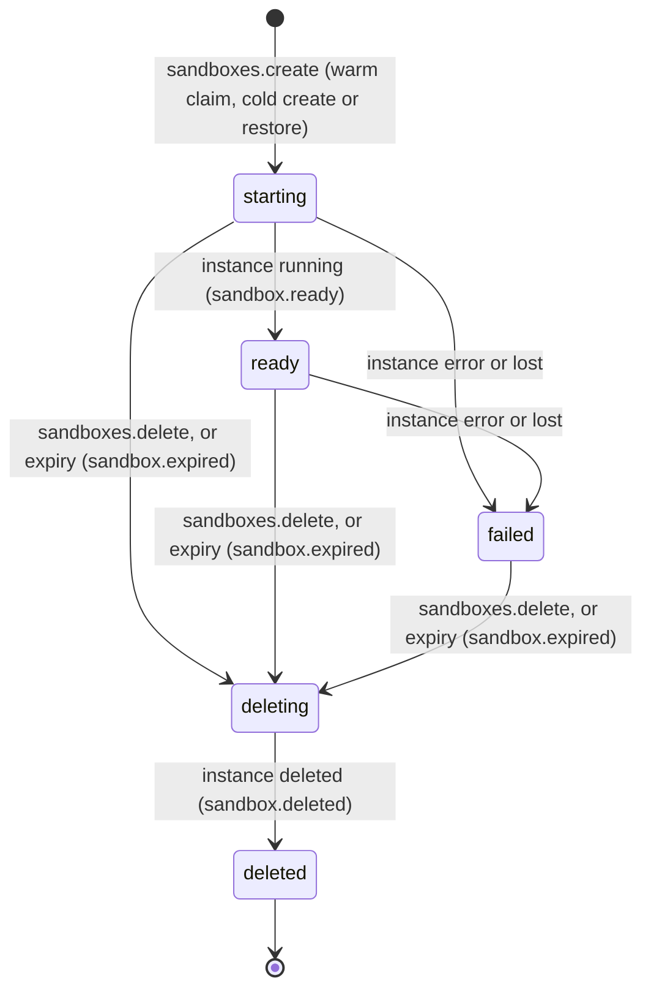
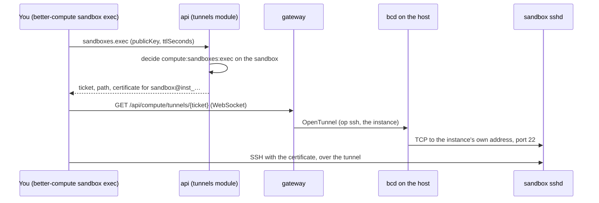

import { Cpu, Instance, KeyRound, Route, SquareTerminal } from '@/lib/icons';

A sandbox is a short-lived, isolated place to run code you do not fully trust: a build, a test suite, an AI agent's
tool call, a customer's notebook. In Better Compute a sandbox is one hosted <Term id="instance">VPS instance</Term>
made from a per-tenant **template**, with a **lifetime** after which it is deleted, optionally started from a **warm
pool** of instances the template keeps booted. It has no placement, quota or tenancy path of its own: the instance
it drives is admitted, placed, charged, addressed, metered and deleted exactly as one from `instances.create`, so the
guarantees of [instances](/docs/guides/vps/instances) hold unchanged. It is its own VM sized by a
<Term id="flavor">flavor</Term>, with no <Term id="join-token">join token</Term>, no `bcd` and no IAM key inside, and
its boot data sealed through the secret broker.

`vps()` serves two API groups for it (v0.5, beta): [sandboxTemplates](/docs/reference/api/sandbox-templates) and
[sandboxes](/docs/reference/api/sandboxes), whose `exec` method the tunnels module contributes. All 12 methods are
served. Migrations `vps/0004_sandboxes` to `vps/0008_template_network` add their tables and columns, and the
`vps.sandboxes` reconciler expires sandboxes, keeps warm pools filled and settles snapshots.

<Callout type="warn" title="The control plane is done; the host runtime is not">
Sandboxes run only on hosted (`vps-host`) pools, and a hosted instance is booted by a runtime inside `bcd` on its
host. bcd has the `instances` converger, `instance.snapshot` and `restore_from`, but a real host build has no runtime
yet (`libvirt-kvm` and `cloud-hypervisor` are not written): a non-empty `instances` section fails with `this host runs
no instance runtime`, so on real hardware a sandbox's instance is placed and holds its allocation and IP lease, but
never boots, and the sandbox stays `starting`. Only fakehw builds of bcd run instances, on a file-backed stand-in.
bcd also does not enforce a template's `network` yet. The TypeScript FakeDaemon's `FakeHypervisor` implements pause,
resume, snapshots and restores for the end-to-end suites. See [where sandboxes run today](#where-sandboxes-run-today).
</Callout>

## Templates

A template belongs to one tenant and fixes what its sandboxes run. Create one with
[sandboxTemplates.create](/docs/reference/api/sandbox-templates#create) (`compute:sandboxes:manage` on the tenant):

```ts title="template.ts"
const template = await client.sandboxTemplates.create({
  tenantId: 'acme',
  name: 'py-small',
  poolId: sandboxPool, // a hosted (vps-host) pool offered to the tenant
  flavor: 'sbx.small',
  imageId: 'ubuntu-24.04',
  userData: '#cloud-config\n…', // optional
  env: { OPENAI_API_KEY: 'secret://acme/sec_01k…' }, // secret references only
  network: 'private', // default 'egress'
  defaultTtlSeconds: 1800, // default 3600
  maxTtlSeconds: 7200, // default 86400
  warm: { min: 2, max: 4 }, // default: no warm pool
});
// { id: 'sbxt_…', runtime: 'cloud-hypervisor', network: 'private', warm: { min: 2, max: 4 }, version: 1, … }
```

<TypeTable
  type={{
    name: { type: 'string', description: "1 to 63 of a-z 0-9 . _ -, starting with a letter or digit; unique among the tenant's live templates (CONFLICT otherwise). A deleted template's name is free again.", required: true },
    poolId: { type: 'string', description: 'A vps-host pool the tenant owns or is offered, not archived. A provider pool is INVALID_INPUT: sandboxes run on hosted pools.', required: true },
    flavor: { type: 'string', description: 'A flavor of that pool, not archived (NOT_FOUND otherwise).', required: true },
    imageId: { type: 'string', description: 'Resolved with vps({ images }) for the tenant (NOT_FOUND when it does not resolve; INVALID_CONFIG without images).', required: true },
    runtime: { type: 'string', description: "Optional. When given it must equal the pool's runtime (INVALID_INPUT otherwise). The template always stores the pool's runtime, checked once here.", default: "the pool's" },
    userData: { type: 'string', description: 'At most 32 KiB of cloud-init, or secret://<tenantId>/<id> for a secret of this tenant; any other URI is INVALID_INPUT. update takes null to remove it.' },
    env: { type: 'Record<string, string>', description: 'Up to 64 variables, named A-Z 0-9 _ (not starting with a digit, at most 64 characters), each a secret://<tenantId>/<id> reference of this tenant; a value is never accepted. Needs the secret broker (INVALID_CONFIG otherwise). update replaces the whole map.', default: '{}' },
    network: { type: "'egress' | 'private' | 'none'", description: "What the sandbox's NICs may reach: anything the pool's network allows, the pool's IPAM subnet and the host, or the host only.", default: "'egress'" },
    defaultTtlSeconds: { type: 'number', description: 'A sandbox lifetime when create gives none. 60 s to 30 days.', default: '3600' },
    maxTtlSeconds: { type: 'number', description: 'The longest lifetime, extensions included. 60 s to 30 days, at least defaultTtlSeconds.', default: 'max(86400, defaultTtlSeconds)' },
    warm: { type: '{ min: number; max?: number }', description: 'Warm instances to keep, 0 to 64 each; max defaults to min and must be at least min.', default: '{ min: 0, max: 0 }' },
  }}
/>

The checks are those of a hosted `instances.create`: the pool must be visible to the tenant, and its runtime must boot
the image's format and pass through the flavor's GPUs. Unknown fields are `INVALID_INPUT`.

[update](/docs/reference/api/sandbox-templates#update) changes the flavor, image, user data, `env`, `network`, TTL
bounds or warm pool and raises `version`; the pool, name and runtime stay, and a new flavor or image is checked again,
including that the pool still runs the template's runtime. A change to the flavor, image, user data, `env` or
`network` also raises the template's internal `instance_version`: warm instances made from an older one are never
claimed and are drained, so a claim always gets an instance of the current shape. Existing sandboxes keep their
instances. [delete](/docs/reference/api/sandbox-templates#delete) hides the template from `get`, `list`, `update` and
`sandboxes.create` and frees its name; its sandboxes live on until they end, and the reconciler deletes its warm
instances. [list](/docs/reference/api/sandbox-templates#list) returns the tenant's live templates ordered by name, and
[get](/docs/reference/api/sandbox-templates#get) one of them. None of these publishes an event. Templates can also
be kept in a [FleetConfig](/docs/guides/fleet-config) document.

### Environment

Each `env` value is resolved by the secret broker for the template's tenant when an instance is created, and written
to `/etc/sandbox/env` (owner `root`, mode 0600) as one `NAME='value'` shell assignment per line, inside the instance's
user data, which the broker seals before it reaches the host. The values never appear in the template, the API or an
event. A warm instance holds the values resolved when it was made; changing `env` drains it, but rotating a secret's
value does not. Source the file from your own user data or command, for example `set -a; . /etc/sandbox/env`.

### Network

`network` becomes the instance's `InstanceSpec.network_policy`, which PLAN.md has bcd enforce with nftables rules on
the instance's taps whatever the runtime:

| `network` | The guest may reach |
| --- | --- |
| `egress` (default) | Anything the pool's network allows; sent as the wire default, so older specs are unchanged |
| `private` | Only the pool's IPAM subnet and the host |
| `none` | Only the host: bcd's tunnel dial, DHCP and ARP. `sandboxes.exec` still works |

<Callout type="warn" title="Not enforced on hosts yet">
The control plane sends the policy in every spec and the FakeDaemon records it, but bcd has no code that applies it
(the Go side has only the generated field). Until it does, treat every sandbox as `egress`.
</Callout>

## Create a sandbox

```ts title="sandbox.ts"
const sandbox = await client.sandboxes.create({
  tenantId: 'acme',
  templateId: template.id,
  ttlSeconds: 900, // default: the template's defaultTtlSeconds
  idempotencyKey: `job-${jobId}`,
  wait: { timeoutMs: 20_000 }, // optional: hold the answer until it leaves 'starting' (at most 30 s)
});
// { id: 'sbx_…', state: 'ready', instanceId: 'inst_…', warm: true, expiresAt: 1790000000000, … }
```

The same call is `POST /api/compute/sandboxes/create`, or
`better-compute sandbox create --template sbxt_… --ttl 15m` from the CLI (see [the CLI](#from-the-cli)). See
[sandboxes.create](/docs/reference/api/sandboxes#create).

### How a create is admitted

A sandbox is admitted like an instance: it exists as a <Term id="draft">draft</Term> before anyone decides on it.

<Steps>
<Step>

### Transaction 1: the draft

The sandbox id (`sbx_` and 52 characters) derives from the tenant, the caller's identity and the idempotency key. An
admitted sandbox with that id is returned as it is (a replay); a different request under the same key is `CONFLICT`
with `details.sandboxId`. `wait` is not part of the compared request. vps reads the template (`NOT_FOUND` when it is
missing or deleted), bounds `ttlSeconds` by its `maxTtlSeconds` (`INVALID_INPUT`), checks that its flavor still
exists (`INVALID_STATE`), checks a `fromSnapshot` (see [restore](#restore)), and writes the draft and its
authorization row.

</Step>
<Step>

### The decision

Better IAM decides `compute:sandboxes:create` on `compute-sandbox/<draft id>`. The row's parent is the template's
pool, its owner is the caller, and it carries `templateId`, `vcpu`, `memoryGiB`, `gpus` (the template's flavor),
`ttlSeconds`, `warm` (true when the template keeps a warm pool and the create is not a restore) and, on a restore,
`fromSnapshot`. A refusal deletes the draft; an agent under
[delegated confirmation](/docs/guides/iam/delegated-confirmation) gets `CONFIRMATION_REQUIRED` and retries with the
same key. After an allow, the pool's budget check runs outside any transaction, as for `instances.create`: a spent
Better IAM budget answers `SPEND_LIMIT_REACHED` and keeps the draft. See
[budgets](/docs/guides/iam/billing-and-usage#budgets).

</Step>
<Step>

### Transaction 2: claim or create

Unless the create is a restore, vps looks for the template's oldest warm instance that has settled (`stopped` or
`paused`, not being deleted) and was made from the template's current `instance_version`, with `FOR UPDATE SKIP
LOCKED`, so concurrent creates never wait on each other and each gets a different instance. A claimed instance moves
to the sandbox: its owner becomes the caller, `desiredState` becomes `running`, `claimed_at` is stamped (its warm
metering ends there), and `instance.starting` is published. Nothing new is placed or charged; it was placed and
charged when it was warmed. Without a claimable instance, vps creates one from the template and schedules it with the
decision's admission context, exactly like a hosted `instances.create`: placement, quota (`QUOTA_EXCEEDED`), an IP
lease (`CAPACITY_UNAVAILABLE`) and sealed user data. When no host fits it waits in `scheduling` and the sandbox stays
`starting`.

The TTL starts here, at admission: `expiresAt` is now plus `ttlSeconds`, whether the instance was warm or cold, so
boot time counts against it. `sandbox.created` is published with `warm` and `expiresAt`.

</Step>
</Steps>

`wait: { timeoutMs }` makes the call async-with-wait: the server re-reads the sandbox until it leaves `starting` and
answers with the last read when the time runs out, which is not an error. The answer's `warm` says which path was
taken. A template whose warm instances have not settled yet (still `provisioning`) gets a cold create.

A policy can bound what callers start, for example short CPU-only sandboxes:

```json title="policy statement"
{
  "sid": "ShortCpuSandboxes",
  "effect": "allow",
  "actions": ["compute:sandboxes:create", "compute:sandboxes:update"],
  "resources": ["compute-sandbox/*"],
  "conditions": {
    "NumericLessThanEquals": { "resource.ttlSeconds": 3600, "resource.gpus": 0 }
  }
}
```

## The sandbox

<TypeTable
  type={{
    id: { type: 'string', description: 'sbx_ and 52 characters.', required: true },
    state: { type: "'starting' | 'ready' | 'failed' | 'deleting' | 'deleted'", description: 'Derived from the instance: ready while it runs, failed in error or lost, deleting once delete or expiry asked, deleted when the instance is gone; starting otherwise.', required: true },
    instanceState: { type: 'InstanceState', description: "The instance's own state.", required: true },
    instanceId: { type: 'string', description: 'The instance it drives.', required: true },
    templateId: { type: 'string', description: 'The template it was made from.', required: true },
    poolId: { type: 'string', description: "The template's pool.", required: true },
    addresses: { type: 'string[]', description: "The instance's addresses.", required: true },
    nodeId: { type: 'string', description: 'The host it is placed on.' },
    ttlSeconds: { type: 'number', description: 'The lifetime: as asked, then from createdAt to the new expiry after an extend.', required: true },
    expiresAt: { type: 'number', description: 'Epoch ms; deleted then unless extended.', required: true },
    warm: { type: 'boolean', description: "Claimed from the template's warm pool.", required: true },
    readyAt: { type: 'number', description: 'When its instance first ran.' },
    expiredAt: { type: 'number', description: 'Set when the sandbox ended by reaching expiresAt.' },
    fromSnapshot: { type: 'string', description: 'The snapshot it was restored from.' },
    snapshots: { type: 'SandboxSnapshot[]', description: 'Its snapshots, newest first, deleted ones left out. Only sandboxes.get returns them.' },
    ownerIdentityId: { type: 'string', description: 'Who created it; list defaults to these.', required: true },
    idempotencyKey: { type: 'string', description: 'The key of the create.', required: true },
    createdAt: { type: 'number', description: 'Epoch ms.', required: true },
  }}
/>



A sandbox is `ready` the moment its instance reaches `running`: the instance reconciler stamps `readyAt` and publishes
`sandbox.ready` in the same transaction, and the sandbox reconciler's pass is only the fallback. A `failed` sandbox is
not replaced; it ends with its TTL or a delete. If its pool sets `recreateOnHostLoss`, a lost instance is recreated
like any other and the sandbox goes back to `starting`.

## Read, extend and delete

- [get](/docs/reference/api/sandboxes#get) returns one sandbox of the tenant with its snapshots, deleted ones
  included; drafts and other tenants' sandboxes are `NOT_FOUND`.
- [list](/docs/reference/api/sandboxes#list) returns `{ items, cursor? }`, newest first. `scope` is `mine` (the
  default, the caller's own) or `all`, and each item is then checked for `compute:sandboxes:read`. Deleted sandboxes
  appear only with `deleted: true`; `templateId` filters by template; `limit` is 1 to 200 (default 50), and `cursor`
  is the last sandbox id of the previous page.
- [extend](/docs/reference/api/sandboxes#extend) moves `expiresAt` later. Give exactly one of `until` (the new expiry,
  epoch ms) or `by` (added to the current expiry: `30m`, `8h`, `7d`, or milliseconds, at most 30 days). It is decided
  as `compute:sandboxes:update` with a pending `ttlSeconds` equal to the whole lifetime after the change, counted from
  `createdAt`, so a policy that caps `ttlSeconds` caps extensions too and cannot be bypassed in small steps. The
  handler then refuses a lifetime above the template's `maxTtlSeconds` (`INVALID_INPUT`), even for a template deleted
  since. An `until` not later than the current expiry returns the sandbox unchanged without a decision; a repeated
  `by` extends again. A sandbox being deleted is `INVALID_STATE`. It publishes `sandbox.extended`.
- [delete](/docs/reference/api/sandboxes#delete) marks the sandbox `deleting`, sets its instance's `desiredState` to
  `deleted` (publishing `instance.deleting` with `sandboxId`) and wakes the reconciler. It is idempotent. The
  `vps.instances` reconciler releases the allocation, IP lease, quota and sealed user data as for any instance.

```ts
await client.sandboxes.extend({ tenantId: 'acme', sandboxId: sandbox.id, by: '30m' });
await client.sandboxes.delete({ tenantId: 'acme', sandboxId: sandbox.id });
```

## Run code inside

There is no platform agent in a sandbox, as in any tenant VM. [sandboxes.exec](/docs/reference/api/sandboxes#exec)
gets you in over plain SSH instead: one call, decided as `compute:sandboxes:exec` on the sandbox, returns a
single-use `ssh` <Term id="tunnel">tunnel</Term> ticket for the sandbox's instance and a short OpenSSH user
certificate for your own public key from the deployment's <Term id="sandbox-ssh-ca">sandbox SSH CA</Term>.



### How the guest trusts it

With `vps({ sandboxExec: { caPublicKey, account } })`, every sandbox instance, warm ones included, gets a user data
MIME multipart whose first part is vps's own cloud-config and whose second is the template's user data (typed by its
first line; a `secret://` reference is resolved first). vps's part:

- creates `account` (default `sandbox`, a locked-password account with `/bin/bash`);
- writes the CA key to `/etc/ssh/bc_sandbox_ca.pub` and the principal `<account>@<instanceId>` to
  `/etc/ssh/bc_sandbox_principals/<account>`;
- adds `/etc/ssh/sshd_config.d/10-bc-sandbox.conf` with `TrustedUserCAKeys` and `AuthorizedPrincipalsFile`, and
  reloads sshd.

The principal names the instance, so a certificate for one sandbox opens no other, and a warm instance trusts the CA
before any sandbox exists. The CA must be one `ssh-ed25519` or `ecdsa-sha2-nistp256` key line (`INVALID_CONFIG`
otherwise), and it is one CA for the deployment, not one per tenant as PLAN.md first described. It is separate from
the [break-glass SSH](/docs/guides/access/ssh) CA, so a sandbox certificate never opens a node.

### Wire it

The tunnels module signs with `tunnels.sandboxSsh` and logs in as `tunnels.sandboxAccount` (default `sandbox`, which
must match vps's `account`); vps renders the same CA's public key. A [PKI bundle](/docs/operations/pki#the-sandbox-ssh-ca)
holds that CA, and `tunnelsOptions(bundle, { issuer })` returns the exec ticket issuer with both SSH CAs:

```ts title="compute.ts"
import { loadPkiBundle } from 'better-compute/cli';
import { tunnelsOptions } from 'better-compute/pki';
import { vps } from 'better-compute/vps';

const bundle = await loadPkiBundle('.better-compute/pki.json', process.env);

export const compute = betterCompute({
  // database, secret, iam, pki ...
  tunnels: tunnelsOptions(bundle, { issuer: 'https://compute.example.com' }), // issuer, ssh, sandboxSsh
  modules: [
    vps({
      images,
      sandboxExec: { caPublicKey: bundle.sandboxSshCa!.publicKey }, // guests trust it
      snapshots: snapshotStore, // see below
    }),
  ],
});
```

A bundle made before sandboxes lacks the CA: add it with `better-compute pki add-sandbox-ca`. Without
`tunnels.sandboxSsh`, `sandboxes.exec` is `UNSUPPORTED`; without `sandboxExec`, guests do not trust the CA and SSH
fails at login.

### The call

<TypeTable
  type={{
    tenantId: { type: 'string', description: 'The tenant acting.', required: true },
    sandboxId: { type: 'string', description: 'The sandbox (sbx_…).', required: true },
    publicKey: { type: 'string', description: 'Your OpenSSH public key line, Ed25519 or ECDSA P-256, at most 4096 characters.', required: true },
    ttlSeconds: { type: 'number', description: "Certificate lifetime, 60 to 900, and never past the caller's session.", default: '600' },
  }}
/>

It answers `{ sandboxId, instanceId, nodeId, tunnelId, ticket, path, expiresAt, certificate, serial, keyId, principal,
account, validBefore }`. Open `GET {basePath}/{path}` as a WebSocket before `expiresAt` (the ticket is single use and
lives 60 s) and speak SSH over it as `account`, with the certificate saved beside your key as `<key>-cert.pub`. The
key id is `bc:<identityId>:<sandboxId>:ssh_<id>`.

| Situation | Error |
| --- | --- |
| No sandbox SSH CA configured | `UNSUPPORTED` |
| An API key rather than a signed-in session | `ACCESS_DENIED`, `details.reason: 'session-required'` |
| The session ends within a minute | `ACCESS_DENIED`, `details.reason: 'session-ending'` |
| The sandbox is not `ready` (its instance not `running`), or is being deleted | `INVALID_STATE` |
| The node is not connected, or its daemon does not advertise `tunnel.instance-dial` | as for `tunnels.open` |
| More tunnels than the per-identity limit, shared with `tunnels.open` | `RATE_LIMITED` |
| An RSA or malformed key | `INVALID_INPUT` |

The typed client does not list `exec`, since the tunnels module adds it at run time; call it by path, then open the
tunnel with the client's `connectTunnel`:

```ts
import { connectTunnel, tunnelUrl } from '@better-compute/client';

const grant = await client.$request<{ path: string; certificate: string; account: string }>('sandboxes/exec', {
  tenantId: 'acme',
  sandboxId: sandbox.id,
  publicKey: 'ssh-ed25519 AAAA… ci@runner',
});
const tunnel = connectTunnel({ url: tunnelUrl('https://compute.example.com', '/api/compute', grant.path) });
// bridge a local socket to `tunnel` and point your SSH client at it
```

The CLI's `better-compute sandbox exec sbx_… -- cmd` does all of it with your OpenSSH client; see
[the CLI](#from-the-cli).

### Revocation

Guests have no agent to receive a revocation list, so the certificate's short lifetime (at most 15 minutes, never
past your session) is the revocation control. The transport is re-authorized: the exec ticket names the sandbox, and
tunnel re-authorization (`tunnelAuthorizer` from `better-compute/iam`) re-decides `compute:sandboxes:exec` on that
sandbox, never on the instance, so withdrawn access closes an open session. Each call publishes `tunnel.issued` (subject `instance/<id>`, with `sandboxId`) and
`sandbox.exec.issued`.

`sandboxes.exec` is the only way in. `tunnels.open` refuses a sandbox's instance, and a warm one, for every op
(`exec`, `ssh`, `tcp`) with `INVALID_STATE` and `details.reason: 'sandbox-managed'` ("managed by sandbox …; use
sandboxes.exec"), so `compute:instances:exec` on the instance, from an API key or a pool-wide grant, cannot bypass the
session requirement and the `compute:sandboxes:exec` decision. `better-compute exec --instance` and `forward
--instance` hit the same refusal. See [tunnels](/docs/guides/access/tunnels).

## Snapshots and restore

`sandboxes.snapshot` saves a sandbox's state, disk and (by default) memory, as a tenant-private snapshot, and
`sandboxes.create({ fromSnapshot })` starts a new sandbox from it.

### The store

Snapshots are uploaded by the host straight to object storage you run. Give vps a `SnapshotStore`:

```ts title="snapshot-store.ts"
import type { SnapshotStore } from 'better-compute/vps';

export const snapshotStore: SnapshotStore = {
  // A presigned https PUT for the new object, and the URL restoring hosts download it from.
  async presign({ tenantId, sandboxId, snapshotId }) {
    const key = `sandboxes/${tenantId}/${snapshotId}`;
    return { uploadUrl: await presignPut(key), uploadHeaders: {}, url: await presignGet(key) };
  },
  // Optional: called after a snapshot's row is deleted (failures are logged, never retried).
  async delete({ tenantId, snapshotId, url }) {
    await removeObject(`sandboxes/${tenantId}/${snapshotId}`);
  },
};
```

Without `vps({ snapshots })`, `sandboxes.snapshot` is `INVALID_CONFIG`; an `uploadUrl` that is not https is
`INVALID_CONFIG` too. The download `url` is stored but never shown to tenants.

### Take one

```ts
const snap = await client.sandboxes.snapshot({
  tenantId: 'acme',
  sandboxId: sandbox.id,
  includeMemory: true, // default: a running state; false for disk only
  keep: false, // default: deleted with the sandbox
  idempotencyKey: 'nightly-42', // optional: a retry returns the same snapshot
});
// { id: 'snap_…', state: 'pending', includeMemory: true, keep: false, runtime: 'cloud-hypervisor', … }
```

It is decided as `compute:sandboxes:update` on the sandbox. The sandbox's instance must be `running` or `paused` on a
node (`INVALID_STATE` otherwise, and for a sandbox being deleted). vps enqueues the `instance.snapshot` command (lane
`bulk`, not retry-safe, timeout 1 h) on the instance's node with the upload URL, keyed
`vps.sandboxes:<snapshotId>:snapshot`, and records the snapshot `pending`. With an `idempotencyKey`, the snapshot id
derives from the key and a retry returns the same snapshot; the key used for another sandbox is `CONFLICT`. Without
one, every call takes a new snapshot.

The host's runtime captures the instance and uploads it with its SHA-256. When the command settles, the command
sweeper or the gateway wakes `vps.sandboxes` with the snapshot id:

| Command outcome | Snapshot | Event |
| --- | --- | --- |
| Succeeded with a valid `InstanceSnapshotResult` | `ready`, with `sha256`, `sizeBytes`, the runtime and, for a memory snapshot, the host's `cpuModel` as a `cpu.model` label value | `sandbox.snapshot.ready` with `snapshotId`, `includeMemory`, `sha256`, `sizeBytes` |
| Failed, rejected, expired or cancelled, or a result that does not decode | `failed`, with `reason` (the command's reason or state, or `bad-result`) | `sandbox.snapshot.failed` with `snapshotId`, `includeMemory`, `reason` |

`sandboxes.get` lists a sandbox's snapshots (`id`, `state`, `includeMemory`, `keep`, `runtime`, `sha256`,
`sizeBytes`, `cpuModel`, `reason`, `createdAt`, `readyAt`).

### Restore

`sandboxes.create({ ..., fromSnapshot: 'snap_…' })` restores one of the tenant's own `ready` snapshots. Another
tenant's snapshot, or a deleted one, is `NOT_FOUND`; one still `pending` or `failed` is `INVALID_STATE`; one taken
on a runtime other than the template's is `INVALID_INPUT`. The decision sees `fromSnapshot`, and a restore never
claims a warm instance: it creates one whose spec carries `restore_from` (the URL, the SHA-256 and the snapshot id). A
memory snapshot places only on nodes whose `cpu.model` label equals the one it was taken on, because memory state
needs the same CPU features. bcd downloads the object into `data_dir/snapshots/<sha256>`, verifies the digest before
using it, and fails the instance for a snapshot from another runtime or a memory snapshot from another CPU model.

### Lifetime

Snapshots are tenant data that include memory. They are never promoted to shared images, and when their sandbox is
deleted they are deleted with it unless taken with `keep: true`; the store's `delete` then removes the object, outside
any transaction. A kept snapshot outlives its sandbox and can still be restored; no method deletes it, and a tenant
teardown deletes every snapshot, kept ones included.

## The reconciler

`vps.sandboxes` runs every 15 seconds (`shardBy: 'none'`, one worker at a time), and `sandboxes.delete` and settled
snapshot commands wake it. Each pass does five things:

1. **Snapshots.** Pending snapshots whose command ended are settled, as above.
2. **Expiry.** Up to 100 sandboxes whose `expiresAt` has passed and whose deletion has not started are locked with
   `SKIP LOCKED`. Each gets `expiredAt`, publishes `sandbox.expired`, and then goes through an ordinary instance delete,
   the same as `sandboxes.delete`. A sandbox can outlive its `expiresAt` by up to one period.
3. **Ready.** A sandbox whose instance is `running` and has no `readyAt` yet gets one and publishes `sandbox.ready`
   (the fallback for the instance reconciler's own stamp).
4. **Deleted.** A sandbox whose instance is `deleted` (or gone) is marked deleted, leaves the authorization
   projection, drops its snapshots that are not kept, and publishes `sandbox.deleted` with `expired` telling whether
   expiry ended it.
5. **Warm pools**, below.

`doctor` reports `vps.sandboxes.expiry` (error: sandboxes more than 30 s past `expiresAt` and not deleting, so the
reconciler is not running), `vps.sandboxes.deleting` (sandboxes deleting for over 10 minutes: a stuck instance) and
`vps.sandboxes.warm` (templates below `warm.min` with no refill for 10 minutes, or warm instances unsettled after 10
minutes). The [metrics](/docs/reference/metrics) include `better_compute_sandbox_ready_seconds` by source (warm or
cold), `better_compute_sandbox_expiry_lag_seconds` and the warm-pool gauges.

### Warm pools

For each live template with `warm.min > 0`, the reconciler keeps `warm.min` warm instances of the template's current
`instance_version`. It creates at most 4 per template per pass, each in its own transaction, owned by the template's
author (`instances.warm_template_id` set). Each is placed and charged to the tenant's quota when it is created, like
any instance, and publishes `instance.created` with `warmTemplateId`. Refills are best effort: a quota refusal, a
flavor or image that is gone, or no fitting host stops that template's refill for the pass, logs `vps: warm sandbox
instance not created`, and the next pass tries again.

A warm instance's `desiredState` depends on the runtime its template stores:

| Runtime `RuntimeTraits.pause` | Warm instance | A claim then |
| --- | --- | --- |
| `true` (`libvirt-kvm`, `cloud-hypervisor`, `firecracker` in `builtinRuntimeTraits`) | Booted, then `paused`: vCPUs stopped, memory resident | Resumes it (`paused` to `running`) |
| absent or `false` (`containerd`, or a runtime you declare without it) | `stopped` | Starts it (`stopped` to `starting` to `running`) |

The lifecycle walks a paused warm instance `provisioning`, `starting`, `running`, then `paused` as the host reports
each; it becomes claimable only once it is `paused` (or `stopped`). See
[paused instances](/docs/guides/vps/instances#paused-instances).

Warm instances of an older `instance_version` are drained first, then instances beyond `warm.max`, newest first since
claims take the oldest; a deleted template's are all drained. Draining sets `desiredState: 'deleted'`. Warm instances
are hidden from `instances.list` and refused by instance methods.

**Metering.** Until a sandbox claims it, a warm instance accrues `vps.sandbox.warm`: its flavor's vCPUs per hour,
billed to the tenant with no identity, so you can price idle capacity. From `claimed_at` on it accrues the ordinary
`vps.vcpu.hours`, `vps.memory.gib.hours` and GPU lines for the sandbox's owner. `better-compute iam setup --meters`
does not create the `vps.sandbox.warm` meter; create it in Better IAM billing before a template keeps a warm pool, or
its windows are dead-lettered. See [usage](/docs/guides/capacity/quotas-and-usage).

## The instance behind a sandbox

`instances.sandbox_id` marks the instance a sandbox drives and `instances.warm_template_id` a warm one; never both.

- `instances.start`, `stop`, `resize` and `delete` refuse both with `INVALID_STATE` ("managed by sandbox …" or "is a
  warm instance of sandbox template …"). Only the sandbox and its template move them.
- `instances.get` returns both; `instances.list` shows a sandbox's instance and hides warm instances.
- Everything else is the instance's: placement, quota, IPAM, sealed user data, host loss and recreation, the leak
  diff, `vps.usage` metering, and [workload identity](/docs/guides/vps/instances#workload-identity) when the pool
  enables it.

See [sandbox and warm instances](/docs/guides/vps/instances#sandbox-and-warm-instances).

## Events

Sandbox events have subject `sandbox/<id>`. The lifecycle events carry `templateId`, `instanceId` and `poolId`:

| Event | When | Extra `data` |
| --- | --- | --- |
| `sandbox.created` | `create` admitted it | `warm`, `expiresAt` |
| `sandbox.ready` | Its instance first ran | `warm` |
| `sandbox.extended` | `extend` moved the expiry | `expiresAt` |
| `sandbox.expired` | The reconciler found `expiresAt` passed | `expiresAt` |
| `sandbox.deleted` | Its instance is gone | `expired` |
| `sandbox.exec.issued` | `exec` issued a certificate | `instanceId`, `tunnelId`, `serial`, `keyId`, `principal`, `identityId`, `validBefore` |
| `sandbox.snapshot.ready`, `sandbox.snapshot.failed` | A snapshot settled | `snapshotId`, `includeMemory`, and `sha256` and `sizeBytes`, or `reason` |

The instance publishes its own `instance.*` events alongside, with `sandboxId` or `warmTemplateId` in `data`. Both
`sandbox.*` and `sandbox.snapshot.*` are in the events catalog, so webhooks can subscribe to them like any other
family. See [event types](/docs/guides/events#event-types).

## Authorization

| Method | Action | Decided on |
| --- | --- | --- |
| `sandboxTemplates.create` | `compute:sandboxes:manage` | `compute-tenant` |
| `sandboxTemplates.list` | `compute:sandboxes:read` | `compute-tenant` + items |
| `sandboxTemplates.get` | `compute:sandboxes:read` | `compute-sandbox-template` |
| `sandboxTemplates.update`, `delete` | `compute:sandboxes:manage` | `compute-sandbox-template` |
| `sandboxes.create` | `compute:sandboxes:create` | `compute-sandbox` (the draft) |
| `sandboxes.list` | `compute:sandboxes:read` | `compute-tenant` + items |
| `sandboxes.get` | `compute:sandboxes:read` | `compute-sandbox` |
| `sandboxes.extend`, `snapshot` | `compute:sandboxes:update` | `compute-sandbox` |
| `sandboxes.exec` (tunnels module) | `compute:sandboxes:exec` | `compute-sandbox`, and again at tunnel re-authorization |
| `sandboxes.delete` | `compute:sandboxes:delete` | `compute-sandbox` |

A `compute-sandbox` has the pool as its parent, so pool relations apply. The example `StopWhenOverBudget` statement
denies `compute:sandboxes:create` and `compute:sandboxes:update` (extensions and snapshots) once the caller's budget is
spent. See [actions and resources](/docs/guides/iam/actions-and-resources) and [policies](/docs/guides/iam/policies).

## Tenant teardown

When an IAM tenant is deleted, the built-in `tenancy` reconciler calls `vps().tenantDeleted` until it answers `DONE`.
In one transaction per call it deletes every snapshot of the tenant (kept ones too; their objects go through the
store's `delete` afterwards), deletes its templates (their warm pools drain), marks its open sandboxes `deleting`,
drops sandbox and instance drafts, and sets up to 100 live instances, sandboxes' and warm ones included, to
`desiredState: 'deleted'`, each publishing `instance.deleting` with `reason: 'tenant deleted'`. It answers
`SYNC_AGAIN` until every instance of the tenant is `deleted`; the `vps.sandboxes` reconciler then publishes each
sandbox's `sandbox.deleted`. See [tenancy](/docs/guides/iam/tenancy).

## From the CLI

The `sandbox` commands (group `Sandboxes`) call the API as `BETTER_COMPUTE_TOKEN`, in process or with `--url`:

```bash
better-compute sandbox templates --format table          # the tenant's templates and warm pools
better-compute sandbox create --template sbxt_01k5w… --ttl 30m
better-compute sandbox create --template sbxt_01k5w… --from-snapshot snap_01k5w…
better-compute sandbox list --all --format table
better-compute sandbox extend sbx_01k5w… --by 30m        # or --until 2026-10-01T12:00:00Z, or --until +2h
better-compute sandbox snapshot sbx_01k5w… --keep        # --no-memory for disk only
better-compute sandbox exec sbx_01k5w… -- uname -a       # or no command for a login shell
better-compute sandbox delete sbx_01k5w…
```

`sandbox exec` reads the public key beside `--key` (default `~/.ssh/id_ed25519`, so `~/.ssh/id_ed25519.pub`; the
private key never leaves your machine), asks `sandboxes.exec` for a certificate of `--minutes` (default 10, 1 to 15),
listens on a random `127.0.0.1` port for exactly one connection, and runs your OpenSSH client (`--ssh`, default
`ssh`) against it with the certificate, `IdentitiesOnly=yes`, a one-off known-hosts file and `HostKeyAlias` set to the
sandbox id. The certificate lives in a temporary directory that is removed afterwards, and the command exits with
ssh's status. It needs `--url` and a signed-in session. See
[the CLI guide](/docs/guides/clients/cli#sandboxes) and the [reference](/docs/reference/cli#sandbox-create).

## Agents over MCP

The [MCP server](/docs/guides/clients/mcp#the-tools) has six sandbox tools: `list_sandbox_templates`,
`create_sandbox` (`templateId`, `ttlSeconds`, `idempotencyKey`, `waitSeconds` default 20; it answers
`{ idempotencyKey, sandbox }` and turns `CONFIRMATION_REQUIRED` into a result the model can retry), `list_sandboxes`,
`get_sandbox`, `extend_sandbox` (`sandboxId`, `by`) and `delete_sandbox`. There are no snapshot or exec tools.

<Callout type="warn" title="Give the gate rules for them">
`gateTools()` has no rules for the sandbox tools yet, so a gate built with `unlisted: 'deny'` refuses and hides them.
Add rules yourself, for example `{ ...gateTools(), create_sandbox: { public: true }, … }`: compute decides every call
on the sandbox or its draft anyway.
</Callout>

## In the console

The console's **Sandboxes** page lists the tenant's templates with their warm pool sizes in a create form (template
and lifetime in minutes, capped at the template's maximum), and the person's own sandboxes, or everyone's, with a
countdown to `expiresAt` that turns to a warning in the last 5 minutes. Each row offers **+30 min**, **Snapshot** and
**Delete**, and shows the `better-compute sandbox exec sbx_…` line to copy, since a shell runs through the CLI. See
[the console](/docs/guides/clients/console#screens).

## Where sandboxes run today

| Layer | State |
| --- | --- |
| API, admission, TTL, warm pools, `env`, `network`, snapshots, exec trust, guard, teardown | Built and tested against PGlite with emulated host reports (`tests/vps-sandboxes.test.ts`, 26 tests; `tests/server-sandbox-exec.test.ts`) |
| End to end | `tests/e2e/sandboxes.test.ts` runs the real server runtime and gateway with three FakeDaemon VPS hosts whose fake `cloud-hypervisor` pauses: a warm claim reaches `ready` without a placement, 500 short-lived sandboxes (`E2E_SANDBOXES`) expire with no leaks on hosts or in the database, a memory snapshot taken on one sandbox restores its guest memory into a new one (and the stored object goes with the sandbox), and deleting a warm template drains its pool |
| FakeDaemon `FakeHypervisor` | Boots then pauses on a desired `PAUSED`, resumes without a reboot, runs `instance.snapshot` and carries guest memory to a restored domain, records the network policy |
| bcd | The `instances` converger, `instance.snapshot` and `restore_from`, and instance `ssh` tunnels; on fakehw builds only, over a file-backed stand-in runtime. A real host build has no runtime, and nothing enforces `network_policy` |
| Provider pools | Not allowed for sandboxes |

On a real host running today's bcd (a host build, which has no runtime), a sandbox's instance is placed but never
reported, so it stays `provisioning` and the sandbox `starting`. Expiry and `delete` still set it to `deleting`, but
a hosted instance finishes deleting only when a complete host report no longer lists it or the host is declared
`lost`.

Not built yet: host runtimes in bcd, bcd's enforcement of `network`, the SDK helpers PLAN.md section 3.7 describes
for commands and files over the SSH session (`sandbox.exec(cmd)`, `files.put`, `files.get`), MCP gate rules and
tools for snapshots and exec, and a method to delete a kept snapshot. See the
[roadmap](/docs/reference/roadmap#sandboxes).

## Lower level: instances directly

Anything a sandbox does not cover, such as provider pools or a VM without a lifetime, is an instance:

```ts
const vm = await client.instances.create({
  tenantId: 'acme',
  poolId: sandboxPool,
  flavor: 'sbx.small',
  imageId: 'ubuntu-24.04',
  sshKeys: ['ssh-ed25519 AAAA… ci@runner'],
  idempotencyKey: `vm-${jobId}`,
  wait: { timeoutMs: 20_000 },
});
// … and delete it yourself: instances have no time-to-live.
await client.instances.delete({ tenantId: 'acme', instanceId: vm.id });
```

It is decided as `compute:instances:create` and runs in a hosted or a provider pool. See
[instances](/docs/guides/vps/instances).

## Sandboxes and GPU reservations

Both come out of the same pools and the same database, so neither can take what the other holds:

| | GPU reservation | Sandbox |
| --- | --- | --- |
| What you get | GPU atoms on a node, as CDI devices for your own workload manager | A VM with its own kernel, vCPUs, memory, disk and optional GPUs |
| Booked by | `reservations.create` | `sandboxes.create` |
| Time | A window (`duration`), extendable | A TTL from the template, extendable up to `maxTtlSeconds` |
| Who runs code | Your scheduler on the node (Kubernetes, Slurm, containerd) | The guest, reached with `sandboxes.exec` over SSH |
| Isolation | The node's, per workload | A VM per sandbox; nothing of the platform inside |

<Cards>
  <Card title="Instances" href="/docs/guides/vps/instances" icon={<Instance />}>
    The lifecycle, paused instances, the sandbox guard, runtimes and workload identity.
  </Card>
  <Card title="Flavors" href="/docs/guides/vps/flavors" icon={<Cpu />}>
    Shapes, scalar claims, overcommit, quota and metering.
  </Card>
  <Card title="Tunnels" href="/docs/guides/access/tunnels" icon={<Route />}>
    The single-use tickets and WebSocket that `sandboxes.exec` rides on.
  </Card>
  <Card title="CLI" href="/docs/guides/clients/cli#sandboxes" icon={<SquareTerminal />}>
    The `sandbox` commands, `sandbox exec` included.
  </Card>
  <Card title="Policies" href="/docs/guides/iam/policies" icon={<KeyRound />}>
    Bound sandbox shapes and lifetimes with conditions on the draft.
  </Card>
</Cards>
