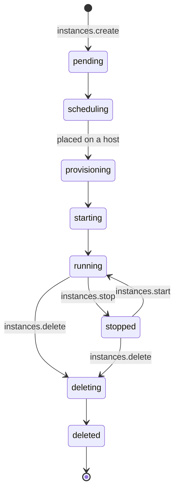
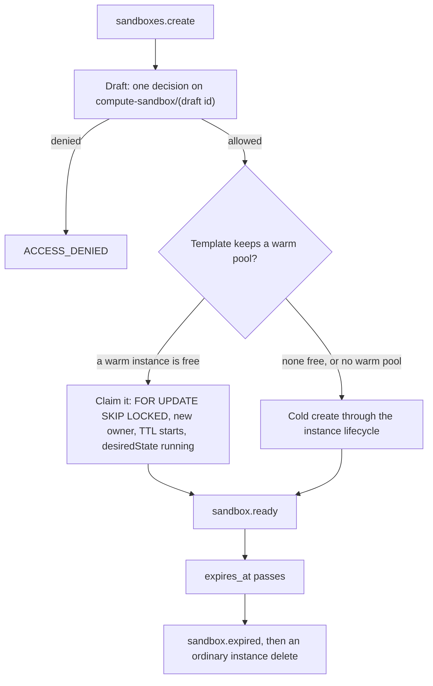

import { Cpu, Instance, KeyRound, Route } from '@/lib/icons';

A sandbox is a short-lived, isolated place to run code you do not fully trust: a build, a test suite, an AI agent's
tool call, a customer's notebook. Better Compute runs sandboxes as <Term id="instance">VPS instances</Term>. Each one
is its own VM, sized by a <Term id="flavor">flavor</Term> of vCPUs, memory and disk, with or without GPUs, and it goes
through the same admission, quotas, metering and audit trail as a GPU reservation.

<Callout type="info" title="What exists today, and what is planned">
Today a sandbox is an instance, created with `instances.create` and removed with `instances.delete`. The control
plane for instances is built and tested (v0.3, beta). Provider pools run the VMs on Hetzner Cloud or Proxmox VE. The
hosted runtimes that run VMs on your own servers, `libvirt-kvm` and `cloud-hypervisor`, are planned inside bcd for
v0.3 and are not built yet, and a Kata runtime plugin is planned for v0.5.

A dedicated `sandboxes` API is decided (D24 in PLAN.md) and planned for v0.5, layered on `vps()`: templates, a
time-to-live, warm pools, snapshots and exec over short-lived SSH certificates. So far only its catalog entries (the
actions, the two resource types and the method rows, all marked planned) and its runtime seams (paused instances,
restore from a snapshot, the snapshot command's messages) exist; no sandbox method is served. See
[the planned sandboxes API](#the-planned-sandboxes-api) and the [roadmap](/docs/reference/roadmap#sandboxes).
</Callout>

## Why a VM

A sandbox has to hold up when the code inside is hostile. An instance gives it these properties, each enforced in the
control plane:

| Property | How |
| --- | --- |
| Its own kernel | A VM (or microVM) per instance. Each runtime declares its isolation as a trait, `vm`, `microvm` or `container`, and a container pool must be single-tenant (`doctor` warns `vps.pools.single-tenant` otherwise). |
| Nothing of the platform inside | The guest gets no <Term id="join-token">join token</Term>, no `bcd` and no IAM key. No platform agent ever runs in a tenant VM. |
| Tenant-bound boot data | User data is rendered at admission, sealed through the secret broker and kept only as a `secret://` reference. The host fetches it with a node-signed request, and the broker releases it only to the instance's own tenant. |
| Bounded resources | The flavor's `vcpu`, `memoryGiB` and `diskGiB` are claimed on the host and charged to the tenant's quota; GPUs are whole atoms passed through VFIO, never overcommitted. |
| Audited access | Exec, SSH and TCP port forwards go through a single-use <Term id="exec-ticket">exec ticket</Term> from `tunnels.open`, decided as `compute:instances:exec`. |
| Clean teardown | Deleting releases the allocation, the IP lease and the sealed user data, and publishes `instance.deleted`. |

## Size sandboxes with flavors

A flavor is a named shape in one pool: 1 to 1024 vCPUs, 1 to 16,384 GiB of memory, 1 to 65,536 GiB of disk, and 0 to
16 GPUs. CPU-only sandboxes use `gpus: 0` (the default), in a pool that needs no GPU model.

```ts title="flavors.ts"
await compute.api.flavors.create(cred, {
  tenantId: 'root',
  poolId: sandboxPool,
  name: 'sbx.small',
  vcpu: 2,
  memoryGiB: 4,
  diskGiB: 20,
});

await compute.api.flavors.create(cred, {
  tenantId: 'root',
  poolId: gpuSandboxPool,
  name: 'g1.h100x1',
  vcpu: 16,
  memoryGiB: 120,
  diskGiB: 200,
  gpus: 1,
});
```

On a hosted pool, capacity places the flavor on one host: a host fits when `allocated + claim` stays within
`floor(allocatable × ratio)` for every scalar, where `ratio` is that host's overcommit for CPU and memory. The same
shape counts against the tenant's quota, and hosted instances are metered as `vps.vcpu.hours`,
`vps.memory.gib.hours` and, for GPU flavors, `gpu.<model>.hours`. A host's capacity comes from its inventory, less a
reserve for the host itself; see [flavors](/docs/guides/vps/flavors) for the details.

## Start a sandbox

```ts title="sandbox.ts"
const sandbox = await client.instances.create({
  tenantId: 'acme',
  poolId: sandboxPool,
  flavor: 'sbx.small',
  imageId: 'ubuntu-24.04',
  idempotencyKey: `sandbox-${jobId}`,
  wait: { timeoutMs: 20_000 }, // hold the answer until it runs or fails (at most 30 s)
});
// { id: 'inst_…', state: 'running', desiredState: 'running', … }
// or, when the wait runs out first: state 'scheduling', 'provisioning' or 'starting'
```

`wait` makes the call async-with-wait: the server re-reads the instance until it leaves `pending`, `scheduling`,
`provisioning` and `starting`, and answers with the last read when `timeoutMs` passes; a timeout is not an error.
Without `wait` the answer comes back at once, `provisioning` in a hosted pool or `scheduling` in a provider pool. See
[waiting for the instance](/docs/guides/vps/instances#waiting-for-the-instance).

The call is one IAM decision on the draft (`compute:instances:create`), so policies can bound what a caller may start:
the flavor's vCPUs, memory and GPUs, the pool, the image and whether it is verified. An agent working under a
delegated session can be held back for a person's confirmation, like any other admission; see
[delegated confirmation](/docs/guides/iam/delegated-confirmation). After the decision the pool's budget check runs,
as for reservations: when the pool sets `admission.budgetCheck: 'meter'` or the tenant's offer stops new work over
budget, a spent Better IAM budget answers `SPEND_LIMIT_REACHED` and keeps the draft for a later retry with the same
key. See [budgets](/docs/guides/iam/billing-and-usage#budgets).

The instance then walks the state table as the `vps.instances` reconciler converges it:



Watch it with [events](/docs/guides/events/watch) (`instance.running`, `instance.failed`, `instance.deleted`) rather
than polling. The full table, including `error`, `lost` and recreation after a host loss, is in
[instances](/docs/guides/vps/instances).

## Run code inside

A sandbox has no API of its own inside it. To run something, open a tunnel into it: `exec` for a command session,
`ssh`, or `tcp` with a `port` to reach a service the sandbox listens on (`console` is for nodes, not instances):

```ts
const { ticket } = await client.tunnels.open({ tenantId: 'acme', instanceId: sandbox.id, op: 'exec' });
```

The ticket is single-use and valid for 60 seconds, bound to that instance's node, and re-verified by the daemon. Tunnels work
for hosted instances whose node is connected; provider instances answer `UNSUPPORTED`, because no platform agent runs
next to them (use SSH keys from `instances.create` there). See [tunnels](/docs/guides/access/tunnels).

From a terminal, `better-compute exec --instance …` opens a shell, and `better-compute forward --instance … --port
8888` forwards a local port to a port of the sandbox, one `tcp` tunnel per connection, like `ssh -L`; see
[the CLI](/docs/guides/clients/cli#interactive-access). Instance `tcp` and `ssh` tunnels need a host daemon that
advertises `tunnel.instance-dial`; without it `tunnels.open` answers `UNSUPPORTED`.

For code that must call other services as the sandbox, a hosted instance can fetch a short-lived workload identity
token from its host's metadata service; see [workload identity](/docs/guides/vps/instances#workload-identity).

## Tear it down

```ts
await client.instances.delete({ tenantId: 'acme', instanceId: sandbox.id });
```

`delete` sets `desiredState: 'deleted'`. The reconciler stops the VM, removes it through the runtime (or the
provider), releases the allocation and the IP lease, deletes the sealed user data and publishes `instance.deleted`.
A sandbox that must not outlive its job is deleted by the caller: instances have no time-to-live. The planned
sandboxes API adds one (below).

## Let an agent manage sandboxes

The [MCP server](/docs/guides/clients/mcp) gives AI agents the whole lifecycle as tools, each calling the instance
method as the agent: `create_instance` (`instances.create`, with an idempotency key and delegated confirmation, and
waiting up to `waitSeconds`, default 20, for the instance to start),
`list_instances` (its own by default, or `scope: 'all'`), `get_instance`, `start_instance`, `stop_instance` and
`delete_instance`. The MCP gate lets any authenticated agent call the last five; compute decides each on the instance
itself, so an agent can only touch sandboxes its policies allow. `stop_instance` and `delete_instance` are marked
destructive, so many MCP hosts ask the person before calling them. Running code inside a sandbox is not an MCP tool:
agents open [tunnels](/docs/guides/access/tunnels) through the API.

## Sandboxes and GPU reservations

Both come out of the same pools and the same database, so neither can take what the other holds:

| | GPU reservation | Sandbox (instance) |
| --- | --- | --- |
| What you get | GPU atoms on a node, as CDI devices for your own workload manager | A VM with its own kernel, vCPUs, memory, disk and optional GPUs |
| Booked by | `reservations.create` | `instances.create` |
| Time | A window (`duration`), extendable | Open-ended until deleted |
| Who runs code | Your scheduler on the node (Kubernetes, Slurm, containerd) | The guest, reached through tunnels or SSH |
| Isolation | The node's, per workload | A VM per sandbox; nothing of the platform inside |

## The planned sandboxes API

<Callout type="warn" title="Planned for v0.5, not built">
Everything in this section is the design in PLAN.md (section 3.7, the section 9.2 row, the v0.5 deliverable and
exit), decided as D24. None of it runs yet. What is in the code today:

- the catalog: the `compute-sandbox` and `compute-sandbox-template` resource types, the `compute:sandboxes:*`
  actions, the `sandboxes` and `sandboxTemplates` method rows (phase v0.5, planned), and the `StopWhenOverBudget`
  example statement naming `compute:sandboxes:create` and `compute:sandboxes:update`;
- the runtime and protocol seams described under [runtime and events](#runtime-and-events): the `paused` instance
  state, `restoreFrom`, the `instance.snapshot` messages and the optional `RuntimeDriver` methods, which the
  FakeDaemon's fake hypervisor implements for tests.

No sandbox method is registered, no sandbox table exists, and names below may still change.
</Callout>

A sandbox will be a VPS instance with a template, a lifetime and a fast start, and it has no placement or tenancy
path of its own. `sandboxes.create({ tenantId, templateId, ttl?, fromSnapshot?, idempotencyKey })` writes a
`sandboxes` row plus the `instances` row it drives (`instances.sandbox_id`), so admission, quota, IPAM, tunnels,
IMDS, usage and the leak diff are the instance's. Instance item methods on a sandbox's instance are refused with
`INVALID_STATE` ("managed by sandbox …"); only `instances.get` and `instances.list` work on it.



### Templates

Templates (`sandbox_templates`) belong to a tenant and hold:

| Field | Meaning |
| --- | --- |
| `poolId`, `flavor`, `imageId` | Where and what to run. The pool must be offered to the tenant; creating a template checks the flavor and runtime against the pool once |
| `runtime` | `cloud-hypervisor` by default. Any `microvm` or `vm` runtime is allowed, and containers only on `singleTenant` pools, as for instances |
| `userData` | The template's cloud-init |
| `env` | `secret://` references, resolved by the secret broker for the sandbox's own tenant only |
| `network` | `egress` (default), `none` or `private` |
| `defaultTtl`, `maxTtl` | The lifetime bounds |
| `warm: { min, max }` | The warm pool |

### Lifetime, warm pools and snapshots

- **Lifetime.** `expires_at` is set when the row is created. `sandboxes.extend` moves it within `maxTtl` and the pool
  policy's bound, as a reservation's `extend` does. The `vps.sandboxes` reconciler deletes an expired sandbox
  through the instance lifecycle (`desiredState: 'deleted'`), so expiry is an ordinary delete: bookings refunded,
  overlay removed, IP released. `sandbox.expired` is published first.
- **Warm pools.** For each template with `warm.min > 0`, the reconciler keeps `min` instances created, booted and
  then `paused` (or `stopped` when the runtime cannot pause), owned by the template's tenant. `sandboxes.create`
  still takes its own admission decision, and only after an allow claims the oldest warm instance in the same
  transaction; on a miss it falls back to a cold create. Warm instances count against the tenant's quota when they
  are created, so a claim charges nothing new. They are metered as `vps.sandbox.warm` so operators can price idle
  capacity, and refills are rate-limited per pool.
- **Snapshots.** `sandboxes.snapshot` sends the host the `instance.snapshot` command: the runtime writes disk and
  memory state, and the daemon uploads it to a presigned URL as an image of `kind: 'snapshot'`, private to the
  sandbox's tenant, never promotable, with its sha256 stored. `create({ fromSnapshot })` restores it on a host with
  the same runtime and `bc.dev/cpu.model` (a placement `nodeLabels` constraint), because memory state needs matching
  CPU features. Snapshots are deleted with the sandbox unless `keep: true`, and restoring another tenant's snapshot
  fails the image visibility check.

### Exec and files without an agent in the guest

No platform agent runs inside a tenant VM, and sandboxes keep that rule. `sandboxes.exec` will return a tunnel ticket
and a short-lived SSH certificate signed by the tenant's sandbox CA, which templates trust through
`TrustedUserCAKeys` in the user data they render. The SDK's `sandbox.exec(cmd)`, `files.put` and `files.get` ride
that SSH session through the tunnel, and the serial console stays as the fallback.

### Runtime and events

The runtime and protocol pieces have landed ahead of the API, all additive:

| Piece | What it is |
| --- | --- |
| `paused` | A new `InstanceState` and `InstanceDesiredState` (proto `INSTANCE_DESIRED_STATE_PAUSED` and `INSTANCE_OBSERVED_STATE_PAUSED`, both 4): vCPUs stopped, memory resident. The state table adds the verbs `pause` (`running` to `paused`) and `resume` (`paused` to `running`); a paused instance can also stop, fail, be deleted or be lost, and a lost one can recover to `paused` |
| `InstanceSpec.restoreFrom` | `{ url, sha256, imageId }` (proto `restore_from = 12`, an `ImageRef`): boot from a snapshot instead of `image`. The host verifies the sha256 and fails the instance on a runtime or CPU model mismatch |
| `InstanceSnapshotRequest` / `InstanceSnapshotResult` | The `instance.snapshot` command's messages: `instance_id`, a presigned `upload_url` with `upload_headers`, `image_id`, `include_memory`; the result carries `uploaded_bytes`, `sha256`, `runtime` and `cpu_model`. State goes to the presigned URL, as for `logs.collect`, never over the session. The command is bulk lane and not retry-safe |
| `RuntimeDriver.pause?`, `resume?`, `snapshot?(instanceId, { uploadUrl, uploadHeaders?, includeMemory })` | Optional runtime methods; `snapshot` returns `{ uploadedBytes, sha256, cpuModel? }`. `RuntimeInstanceStatus.state` may be `paused` |

A runtime without `pause` treats `paused` as `stopped` (a warm pool then warms to `stopped`), and one without
`snapshot` fails the command with `UNSUPPORTED`. Still to come from the sandboxes work: the vps lifecycle and status
mapping for `paused`, registering the `instance.snapshot` kind, and the database check on `desired_state`. The events
will be `sandbox.created`, `sandbox.ready`, `sandbox.expired`, `sandbox.deleted` and `sandbox.snapshot.ready`.

### Authorization

The catalog already holds the planned rows, so policies can be written against them now:

| Method | Action | Decided on |
| --- | --- | --- |
| `sandboxes.create` | `compute:sandboxes:create` | `compute-sandbox/(draft id)`, with `templateId`, `vcpu`, `memoryGiB`, `gpus`, `ttlSeconds`, `fromSnapshot` and `warm` |
| `sandboxes.list` | `compute:sandboxes:read` | `compute-tenant`, owner-scoped like `instances.list` |
| `sandboxes.get` | `compute:sandboxes:read` | `compute-sandbox` |
| `sandboxes.extend`, `sandboxes.snapshot` | `compute:sandboxes:update` | `compute-sandbox` |
| `sandboxes.exec` | `compute:sandboxes:exec` | `compute-sandbox` |
| `sandboxes.delete` | `compute:sandboxes:delete` | `compute-sandbox` |
| `sandboxTemplates.create` | `compute:sandboxes:manage` | `compute-tenant` |
| `sandboxTemplates.list` | `compute:sandboxes:read` | `compute-tenant` + items |
| `sandboxTemplates.get` | `compute:sandboxes:read` | `compute-sandbox-template` |
| `sandboxTemplates.update`, `sandboxTemplates.delete` | `compute:sandboxes:manage` | `compute-sandbox-template` |

A `compute-sandbox` has the pool as its parent, like an instance, so pool relations apply. See
[actions and resources](/docs/guides/iam/actions-and-resources) and the generated
[sandboxes](/docs/reference/api/sandboxes) and [sandboxTemplates](/docs/reference/api/sandbox-templates) pages.

### The v0.5 exit

`tests/e2e/sandboxes.test.ts` closes the deliverable: 500 sandboxes expire on emulated hosts with the same zero-leak
diff as the v0.3 churn; a warm claim reaches `ready` without a placement; a snapshot round trip restores memory
state; another tenant's snapshot is refused; and instance methods on a sandbox's instance are refused.

<Cards>
  <Card title="Instances" href="/docs/guides/vps/instances" icon={<Instance />}>
    The lifecycle, reports, lost hosts, runtimes and workload identity.
  </Card>
  <Card title="Flavors" href="/docs/guides/vps/flavors" icon={<Cpu />}>
    Shapes, scalar claims, overcommit, quota and metering.
  </Card>
  <Card title="Tunnels" href="/docs/guides/access/tunnels" icon={<Route />}>
    Exec, SSH and TCP through single-use tickets.
  </Card>
  <Card title="Policies" href="/docs/guides/iam/policies" icon={<KeyRound />}>
    Bound what callers may start with conditions on the draft.
  </Card>
</Cards>
