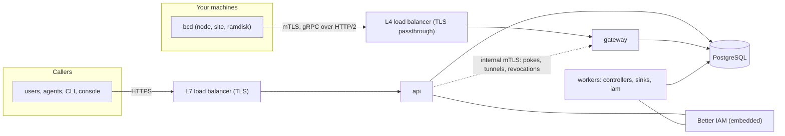

import { Activity, ClipboardCheck, Database, History, KeyRound, Rocket, Scale, Settings2, ShieldCheck, Terminal } from '@/lib/icons';

A Better Compute deployment is one configuration file, one PostgreSQL database and some number of Node.js
processes started from that configuration. Each process runs a subset of the same roles: the HTTP API, the daemon
<Term id="gateway">gateway</Term>, and the worker roles that run reconcilers, deliver events and run Better IAM's
jobs. PostgreSQL is the only source of truth. Every process can be stopped, restarted or duplicated, and the
leases in the database keep each job single-writer.

This section covers running that system: how to lay the processes out, what to configure, what the database needs,
how the machine PKI works, and how to harden, observe and scale it.

<Callout type="warn" title="What runs today">
  The control plane, the gateway and the CLI host are built and tested in TypeScript. The Go daemon `bcd` has a
  working v0.1 node agent, tested end to end against a real gateway, but no release: there is no published binary
  for the install script, and it has not run on a real GPU host. The `FakeDaemon` speaks the real protocol in the
  simulator, most tests and `better-compute dev --sim N`. The npm packages are at 0.2.0; see
  [installation](/docs/guides/installation).
</Callout>

## Process roles

`better-compute serve` runs the roles you name with `--roles` (or `BETTER_COMPUTE_ROLES`). The default, `all`, runs
the API, every worker role, and the gateway when the configuration exports `host.gateway`.

| Role | What it runs | Listens on | Scale by |
| --- | --- | --- | --- |
| `api` | The HTTP API (`POST {basePath}/{group}/{method}`), admission transactions, `/healthz`, `/readyz`, `/.well-known/better-compute`, the host's own routes, and the tunnel upgrade `GET {basePath}/tunnels/{ticket}` when tunnels are configured | `--host`:`--port` (default `0.0.0.0:3000`), plain HTTP behind your TLS terminator | Requests, behind an L7 load balancer |
| `gateway` | Daemon sessions over gRPC on HTTP/2 mTLS, liveness, command dispatch, result and event ingestion, `Join`/`Renew`/`Secret` hand-off, the revocation feed, tunnels | `host.gateway.listen` (default `0.0.0.0:8443`), plus the internal control API (default port 8444) and the WebSocket fallback (default port 443) when configured | Streams, behind an L4 load balancer with TLS passthrough |
| `controllers` | Every reconciler not declared for the scheduler (node lifecycle, NodeSpec, liveness, inventory, reservations, workflows, webhooks, audit sinks, …) over 256 shards, and the CommandSweeper | nothing | Shards, spread over worker processes |
| `scheduler` | Reconcilers that declare `role: 'scheduler'`: the pool-lease placer `capacity.placer`, under its own shard membership | nothing | Pool shards, spread over scheduler processes |
| `sinks` | OutboxDispatch to event sinks (`sinks.events` and modules' event sinks) | nothing | Sinks, one `singleton:outbox-dispatch:<sink id>` lease each, spread over the `sinks` workers |
| `iam` | Better IAM's jobs (`iamJobs`), each under its own `singleton:iam:<name>` lease | nothing | One holder per job |

`--roles` takes `all` or a comma list: `api`, `gateway`, and any of `controllers`, `scheduler`, `sinks`, `iam`.
The worker roles are the server's `workerRoles` export; `compute.start()` with no argument runs all four.

```bash
better-compute serve                                          # all: api, workers, and the gateway if configured
better-compute serve --roles api --port 3000 --no-migrate
better-compute serve --roles controllers,scheduler,sinks,iam --no-migrate
better-compute serve --roles gateway --no-migrate
```

## What talks to what



- **Callers to the API.** JSON over HTTPS with `X-Better-Compute: 1`. Better IAM authenticates every caller and
  decides every call. See [security](/docs/operations/security).
- **Daemons to gateways.** Nodes only dial out, to `gw.<region>:443` through an L4 balancer that passes TLS
  through, so the gateway sees the client certificate. See [the gateway](/docs/daemon/gateway).
- **Everything to PostgreSQL.** Processes never call each other for correctness. The API writes commands, desired
  state and outbox rows in its transactions; gateways and workers read them from the database.
- **API to gateways, as an accelerator.** After a commit the API can poke the owning gateway (`notifier`), relay a
  tunnel, or push a revocation through the gateway's internal control API, over mutual TLS from the internal CA.
  Without it, gateways still converge from their 1-second dispatch loop.

## One configuration

Every process loads the same `better-compute.config.ts`. Its default export describes the control plane
(`defineConfig`, the options of `betterCompute()`); its named `host` export describes what `serve` runs around it
(`defineHost`: extra routes, metrics, tunnels, the gateway listener). Environment variables supply what differs
between environments. See [configuration](/docs/operations/configuration).

```ts title="better-compute.config.ts"
import { defineHost } from 'better-compute/cli';
import { postgres } from 'better-compute/postgres';
import { defineConfig } from 'better-compute/server';

export default defineConfig(({ env = process.env } = {}) => ({
  database: postgres({ url: env.BETTER_COMPUTE_DATABASE_URL! }),
  secret: env.BETTER_COMPUTE_SECRET!,
  baseURL: 'https://compute.example.com',
  iam, // bridge.embedded(iam, { rootTenantId })
  modules: [/* provisionModule(), metal(), vps(), eventsModule(), … */],
}));

export const host = defineHost(async ({ compute, env }) => ({
  gateway: { region: 'eu-1', tls: { key, cert, ca: nodeCaPem } },
}));
```

## Before the first node joins

<Steps>
<Step>

### A database and a secret

PostgreSQL 16 or newer with `btree_gist`, and a deployment secret of at least 32 random characters, the same for
every process. See [database](/docs/operations/database).

</Step>
<Step>

### The machine PKI

`better-compute pki init --trust-domain compute.example.com` writes the CAs and JoinService keys, sealed under the
secret; `pki issue-gateway` issues the gateway's serving certificate. See [PKI](/docs/operations/pki).

</Step>
<Step>

### Better IAM

Until the IAM bridge is wired in, no credential authenticates and only public methods answer. See
[Better IAM](/docs/guides/iam).

</Step>
<Step>

### Migrate, start, check

```bash
better-compute migrate
better-compute serve --no-migrate
better-compute doctor --strict
```

`doctor` checks the schema, the clock, the method registry, the PKI bundle and the `host` export: whether the
gateway role can authenticate daemons, whether the API can reach gateways, and whether host routes fit beside the
API. Once the schema is migrated it also reports running problems: overdue work, a stalled command sweeper, usage
backlogs, gateway headroom, silent nodes, old daemons and expiring node certificates, plus each module's findings.
See [deployment](/docs/operations/deployment) and [the doctor checks](/docs/operations/observability#doctor).

</Step>
</Steps>

## In this section

<Cards>
  <Card title="Deployment" href="/docs/operations/deployment" icon={<Rocket />}>Topologies, the serve host, load balancers, embedding in Next.js and the examples.</Card>
  <Card title="Configuration" href="/docs/operations/configuration" icon={<Settings2 />}>Every option, the host export, environment variables and the deployment secret.</Card>
  <Card title="Database" href="/docs/operations/database" icon={<Database />}>PostgreSQL requirements, migrations, PGlite, the runtime tables and pooling.</Card>
  <Card title="PKI" href="/docs/operations/pki" icon={<KeyRound />}>The CAs, JoinService keys, the bundle, SPIFFE IDs, revocation and rotation.</Card>
  <Card title="Security" href="/docs/operations/security" icon={<ShieldCheck />}>The threat model and a hardening checklist.</Card>
  <Card title="Local development" href="/docs/operations/local-development" icon={<Terminal />}>`better-compute dev`, PGlite and simulated machines.</Card>
  <Card title="Testing" href="/docs/operations/testing" icon={<ClipboardCheck />}>Fixtures, the FakeDaemon and the fleet simulator.</Card>
  <Card title="Observability" href="/docs/operations/observability" icon={<Activity />}>Metrics, logs, traces and `doctor`.</Card>
  <Card title="Retention" href="/docs/operations/retention" icon={<History />}>What is pruned, when, and what is kept.</Card>
  <Card title="Scaling" href="/docs/operations/scaling" icon={<Scale />}>Shards, leases, gateways and what breaks first.</Card>
</Cards>
