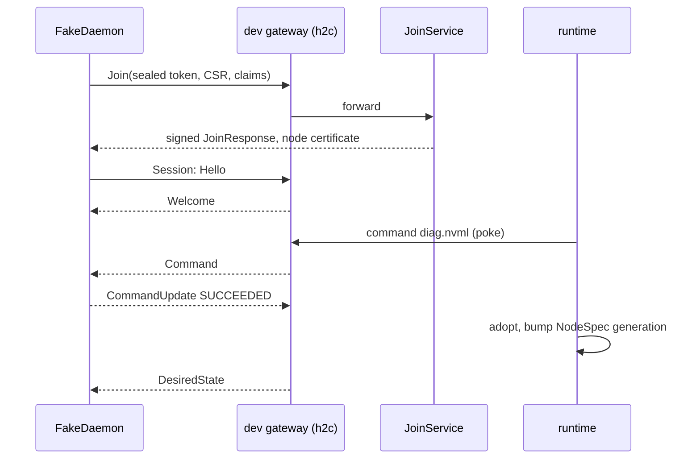

import { ClipboardCheck, Database, Scale, Terminal } from '@/lib/icons';

`better-compute dev` runs the API and every worker role in one process on `127.0.0.1`, with no setup: an embedded
PostgreSQL (PGlite), a generated deployment secret and migrations on start. `--sim N` adds a gateway and N
simulated GPU machines that join the way the real daemon does, so reservations, commands, liveness and tunnels
all run end to end on your laptop. `better-compute sim` is the other tool: a seeded, deterministic fleet
simulation that checks the fleet invariants and prints a digest you can reproduce.

<Callout type="warn" title="Simulated machines, real control plane">
The simulated machines are `FakeDaemon`s from `@better-compute/testing`: the daemon side of the protocol in
TypeScript. Everything above the daemon is the real code: JoinService, the gateway, the runtime, the reconcilers,
capacity and Better IAM. The dev gateway authenticates sessions by a header over cleartext HTTP/2 and listens on
loopback only; never expose it. The Go daemon `bcd` is built and tested but not released, and `better-compute dev`
has no flag to join it; the dev stack in code can (see [a real bcd](#a-real-bcd)).
</Callout>

## Start a server

```bash
better-compute dev                 # PGlite in .better-compute/dev-db, kept between runs
better-compute dev --memory        # a throwaway in-memory database
better-compute dev --memory --sim 8
```

`dev` always migrates first, then serves the API under `/api/compute` and runs the worker roles `controllers`,
`scheduler`, `sinks` and `iam`. It stops on SIGINT or SIGTERM, releasing its leases.

| Flag | Default | Meaning |
| --- | --- | --- |
| `--host HOST` | `127.0.0.1` | The address to listen on |
| `--port PORT` | `3000` (env `PORT`) | The port; `0` picks a free one |
| `--data DIR` | `.better-compute/dev-db` | Where PGlite keeps the database, when there is no configuration |
| `--memory` | off | A throwaway in-memory database (`pglite:memory`) |
| `--config PATH` | discovered (env `BETTER_COMPUTE_CONFIG`) | The configuration file |
| `--sim N` | `0` | Join N simulated machines, 0 to 1000; needs `@better-compute/testing` |
| `--sim-variant VARIANT` | `hgx-h100` | Hardware of the simulated machines, see [below](#simulated-machines) |

**Without a configuration** (and without `BETTER_COMPUTE_DATABASE_URL`), `dev` builds its own deployment: PGlite in
`--data`, and a generated secret in `.better-compute/dev-secret` (owner-only), so repeated runs keep their data.
`BETTER_COMPUTE_BASE_URL` defaults to `http://<host>:<port>`.

**With a configuration file**, `dev` uses that deployment. `--memory` then sets `BETTER_COMPUTE_DATABASE_URL` to
`pglite:memory` for the run, which the examples and the configuration template read. The `host` export's HTTP
routes and metrics are mounted; its gateway role stays off in `dev`.

Either way the CLI adds `retentionModule()` from `@better-compute/postgres` unless the configuration registers a
`retention` module itself. See [retention](/docs/operations/retention).

**IAM.** A deployment without Better IAM configured answers only public methods. `better-compute dev --sim N`
replaces the missing IAM with an embedded one; plain `dev` does not. See [Better IAM](/docs/guides/iam).

### PGlite

PGlite is PostgreSQL 18 compiled to WebAssembly, with `btree_gist`. It is one connection, so the executor
serializes transactions behind a mutex. PGlite has no autovacuum, so the executor runs `ANALYZE` after `migrate()`
and then every `analyzeEveryMs` (default 60,000) to keep query plans close to Postgres's. It is the database of
`dev`, the tests and the simulators, not of production; see [database](/docs/operations/database).

## Simulated machines

`--sim N` joins N machines to the dev server's own control plane. Nothing is mocked above the daemon:

<Steps>
<Step>

### Local keys and IAM

`dev` creates throwaway JoinService keys and a node CA (`createDevJoinKeys()`, the dev equivalent of
`better-compute pki init`), overriding any configured `pki.join`. Without configured IAM it starts an embedded,
in-memory Better IAM (`createEmbeddedTestIam()` from `@better-compute/iam/testing`, on better-iam's SQLite adapter)
with compute's plugin and resolver, and prints its root administrator's token. With configured IAM,
`BETTER_COMPUTE_TOKEN` must hold a root administrator's token (`MISSING_ENV` otherwise).

</Step>
<Step>

### A loopback gateway

A real gateway starts on cleartext HTTP/2 at `127.0.0.1` on a free port, wired to the control plane's gateway
services, work queue, outbox and report handlers. Sessions authenticate by the `x-bc-test-node` header, and only
for node ids that joined through this fleet and whose certificate is not revoked. Pokes after each commit reach the
gateway in process (`devFleetNotifier()`).

</Step>
<Step>

### A site, a pool and a join token

As the root administrator, `dev` creates a shared site in region `dev-1` and a `metal-host` pool with `diag.nvml`
acceptance (and an expected GPU count for the H100 and L40S variants), then mints one join token with `maxUses: N`.

</Step>
<Step>

### Join, session, acceptance, adoption

Each machine seals the token to JoinService's key and binds it to its CSR, calls the `Join` RPC through the gateway,
verifies the signed JoinResponse against the pinned keys, then opens its `Session` stream. The runtime runs
`diag.nvml`, adopts the node and pushes its NodeSpec. `dev` reports adoption once every node has applied a NodeSpec
of generation 1 or later.

</Step>
</Steps>



| `--sim-variant` | Machines | Pool |
| --- | --- | --- |
| `hgx-h100` | 8x H100 SXM5 80GB | GPU model `H100`, expects 8 GPUs |
| `hgx-h100-gpu-missing` | the same board with a GPU missing | expects 8 GPUs, so acceptance fails and they are never adopted |
| `l40s` | 4x L40S | GPU model `L40S`, expects 4 GPUs |
| `cpu` | no GPUs | no GPU model, no GPU count check |

Standard error shows the progress (from `examples/dev`):

```text
better-compute listening on http://127.0.0.1:3000/api/compute
Dev gateway (h2c, header auth, loopback only): http://127.0.0.1:52011
Embedded IAM root tenant ten_…; root token (dev only): biam_ses_…
Joined 8 simulated hgx-h100 node(s) into pool_…
8 simulated node(s) adopted
```

The embedded IAM lives in memory for this run only, and its root token is a development credential.

### Look around

In a second terminal, as the root administrator (see the [CLI](/docs/guides/clients/cli)):

```bash
export BETTER_COMPUTE_URL=http://127.0.0.1:3000
export BETTER_COMPUTE_TOKEN=biam_ses_…   # the root token dev printed
export BETTER_COMPUTE_TENANT=ten_…       # the root tenant dev printed
better-compute nodes list
export POOL=pool_…                        # the pool dev created (pools list)
better-compute pools offer $POOL --to $BETTER_COMPUTE_TENANT --quota gpu=64
better-compute reserve --pool $POOL --gpus 4 --for 1h
source <(better-compute completion bash) # optional: tab completion for every command
```

The reservation binds through the node's desired state and turns `active` once the simulated daemon reports
`AllocationBound`; its CDI device names are in the reservation's `binding`. With a configuration that mounts the
events module's `GET /watch` (the examples do), `better-compute events watch --types "node.*,reservation.*"` prints
the tenant's events one JSON line each (`curl -N` on the same route shows the raw stream); cordon a node in another
terminal (`better-compute nodes cordon node_… --reason demo`) to see `node.cordoned` arrive. This is the walkthrough
of `examples/dev/README.md` (786cc80).

### Tunnels

With `--sim`, `dev` issues exec tickets (the configured `tunnels.issuer`, or a throwaway one) and mounts
`GET /api/compute/tunnels/{ticket}`. The gateway verifies tickets and serves its control API on loopback, and every
simulated machine answers `OpenTunnel` with an echo shell, so [tunnels](/docs/guides/access/tunnels) work end to end:
`better-compute console --node node_…` opens a session on a simulated machine, where `size` prints your terminal
size, `exit` ends it with status 0, `false` with 1, and Ctrl-] detaches (`tests/cli-console.test.ts`).
Unless the deployment's `tunnels` options bring their own, it also adds a throwaway break-glass SSH CA (`tunnels.ssh`,
for `nodes.issueSshCert` and `better-compute ssh-cert`) and a separate throwaway sandbox SSH CA (`tunnels.sandboxSsh`),
so both can be tried against the simulated fleet. It adds these throwaway CAs only on a PGlite store: against a real
database every node's spec would start trusting a CA that dies with the process, so there `dev --sim` uses only the
CAs the deployment configures.
With the embedded IAM, an open tunnel is not re-authorized every 60 seconds: the embedded test IAM has no session
reviewer. `tunnels.open` still decides every ticket.

## The dev stack in code

The same pieces are exported from `@better-compute/testing` for your own hosts and tests.

| Export | What it does |
| --- | --- |
| `createDevJoinKeys({ trustDomain? })` | A node CA and JoinService keys (`pki`, for `betterCompute({ pki })`), the `pins` a daemon checks and what the agent half needs. Default trust domain `compute.dev.local`. |
| `devFleetNotifier()` | A `Notifier` for `betterCompute({ notifier })` that turns `gw:<id>` publishes into `gateway.poke(nodeIds)` in process. |
| `attachDevFleet(options)` | Adds a loopback h2c gateway and simulated machines to a running control plane. Demands `insecureHeaderAuth: true`. |
| `createDevStack(options?)` | All of it on PGlite in one call: control plane, workers, gateway, tunnels, `retentionModule()`. |
| `DEV_ROOT_TOKEN` | `bc_dev_root`: the token `createDevStack()`'s default fake IAM accepts as a root administrator (it allows everything). |

```ts title="dev-stack.test.ts"
import { afterEach, expect, it } from 'vitest';
import { createDevStack, type DevStack } from 'better-compute/testing';

let dev: DevStack | undefined;
afterEach(() => dev?.close());

it('adopts three simulated machines', async () => {
  dev = await createDevStack();
  const { poolId } = await dev.createPool({ expectGpuCount: 8 });
  const nodes = await dev.join({ poolId, count: 3 }); // sealed-token Join, then a Session each
  await dev.waitFor(nodes); // adopted, NodeSpec generation 1 or later applied
  expect(dev.daemons.size).toBe(3);
});
```

A `DevFleet` has `createPool({ gpuModel?, key?, expectGpuCount? })`, `join({ poolId, count?, variant?, seed? })`
(1 to 10,000 machines on one token), `joinSite({ siteId, count?, kinds?, seed? })` for site agents (1 to 16, through
`siteTokens.create`), `waitFor(nodeIds, { provisionState?, timeoutMs? })` (default `adopted`, 30 s), the running
`daemons`, the `gatewayUrl`, and `close()`. `createDevStack()` takes `database`, `iam`, `modules`, `baseURL`,
`secret`, `trustDomain`, `worker` (default `pollMs` 100), `region`, `gateway` and `daemon` options, and
`signedIntent: true` (5071dbc), which gives the stack a fresh command-signing root (`pki.commandSigning`), so every
command and spec is signed and joining daemons receive the roots in `JoinResponse.trust`.

### A real bcd

Two options let a daemon outside the process, such as a real `bcd`, join the dev stack:

| Option | What it adds |
| --- | --- |
| `externalTls: { host?, port?, dnsNames?, servingCa? }` | A second gateway listener authenticated as in production: HTTP/2 over mTLS, a serving certificate from a dev serving CA (`servingCaCertificate`, what the daemon pins; names `localhost` and `gw.dev.local` by default), client certificates checked against the dev node CA. Its URL is `externalGatewayUrl`. Its port (a free one unless given) and serving CA are chosen before the control plane starts and published in `/.well-known/better-compute` as `gateway` (`https://<host or 127.0.0.1>:<port>`, `serverName` the first DNS name, and the CA's pin). Safe to bind beyond loopback |
| `admitExternalJoins: true` | On the loopback h2c listener, also accepts the `x-bc-test-node` header of nodes that joined on their own, once their current certificate is in `node_certs` (polled every 250 ms, or `admit(nodeId)` at once). bcd reaches it only as a fakehw build with `dev_insecure_h2c = true` |

For `externalTls`, write a `config.toml` with `gateway_url` set to the listener, `serving_ca_spki_pin` from
`servingCaCertificate`, the join pins from `pins`, and `gateway_server_name = "gw.dev.local"` when you dial an IP
address; put `pins.joinEncryptionJwk` next to it as `join-encryption.jwk`. Then pipe a join token into `bcd join`
and start `bcd node`. `tests/e2e/bcd.test.ts` does exactly this from WSL; see
[testing](/docs/operations/testing#the-go-daemon). Since the stack publishes its gateway, a machine without any
`config.toml` can also join with `bcd join --server <the stack's base URL>`, which takes the gateway from the
well-known document: a host build also needs `--serving-ca-pin`, `--join-signing-pin` and `--join-encryption-pin`
(from `servingCaCertificate` and `pins`), while a fakehw build may join with `--server` alone, taking the pins from
the document on trust (and accepts an `http://` server); see
[joining from the well-known document](/docs/daemon/install#joining-from-the-well-known-document).

For many real daemons at once, a fakehw build runs `bcd sim --config <that config.toml> --nodes N` with one join token
allowing N uses on standard input: N node agents in one process, each a distinct fakehw machine with its own
identity under `data_dir/sim/<i>` (see [bcd sim](/docs/daemon#bcd-sim)).

Two fakehw behaviours help when you test placement against a real bcd:

- **Reserved huge pages show in the inventory** (cd7a311). The host units write under the fake root
  (`<data_dir>/fakehw-root`), and the fakehw inventory reads `nr_hugepages` back from there: the machine-wide pools,
  and each NUMA node's own file or an even share of the machine-wide pool (node 0 takes the remainder). A pool with
  `policy.hugepages` therefore books `hugepages2Mi` and `hugepages1Gi` on a fakehw node as it would on a real host.
- **The libvirt plan is written out** (9a6aaf4). The fakehw runtime still runs every domain itself, but also writes
  the libvirt domain XML bcd would define on a real host to `<data_dir>/fakehw-plans/<id>.xml` (`vcpupin`,
  `numatune`, huge-page backing, the memory balloon, volumes by serial, GPU hostdevs), or `<id>.error` when libvirt
  would refuse the spec, and removes it on destroy. Its balloons live on disk (`<runtime>.balloons`), so they survive
  a restart. `tests/e2e/bcd-placement.test.ts` reads both (see [testing](/docs/operations/testing#the-go-daemon)).

## The example

`examples/dev` is the whole deployment every example shares (`examples/shared/compose.ts`: provision and metal,
vps, events, fleet, retention, and rollout and audit when their keys are present) with eight simulated machines:

```bash
cd examples/dev
better-compute dev --memory --sim 8     # the package's "dev" script
better-compute dev --sim 8              # "dev:persistent": data in .better-compute/example-db
```

## The console locally

`apps/console` is the Next.js console (Better IAM and Better Compute on one origin). `node server.mjs --dev` (its
`dev` script) runs Next.js plus the WebSocket upgrade for tunnels on `http://localhost:3100`. `--dev` is the only mode
in which the console generates its own secrets under `.console-data`: the session secret, the exec ticket and SSH CA
keys, and on first start the root administrator's password, printed once. Its compute store defaults to PGlite in
`.console-data/compute` and its IAM store to a libSQL file. The console does not start simulated machines. See
[the console](/docs/guides/clients/console).

## The fleet simulator

`better-compute sim` runs `--nodes` FakeDaemons on fake hardware against the in-memory gateway stub, entirely in
simulated time. A steady workload runs for `--duration` (every 2 simulated seconds: three commands drawn from
`diag.nvml`, `inventory.refresh`, `logs.collect` and `node.reboot`, a GPU booking and sometimes a release), with the
faults of `--chaos`. The simulator then quiesces for `--settle`, flushes usage and checks the invariants. Nothing reads
the wall clock, so the same seed prints the same digest.

```bash
better-compute sim
better-compute sim --seed nightly-42 --nodes 500 --duration 1h --chaos heavy --log sim.log
```

| Flag | Default | Meaning |
| --- | --- | --- |
| `--seed SEED` | `sim` | Everything random derives from it |
| `--nodes N` | `50` | Simulated nodes, 1 to 5000 |
| `--duration DURATION` | `10m` | Simulated time under workload (`30s`, `10m`, `2h`) |
| `--settle DURATION` | `16m` | Quiet time afterwards, so the sweeper and replays settle |
| `--chaos LEVEL` | `light` | `none`, `light` or `heavy` |
| `--log PATH` | none | Write the event log to a new file (fails if it exists) |

| Chaos | Links (both directions) | Faults, drawn every |
| --- | --- | --- |
| `none` | perfect | none |
| `light` | 5 ms latency, 20 ms jitter, 0.0001 drop (reset), 0.002 duplicate, 0.0005 reorder down | 15 s: crash 0.1, reboot 0.05, partition 0.1, reset 0.1, stall 0.05 |
| `heavy` | 5 ms latency, 20 ms jitter, 0.0005 drop (reset), 0.01 duplicate, 0.002 reorder down | 5 s: crash 0.3, reboot 0.1, journal loss 0.05, partition 0.3, isolate 0.1, half-open 0.1, reset 0.2, stall 0.2, gateway kill 0.02 |

It checks I1 (no overlapping bookings or node-held devices), I2 (at most one execution per command; after a journal
loss, in-flight commands that are not retry-safe fail instead of replaying), I3 (a delivered spec is reported
observed within 60 s while the node stays reachable), I4 (no node marked unreachable within 20 s of a gateway hearing
from it), I5 (no release caused by connectivity) and I8 (usage windows add up to booked time times atoms, with no
duplicate keys). The command's own help text still lists only I1, I2, I5 and I8; the checks come from the simulator's
`invariants()`. See [testing](/docs/operations/testing#invariants).

The report is JSON: `seed`, `nodes`, `chaos`, `simulatedMs`, `wallMs`, `digest` (SHA-256 of the event log),
`commands` (`total`, `open`), `faults` (`crashes`, `reboots`, `journalLosses`, `gatewayKills`), `violations` and the
first 20 violations. On a violation the command prints the report and exits with `SIM_INVARIANT_VIOLATED`; re-run
with the same `--seed` to reproduce it, and add `--log` to get the event log. `sim` needs `@better-compute/testing`.

<Callout title="The stub is not the server">
`better-compute sim` exercises the daemon side and the protocol against `GatewayStub`, a minimal in-memory control
plane. The runs against the real control plane and real gateways are `createControlPlaneSim` and the nightly
matrix; see [testing](/docs/operations/testing#the-control-plane-simulator). `bcd sim` is unrelated despite the
name: it runs real Go daemons in real time against a real gateway, with no chaos or invariant checks (see
[bcd sim](/docs/daemon#bcd-sim)).
</Callout>

## Working on the repository

The repository is a pnpm workspace; `docs/development.md` is the full guide.

- **Node.js 22.12 or later**, ESM only. CI runs Node 22 and 24 on Ubuntu and Windows.
- **pnpm 11.19.0**, pinned in `packageManager`. When your global pnpm is another major, run the pinned copy:
  `node node_modules/pnpm/bin/pnpm.mjs <args>`.
- **No database server.** PGlite backs the tests. Suites that need real Postgres skip unless
  `BETTER_COMPUTE_POSTGRES_URL` is set.
- **Go 1.26 or later** only for `daemon/`: `node scripts/daemon-test.mjs` runs `go test -tags nonvml,fakehw`
  without cgo or GPUs, natively on Linux and through WSL on Windows. The bcd end-to-end suite is opt-in on Windows
  (`BCD_E2E=1`); see [testing](/docs/operations/testing#the-go-daemon).

| `pnpm …` | What it does |
| --- | --- |
| `check` | `typecheck`, `test`, `test:iam-remote`, `lint:repo` and `validate:packages`: what CI runs first |
| `test` | `vitest run` over `tests/`, against the packages' sources (no build needed) |
| `test:iam-remote` | the IAM-dependent suites again with IAM over HTTP (`vitest.iam-remote.config.ts`) |
| `typecheck` | `tsc -b`, plus the client type tests |
| `lint:repo` | the dependency rules, the one-clock rule (`compute_now()` only), the umbrella drift check, `proto-gen --check` and `--breaking`, and the v1.0 API surface freeze (`scripts/api-surface.mjs`) |
| `api:surface` | records compatible API additions in `generated/api-surface.json`; see [the API surface freeze](/docs/operations/testing#the-api-surface-freeze) |
| `test:postgres` | the Postgres-only suites (needs `BETTER_COMPUTE_POSTGRES_URL`) |
| `bench:scale` | the scale benchmarks in `tests/bench/` (`vitest.bench.config.ts`) |
| `sim:nightly` | the nightly simulation matrix in `tests/nightly/` |
| `build` | `tsc -b`: every package's `dist/` |

Tests live in the root `tests/` folder as `tests/<area>-<topic>.test.ts`; `vitest.config.ts` maps every
`@better-compute/*` specifier and `better-compute/*` subpath to `packages/*/src`. See [testing](/docs/operations/testing).

<Cards>
  <Card title="Testing" href="/docs/operations/testing" icon={<ClipboardCheck />}>Fixtures, the FakeDaemon, the simulators and the benchmarks.</Card>
  <Card title="Database" href="/docs/operations/database" icon={<Database />}>PostgreSQL, PGlite and migrations.</Card>
  <Card title="Scaling" href="/docs/operations/scaling" icon={<Scale />}>What the benchmarks measured so far.</Card>
  <Card title="CLI reference" href="/docs/reference/cli" icon={<Terminal />}>Every command and flag.</Card>
</Cards>
