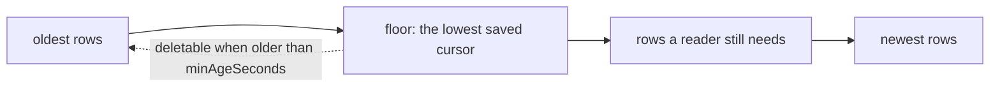

import { Activity, Database, Scale } from '@/lib/icons';

Most of Better Compute's tables hold current state and stay the size of your fleet. A few are logs that grow with
every change: the transactional <Term id="outbox">outbox</Term>, the authz change feed, the IAM inbox, replay guards
for attestations, commands, audit rows and usage windows. This page says which of them are pruned, by what, with
which defaults, and which are kept on purpose.

| Table | Grows with | Pruned by | Default |
| --- | --- | --- | --- |
| `outbox` | every event | `retentionModule()` | behind every sink cursor, and older than 1 h |
| `authz_changes` | every change to the authz projection | `retentionModule()` | behind every cursor of the stream; none by default |
| `attestation_uses` | single-use attestations | `retentionModule()` | once `expires_at` passed; rows without expiry are kept |
| `join_requests` | deferred joins | `retentionModule()` | marked `expired`, not deleted |
| `iam_inbox` | IAM audit events | the IAM inbox job | processed rows older than 7 days |
| `work_queue` | dirty keys | the runtime | a key is deleted when its run succeeds |
| `workers` | worker processes | the runtime | rows of workers long gone |
| `commands` | every command | nothing | kept |
| `audit_events` | every allowed mutation, command and security event | nothing | kept; sealed by checkpoints |
| `usage_windows` | hourly per allocation and meter | nothing | kept |
| `webhook_deliveries` | webhook deliveries | nothing | kept |

## The retention module

`retentionModule(options?)` from `@better-compute/postgres` is the store's housekeeping, one singleton
<Term id="reconciler">reconciler</Term> named `core.retention` with a periodic key. It runs under the `controllers`
worker role, in short transactions and bounded batches, so a pass never holds long locks.

The server cannot import the store adapter, so it cannot register the module itself. The CLI does it for you:
deployments built by `serve`, `dev` and `migrate` get `retentionModule()` unless the configuration registers a module
named `retention` already. `createDevStack()` registers it too. If you build `betterCompute()` yourself, add it:

```ts
import { retentionModule } from 'better-compute/postgres';

betterCompute({ database, modules: [retentionModule({ every: '10m' }), ...modules] });
```

| Option | Default | Meaning |
| --- | --- | --- |
| `every` | `5m` | How often a pass runs |
| `minAgeSeconds` | 3600 | Outbox and `authz_changes` rows stay at least this long after every cursor passed them |
| `batch` | 5,000 | Rows per statement; a job repeats its statement until it deletes fewer |
| `maxRounds` | 20 | Most statements per job in one pass, so a large backlog drains over several passes |

A pass runs four jobs in order and returns how many rows each touched:

1. **`outbox`**: `pruneBehindCursors(tx, 'outbox')`.
2. **`authz_changes`**: `pruneBehindCursors(tx, 'authz_changes')`.
3. **`attestation_uses`**: `pruneAttestationUses(tx)` deletes rows whose `expires_at` has passed.
4. **`join_requests`**: `expireJoinRequests(tx)` marks `pending` and `approved` requests past their expiry as
   `expired`, which frees the one-pending-request-per-machine index for a new request.

When a pass touched anything it logs `retention pass` at info level with the four counts. To schedule passes
yourself, call `runRetention(sql, options)`; it returns `{ outbox, authzChanges, attestationUses,
joinRequestsExpired }`.

## Cursors decide what goes

The outbox and the authz change feed are read by cursor: a `(txid, seq)` position that only moves forward. Readers
that must not miss a row save their position in `outbox_cursors` (`core/0009_runtime`), one row per reader and
stream. Retention deletes only rows that **every** saved cursor of that stream has passed, and only when they are
older than `minAgeSeconds`, measured with <Term id="compute-now">`compute_now()`</Term>.



- **A stream with no saved cursor is never pruned.** A reader that has not saved a position yet could need
  everything.
- **Outbox cursors come from event sinks.** Each sink in the `sinks` worker role saves its cursor as `sink:<id>` after
  every delivered batch, and a save never moves a cursor back. SSE watchers, `events.list` callers and the webhook
  fan-out cursor do not hold retention back; a client that resumes from a pruned position continues with the oldest
  row still there. A deployment without sinks saves no outbox cursor, so it keeps its whole outbox. See
  [events](/docs/guides/events).
- **No built-in reader saves an `authz_changes` cursor.** The IAM bridge's projection tails the feed with a cursor it
  keeps in memory and reloads the projection on start. So by default the authz change feed is not pruned. If you add
  a durable reader, save its position with `saveCursor(tx, { name, stream: 'authz_changes', txid, seq })`, and retention
  starts pruning behind it.
- **A stopped reader holds everything back.** A cursor row that no longer moves keeps every row after it. When you
  retire a sink or reader, delete its `outbox_cursors` row.

`saveCursor` and `loadCursor` are exported from `@better-compute/postgres`; `txid` is passed as text, as readers
alias it (`txid_text`). See [database](/docs/operations/database) for the runtime tables.

## Attestation replay guards

`attestation_uses` (`core/0011_v02_security`) records evidence an <Term id="attestor">attestor</Term> admits only
once, such as a cloud instance identity document or a site agent's discovery assertion, keyed by the attestor and the
SHA-256 of the evidence. Attestors insert the row in the join transaction of the final round, so a deferral does not
burn it, and a second join with the same subject is refused. Evidence that can no longer be presented needs no
guard, so the pass deletes rows once their `expires_at` passes. A row with no `expires_at` stays forever: that is how
an attestor says "never again". See [attestation](/docs/guides/nodes/attestation).

## What else cleans up after itself

- **IAM inbox.** The IAM inbox job (`drainIamInbox`, worker role `iam`) marks rows processed and deletes processed
  rows older than `retainMs`, default 7 days (0 keeps them).
- **Work queue.** A successful run deletes its `work_queue` key only when the key's generation is still the one it
  claimed, so a key dirtied again mid-run survives and no wake-up is lost.
- **Workers.** Each worker heartbeats its `workers` row; rows of workers gone long after their shards moved are
  deleted, and a stopping worker deletes its own.
- **The daemon's journal.** On the node, done command results are kept 7 days, and the journal is capped at 64 MiB
  and 10,000 unacked events. See [delivery](/docs/daemon/delivery).

## What is kept on purpose

<Callout type="warn" title="No archival yet">
Nothing prunes `commands`, `audit_events`, `usage_windows` or `webhook_deliveries` today. PLAN.md plans partitioned
history for v0.4 ("history → partitions" is on its list of what breaks first at scale); it is not built. Size the
database for these tables growing with activity, and watch them.
</Callout>

**Commands.** The CommandSweeper expires commands that were never delivered before their `not_after`, and results
settle rows into a terminal state, but rows are never deleted. They are the record of what ran where. The
idempotency key of a command is unique per node, so a retry with the same key finds the old row.

**Audit rows and Merkle checkpoints.** `audit_events` records every allowed mutation with its admission context, plus
commands, steps, tickets and security events. With `auditModule()` from `@better-compute/audit`, an hourly
`audit.checkpoint` pass seals new rows into signed per-tenant Merkle checkpoints, following the `(txid, seq)` commit
order. `verifyAuditCheckpoints` recomputes every root and size **against the rows as they are now**, so a deleted
row is reported as tampering, exactly like an edited or inserted one. Retention and tamper evidence therefore pull
in opposite directions, and today the code chooses evidence: no audit row is ever deleted. The module's `doctor` check
`audit.checkpoints` warns when rows older than 3 hours are still unsealed. See [audit](/docs/guides/events/audit).

**Usage windows.** The `capacity.usage` reconciler writes hourly `usage_windows` rows (key
`cmp:<allocationId>:<windowStartMs>`) every 5 minutes, and the IAM usage sink records them in Better IAM's billing,
setting `recorded_at` and `outcome` (`recorded`, `duplicate`, `reattributed` or `dead-lettered`). The rows stay: they
are the proof that usage adds up to booked time times atoms (invariant I8) and what a billing dispute is settled
from. See [billing and usage](/docs/guides/iam/billing-and-usage).

**Webhook deliveries.** Delivered and dead deliveries stay in `webhook_deliveries` so `webhooks.deliveries` can list
them and dead ones can be redelivered; `doctor` warns about dead letters. See [webhooks](/docs/guides/events/webhooks).

<Cards>
  <Card title="Database" href="/docs/operations/database" icon={<Database />}>The runtime tables, migrations and pooling.</Card>
  <Card title="Observability" href="/docs/operations/observability" icon={<Activity />}>Findings and series that show a growing backlog.</Card>
  <Card title="Scaling" href="/docs/operations/scaling" icon={<Scale />}>What grows first at 10k nodes.</Card>
</Cards>
