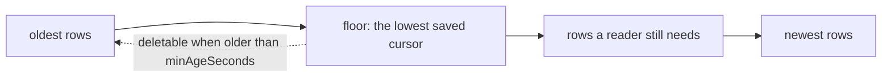

import { Activity, Database, Scale } from '@/lib/icons';

Most of Better Compute's tables hold current state and stay the size of your fleet. A few are logs that grow with
every change: the transactional <Term id="outbox">outbox</Term>, the authz change feed, the IAM inbox, replay guards
for attestations, commands, inventory snapshots, audit rows, usage windows and webhook deliveries. This page says
which of them are pruned, by what, with which defaults, and which are kept on purpose.

| Table | Grows with | Pruned by | Default |
| --- | --- | --- | --- |
| `outbox` | every event | `retentionModule()` | behind every sink cursor, and older than 1 h |
| `authz_changes` | every change to the authz projection | `retentionModule()` | behind every cursor of the stream; with no cursor saved, rows older than 1 day |
| `commands` | every command | `retentionModule()` | settled commands last updated more than 30 days ago |
| `attestation_uses` | single-use attestations | `retentionModule()` | once `expires_at` passed; rows without expiry are kept |
| `join_requests` | deferred joins | `retentionModule()` | marked `expired`, not deleted |
| `inventory_snapshots` | every inventory report | `retentionModule()` | superseded snapshots older than 180 days; empty past months dropped |
| `usage_windows` | hourly per allocation and meter | `retentionModule()`, opt-in | kept unless `history.usageOlderThanDays` is set |
| `webhook_deliveries` | webhook deliveries | `events.prune` | delivered and cancelled after 30 days, dead after 90 |
| `iam_inbox` | IAM audit events | the IAM inbox job | processed rows older than 7 days |
| `work_queue` | dirty keys | the runtime | a key is deleted when its run succeeds |
| `workers` | worker processes | the runtime | rows of workers long gone |
| `audit_events` | every allowed mutation, join and secret release | nothing | kept; sealed by checkpoints; archived by hand |
| `outbox_dead_letters` | poison events of event sinks | nothing | kept |

## The retention module

`retentionModule(options?)` from `@better-compute/postgres` is the store's housekeeping, one singleton
<Term id="reconciler">reconciler</Term> named `core.retention` with a periodic key. It runs under the `controllers`
worker role, in short transactions and bounded batches, so a pass never holds long locks.

The server cannot import the store adapter, so it cannot register the module itself. The CLI does it for you:
deployments built by `serve`, `dev` and `migrate` get `retentionModule()` unless the configuration registers a module
named `retention` already. `createDevStack()` registers it too. If you build `betterCompute()` yourself, add it:

```ts
import { retentionModule } from 'better-compute/postgres';

betterCompute({ database, modules: [retentionModule({ every: '10m' }), ...modules] });
```

| Option | Default | Meaning |
| --- | --- | --- |
| `every` | `5m` | How often a pass runs |
| `minAgeSeconds` | 3600 | Outbox and `authz_changes` rows stay at least this long after every cursor passed them |
| `batch` | 5,000 | Rows per statement; a job repeats its statement until it deletes fewer |
| `maxRounds` | 20 | Most statements per job in one pass, so a large backlog drains over several passes |
| `authzChangesMaxAgeSeconds` | 86,400 | While no reader saved an `authz_changes` cursor, rows older than this go (at least 3,600); `false` keeps them |
| `commandsOlderThanDays` | 30 | Settled commands last updated this long ago go (at least 1); `false` keeps them |
| `history.monthsAhead` | 2 | Month partitions kept created ahead of the current month |
| `history.inventoryOlderThanDays` | 180 | Superseded inventory snapshots older than this go; `false` keeps them all |
| `history.usageOlderThanDays` | unset | Recorded usage windows of allocations that ended this long ago go (at least 7); unset keeps them |

A pass runs these jobs in order and returns how many rows each touched:

1. **History partitions**: `ensureHistoryPartitions(tx, { monthsAhead })` creates the month partitions from the
   current month through `monthsAhead` ahead.
2. **`outbox`**: `pruneBehindCursors(tx, 'outbox')`.
3. **`authz_changes`**: `pruneBehindCursors(tx, 'authz_changes')`, then `pruneUncursoredAuthzChanges(tx)`, which acts
   only while the stream has no saved cursor.
4. **`commands`**: `pruneSettledCommands(tx)` deletes commands in a settled state (`succeeded`, `failed`,
   `rejected`, `expired`, `cancelled`) last updated more than `commandsOlderThanDays` ago, through the
   `commands_settled` index (`core/0020_command_created_at`). Open commands are never pruned.
5. **`attestation_uses`**: `pruneAttestationUses(tx)` deletes rows whose `expires_at` has passed.
6. **`join_requests`**: `expireJoinRequests(tx)` marks `pending` and `approved` requests past their expiry as
   `expired`, which frees the one-pending-request-per-machine index for a new request.
7. **`inventory_snapshots`**: `pruneInventorySnapshots(tx)`, unless `inventoryOlderThanDays` is `false`.
8. **`usage_windows`**: `pruneUsageWindows(tx)`, only when `usageOlderThanDays` is set.
9. **Dropping emptied months**: `dropEmptyHistoryPartitions` for `inventory_snapshots` and `usage_windows`, each in
   its own short transaction.

When a pass touched anything it logs `retention pass` at info level with the counts. To schedule passes yourself,
call `runRetention(sql, options)`; it returns `{ outbox, authzChanges, commands, attestationUses,
joinRequestsExpired, partitionsCreated, inventorySnapshots, usageWindows, partitionsDropped }`.

<Callout type="warn" title="Pruned commands free their idempotency keys">
A command's idempotency key is unique per node, so a retry with the same key finds the old row. Once a settled
command is pruned, its key is free again. Keep `commandsOlderThanDays` longer than any caller retries a key.
</Callout>

## Cursors decide what goes

The outbox and the authz change feed are read by cursor: a `(txid, seq)` position that only moves forward. Readers
that must not miss a row save their position in `outbox_cursors` (`core/0009_runtime`), one row per reader and
stream. Retention deletes only rows that **every** saved cursor of that stream has passed, and only when they are
older than `minAgeSeconds`, measured with <Term id="compute-now">`compute_now()`</Term>.



- **An outbox with no saved cursor is never pruned.** A reader that has not saved a position yet could need
  everything.
- **Outbox cursors come from event sinks.** Each sink in the `sinks` worker role saves its cursor as `sink:<id>` after
  every delivered batch, and a save never moves a cursor back. SSE watchers, `events.list` callers and the webhook
  fan-out cursor do not hold retention back; a client that resumes from a pruned position continues with the oldest
  row still there. A deployment without sinks saves no outbox cursor, so it keeps its whole outbox. See
  [events](/docs/guides/events).
- **No built-in reader saves an `authz_changes` cursor.** The IAM bridge's projection tails the feed with a cursor it
  keeps in memory and reloads the whole projection on start, so only a live tail more than a day behind could miss a
  pruned row. While no cursor is saved, rows older than `authzChangesMaxAgeSeconds` (one day) that committed before
  every open transaction go. If you add a durable reader, save its position with
  `saveCursor(tx, { name, stream: 'authz_changes', txid, seq })`: from then on only the cursor rule prunes the stream.
- **A stopped reader holds everything back.** A cursor row that no longer moves keeps every row after it. When you
  retire a sink or reader, delete its `outbox_cursors` row.

`saveCursor` and `loadCursor` are exported from `@better-compute/postgres`; `txid` is passed as text, as readers
alias it (`txid_text`). See [database](/docs/operations/database) for the runtime tables.

## History partitions

`core/0018_partitioned_history` range-partitions `audit_events`, `inventory_snapshots` and `usage_windows` by UTC
month on `occurred_at`, `collected_at` and `window_start`. Month partitions are named `<table>_pYYYYMM`, and each
table has a `DEFAULT` partition, so an insert never fails for want of a month (a simulated clock, a skewed row).
Primary keys include the partition column: `(id, occurred_at)`, `(id, collected_at)`,
`(idempotency_key, window_start)`.

- **Created ahead.** Each pass creates the current month and the next `monthsAhead`, moving any rows of those months
  out of the default partition first (`compute_history_partition(parent, at)`, serialized by an advisory lock).
  `defaultPartitionRows(tx, table)` counts what the default partition still holds.
- **Pruned by row.** `pruneInventorySnapshots` deletes snapshots older than the window that a newer snapshot of the
  same node superseded; a node's newest snapshot and the one its inventory is applied from always stay.
  `pruneUsageWindows` deletes only windows that were recorded in billing, of allocations that ended more than the
  window ago; unrecorded windows always stay, and the minimum of 7 days leaves metering's 48 h lookback intact.
- **Dropped when empty.** `dropEmptyHistoryPartitions` detaches and drops month partitions of `inventory_snapshots`
  and `usage_windows` that are empty and ended more than the window ago. The default partition and current or future
  months are never dropped. It refuses `audit_events`.
- **Archived by hand.** `detachHistoryPartition(tx, table, name)` detaches one past month, leaving a standalone
  table to export and drop. It refuses the default partition and the current or a future month.
  `historyPartitions(tx, table?)` lists what exists.

## Attestation replay guards

`attestation_uses` (`core/0011_v02_security`) records evidence an <Term id="attestor">attestor</Term> admits only
once, such as a cloud instance identity document or a site agent's discovery assertion, keyed by the attestor and the
SHA-256 of the evidence. Attestors insert the row in the join transaction of the final round, so a deferral does not
burn it, and a second join with the same subject is refused. Evidence that can no longer be presented needs no
guard, so the pass deletes rows once their `expires_at` passes. A row with no `expires_at` stays forever: that is how
an attestor says "never again". See [attestation](/docs/guides/nodes/attestation).

## Webhook deliveries

`eventsModule()` prunes its own delivery history with a third reconciler, `events.prune` (hourly, migration
`events/0002_delivery_retention` adds the index it uses). It deletes delivered and cancelled deliveries 30 days after
they were created and dead letters after 90, in batches of 5,000, running again a second later while a batch
comes back full. Pending deliveries are never deleted, whatever their age.

```ts
eventsModule({ secret, retention: { deliveredDays: 14, deadDays: 60 } }); // or retention: false to keep everything
```

A period under one day is `INVALID_CONFIG` when the module is defined. `pruneWebhookDeliveries(sql, retention?,
limit?)` is exported for hosts that schedule it themselves. See [webhooks](/docs/guides/events/webhooks).

## What else cleans up after itself

- **IAM inbox.** The IAM inbox job (`drainIamInbox`, worker role `iam`) marks rows processed and deletes processed
  rows older than `retainMs`, default 7 days (0 keeps them).
- **Work queue.** A successful run deletes its `work_queue` key only when the key's generation is still the one it
  claimed, so a key dirtied again mid-run survives and no wake-up is lost.
- **Workers.** Each worker heartbeats its `workers` row; rows of workers gone long after their shards moved are
  deleted, and a stopping worker deletes its own.
- **The daemon's journal.** On the node, done command results are kept 7 days, and the journal is capped at 64 MiB
  and 10,000 unacked events. See [delivery](/docs/daemon/delivery).

## What is kept on purpose

**Audit rows and Merkle checkpoints.** `audit_events` records every allowed mutation with its admission context, plus
joins and secret releases. With `auditModule()` from `@better-compute/audit`, an hourly
`audit.checkpoint` pass seals new rows into signed per-tenant Merkle checkpoints, following the `(txid, seq)` commit
order. `verifyAuditCheckpoints` recomputes every root and size **against the rows as they are now**, so a deleted
row is reported as tampering, exactly like an edited or inserted one. Retention and tamper evidence therefore pull
in opposite directions, and the code chooses evidence: no pass ever deletes an audit row. To take an old month out,
mark it with `markAuditArchived(sql, { month })` from `better-compute/audit`, then detach its partition with
`detachHistoryPartition`; `verify` reports that month's checkpoints as archived instead of failed. The module's
`doctor` check `audit.checkpoints` warns when rows older than 3 hours are still unsealed. See
[audit](/docs/guides/events/audit#archiving).

**Usage windows, by default.** The `capacity.usage` reconciler writes hourly `usage_windows` rows (key
`cmp:<allocationId>:<windowStartMs>`) every 5 minutes, and the IAM bridge's `iam.usage` job records them in Better
IAM's billing, setting `recorded_at` and `outcome` (`recorded`, `duplicate`, `reattributed` or `dead-lettered`). The
rows are the proof that usage adds up to booked time times atoms (invariant I8) and what a billing dispute is settled
from, so they stay unless you set `history.usageOlderThanDays`. See [billing and usage](/docs/guides/iam/billing-and-usage).

**Event sink dead letters.** `outbox_dead_letters` (`core/0019_outbox_dead_letters`) holds the events an event sink
refused on every attempt. Nothing prunes or redelivers them; delete rows once you have handled them. See
[sinks](/docs/extending/sinks#poison-events).

<Cards>
  <Card title="Database" href="/docs/operations/database" icon={<Database />}>The runtime tables, migrations and pooling.</Card>
  <Card title="Observability" href="/docs/operations/observability" icon={<Activity />}>Findings and series that show a growing backlog.</Card>
  <Card title="Scaling" href="/docs/operations/scaling" icon={<Scale />}>What grows first at 10k nodes.</Card>
</Cards>
