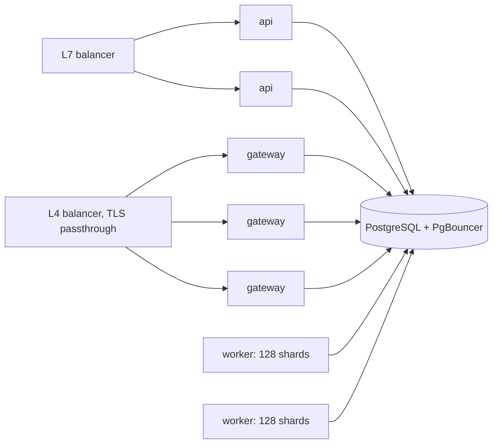

import { Activity, ClipboardCheck, Database, Route } from '@/lib/icons';

Better Compute is designed for 10,000 nodes and 100,000 GPUs per region on one PostgreSQL. PLAN.md section 16 turns
that into gates each phase must pass, measured with `pnpm bench:scale` on fixed reference hardware. This page lists
the gates, the numbers measured so far, how each process tier scales out, and which limits you meet first.

<Callout type="warn" title="Indicative numbers only">
Every number below was measured on a development workstation (64 vCPU, 255 GiB), mostly on PGlite in one Node.js
process with the load generator in the same process, on 2026-09-24 and 25. None is on the reference hardware, and no
run on real PostgreSQL is recorded yet (the machine had no Postgres). PGlite is a single serialized connection, so
these runs understate what Postgres can do in throughput and overstate latency under load. Treat them as a floor and
as a record of what each optimization changed, not as capacity planning.
</Callout>

## The gates

`bench/REFERENCE.md` fixes the reference machines: the gateway on 8 vCPU and 32 GiB running one gateway process on
Node.js 24, and PostgreSQL 17 on 16 vCPU, 64 GiB and NVMe. The instance type, network, the hosts for api, worker and
load generators, PgBouncer placement and the Postgres configuration are not fixed yet (decision D15). Load generators
never share a host with the process they measure.

| Gate | Phase | Target | Measured so far |
| --- | --- | --- | --- |
| Gateway streams | v0.1 | One Node gateway holds 5,000 or more mTLS sessions at 10 s heartbeats for 30 min, dispatch p99 below 500 ms, RSS below 2 GiB; otherwise decide D20 (a Go gateway) before v0.2 | 5,000 sessions held for 60 s over h2c, dispatch p99 22 to 32 ms, RSS 924 to 1,115 MiB, 0 drops |
| IAM lane | v0.1 | Embedded better-iam on adapter-postgres sustains 50 or more admissions/s (about 150 lock acquisitions/s) with lock wait below 50%; record the ceiling; below 200 admissions/s, propose R1 (D18) | not run: it needs Postgres |
| Placements | v0.1 | Placements/s recorded | 35.7/s inline, 1k nodes, PGlite (see below) |
| Place to active | v0.1 | p99 below 2 s with 1k FakeDaemons in the real-time harness | 1.02 s at 5/s in the first runs; 101 to 191 ms at 5/s and 176 ms at 10/s in later runs |
| Cold start | v0.4 | 10k nodes in under 3 min | simulated time only (`runColdStart`, 3 gateways, PGlite): 10k nodes all connected, adopted and schedulable at 80 s (connected p99 29.7 s, bound by the 30 s power-on spread), all back 40 s after a power cycle, 0 unreachable marks, 0 violations; not measured on the wall clock or on Postgres |
| Gateway kill | v0.4 | Recovery under 60 s, 0 false unreachable marks, 0 duplicate executions | 10k nodes, 3 gateways, in simulated time: re-home p99 13.25 s, 0 invariant violations |
| Placements at scale | v0.4 | 200 or more placements/s | pool-lease end to end on PGlite: 1,092/s at 1k nodes; 464/s at 10k nodes in the latest recorded run (see below) |
| Commands | v0.4 | p99 below 1.5 s with polling only | ack p99 378 ms at 100 commands/s on 1k nodes, PGlite |
| Postgres CPU | v0.4 | below 50% at 10k nodes and 100k GPUs on the reference Postgres | not measured |

A phase closes only when its exit tests are green in CI; v0.4's exit also asks for every section 15 simulation
scenario green on three consecutive nights. See [testing](/docs/operations/testing#benchmarks) for the suites and
their knobs.

## What the benchmarks measured

### Gateway sessions

`bench/gateway-streams`: 5,000 simulated daemons each open a real `Session` with a `Hello` over HTTP/2 (100 streams
per connection), heartbeat every 10 s, and answer 50 commands/s enqueued at random.

| Run | Ramp | Dispatch p50 / p99 / max | RSS max | Drops |
| --- | --- | --- | --- | --- |
| 60 s | 24.8 s (bound by the 200/s handshake bucket) | 4 / 22 / 381 ms | 1,115 MiB | 0 |
| 30 s, before admission control | 58 s, 9,880 opens for 5,000 sessions | 15 / 924 / 7,606 ms | 871 MiB | 5,464 |
| 60 s with a reconnect storm, `maxPendingHellos` on | 25.5 s | 5 / 32 / 101 ms | 924 MiB | 0 |

The failed run found that a storm could make the gateway fence itself: Hellos queued without bound behind a slow
store, the gateway's own lease renewal waited past its 20 s TTL, and every fenced transaction dropped its streams.
`maxPendingHellos` (default 64) now refuses Hellos beyond that with `RESOURCE_EXHAUSTED`, and daemons retry with
jitter. In the storm run all 5,000 sessions came back, p99 32.5 s and all within 33.2 s, and 3,056 of 3,056
commands succeeded. RSS includes the in-process load generator, and h2c leaves out TLS handshake cost.

### Placements

`bench/placements` measures one pool of 8-GPU nodes, one GPU per placement, sequential, on PGlite.

| 1k nodes | Placements/s | p50 latency | p50 pool lock held |
| --- | --- | --- | --- |
| Inline, whole pool loaded under the pool lock (baseline) | 12.4 | 79 ms | 78 ms |
| Inline with the SQL shortlist, planned before the lock | 35.7 | 27 ms | 2.3 ms |
| Pool-lease, batches of 64, in-memory index | 118.1 | ~540 ms per batch | the whole batch |
| Pool-lease, in-memory shortlist, index kept between batches (5 s) | 350.2 | ~170 ms per batch | the whole batch |

| 10k nodes | Placements/s |
| --- | --- |
| Inline | 7.8 |
| Pool-lease, index rebuilt every batch | 21.1 |
| Pool-lease, in-memory shortlist, index kept | 93.3 |

End to end through the pool-lease worker's `placeQueued` (reservation rows, an event and a work-queue write each):
224/s one reservation at a time at 1k nodes; with set-based commits (one bookings insert, one allocations insert and
one reservations update per batch), 1,092/s at 1k nodes and 161/s at 10k nodes. Batches that rank a pool once per
request shape were measured at about 500/s at 10k nodes when they landed, and the latest recorded 10k run has 464/s
(640 placements, `bench/placements/results`).

Two later changes keep the pool lock short at 10k nodes; their numbers come from the changes' own PGlite runs at
10k nodes and are not in `bench/placements/results` yet:

- **The index is loaded before the lock.** A batch first claims its queued reservation rows (`FOR UPDATE SKIP
  LOCKED`), then loads or checks out the pool's index, and only then takes the pool row lock for planning and the
  guarded commits, which catch any booking committed in between. Rebuilding the index no longer holds the lock that
  inline placements on the same pool (instances, gangs, BookingRepair) wait for: lock held p90 went from 875 ms to
  138 ms. The benchmark's `lockHeldMs` for `placeQueued` now measures the lock itself, from the pool's `FOR UPDATE`
  to the commit.
- **The index loads devices lazily.** `PoolIndex.load` reads per-class counts from `capacity_device_counts`, the
  booked devices with their bookings, and which nodes have link rows. Full device rows and link matrices are read
  per node the first time a placement view asks for that node, so a shortlist reads a handful of nodes and only
  gangs and the whole-pool fallback read everything. Index load p90 went from about 1 s to 256 ms, `placeQueued`
  to about 1,058 placements/s, and lock held p90 to 60 ms.

The shortlist
(`packages/capacity/src/shortlist.ts`) ranks nodes in SQL and plans only the best 48, and it is exact: when a node
outside the shortlist could reach the top N, the placer plans the whole pool. It reads per-node device totals from
`capacity_device_counts` (migration `capacity/0003_device_counts`), which a row trigger on `devices` keeps exact,
instead of aggregating every device of the pool per placement: inline at 10k nodes went from 7.7 to 7.8/s to 10 to
12.3/s on PGlite. `doctor` reports `capacity.device_counts.drift` if the counts ever disagree with `devices`.

### Place to active, joins and commands

`bench/realtime-spine` runs the whole v0.1 spine on the wall clock: a started control plane, a gateway over h2c and
1k FakeDaemons that join with sealed tokens, pass `diag.nvml` acceptance and apply their NodeSpec. Whole-node
reservations then bind, and turn active when the daemons report `AllocationBound`.

| Placement rate | Create p50 / p99 | Placed to active p50 / p99 | Gate |
| --- | --- | --- | --- |
| 2/s (60) | 143 / 179 ms | 72 / 133 ms | met |
| 5/s (100) | 174 / 353 ms | 776 ms / 1.02 s | met |
| 10/s (150), first runs | 1.61 / 2.04 s | 17.1 / 29.4 s | missed (saturated) |

In the first runs each inline placement held the pool fence about 150 ms on PGlite, so one pool saturated between 5
and 10 placements/s; at saturation even the `singleton:capacity.reservations` lease lapsed. Later recorded runs
(`bench/realtime-spine/results`) held place-to-active p99 at 101 to 191 ms at 5/s with a burst of 100 reported at
p99 4.6 to 6.4 s, and 176 ms at 10/s, with no lease lapses. On an idle fleet a reservation is active about 70 ms
after `placed`.

**Joins.** Joining 1k nodes at 32 concurrent Joins took 75 to 99 s in the first spine runs and 62 to 65 s in later
ones, with Join RPC p50 about 1.8 to 3 s: every Join runs JoinService, the node CA and acceptance on the one PGlite.
The target set for join throughput, 1k joins in under 30 s on PGlite, is not met in these runs. In the multi-gateway
simulation, 1,000 nodes joined through JoinService in 9.8 s of wall time and 10,000 in 97 s.

A join-storm profile then cut the statements each join costs from 168 to 97 (200 joins on PGlite: 17.5 s to 10.7 s):
the gateway ingests the inventory sections of a whole group commit set-wise (one insert and one work-queue write per
batch, instead of a savepoint, an insert and an enqueue per section), inventory applies devices, labels, health
findings and conditions with one statement each, the node's authorization row is refreshed in one statement, and
JoinService no longer wakes the node controller at join when the pool runs acceptance checks (the first `Hello`
does).

**Commands.** `bench/realtime-fleet` times dispatch on 1k connected nodes. Gateway group commit (CommandUpdate and
event ingestion from every session in one I/O turn share one transaction, up to 500 per flush) moved ack p99 from
2.0 to 2.6 s down to 0.65 to 1.13 s across the recorded runs. Steady load on 1k nodes, 20 s per rate:

| Offered | Completed | Ack p50 | Ack p99 | Terminal p99 |
| --- | --- | --- | --- | --- |
| 25/s | 24.4/s | 58 ms | 94 ms | 597 ms |
| 50/s | 48.7/s | 59 ms | 114 ms | 636 ms |
| 100/s | 96.0/s | 245 ms | 378 ms | 1.48 s |
| 200/s asked, saturated at 117/s | 111.7/s | 1.04 s | 1.88 s | 2.45 s |

A full-fleet reconnect storm cost about what the first connect did: reconnect p99 10.3 s at 1k nodes and 28.1 s at
2k, since each handshake takes 10 to 20 ms serialized on PGlite.

### Gateway kill

`bench/multi-gateway` runs N nodes joined through JoinService against 3 real gateways and the real control plane, in
simulated time, then kills one gateway without disconnect writes or a lease release.

| Nodes | Moved | Re-home p50 | p90 | p99 | Violations | Heap per session (upper bound) |
| --- | --- | --- | --- | --- | --- | --- |
| 200 | 67 | 0.5 s | — | 1.25 s | 0 | 408 KiB |
| 1,000 | 334 | 0.5 s | 1.0 s | 1.0 s | 0 | 209 KiB |
| 10,000 | 3,334 | 3.25 s | 8.5 s | 13.25 s | 0 | 102 KiB |

The gate (p99 below 60 s) holds at 10k. Re-homing grows with the fleet because a third of the nodes redial at once
into two gateways, whose handshake buckets and Hello transactions pace them. I1, I2, I5 and I8 held afterwards: no
command ran twice.

### Cold start

`bench/cold-start` runs `runColdStart` with 3 real gateways and the real control plane on PGlite, in simulated time
(see [testing](/docs/operations/testing#cold-start)). Every node powers on within a 30 s spread; the fleet is ready
when every node is connected, adopted (after its `diag.nvml` acceptance) and schedulable. Then every gateway dies
for 10 s and every node reboots.

| Nodes | Connected p99 / all | Adopted p99 / all ready | Power cycle, all back | Unreachable | Violations | Wall |
| --- | --- | --- | --- | --- | --- | --- |
| 1,000 (`workerPasses` 1) | 29.8 s / 30.0 s | 79 s / 80 s | 40 s | 0 | 0 | 73 s |
| 10,000 | 29.7 s / 30.0 s | 79 s / 80 s | 40 s | 0 | 0 | 641 s |

The gate (under 3 minutes) holds at 10k with room to spare. Connection is bound by the power-on spread, and
adoption takes the same time at 1k and 10k (p50 55 s): it is paced by the acceptance command and the node pass,
not by throughput. Invariants I1 to I5 and I8 held. Of the 10k run's wall time, 327 s went to the reconcilers and
46 s to the gateways' jobs, both on the one PGlite. The run does not measure Postgres CPU, the separate v0.4 gate.

## How each tier scales

**API processes** are stateless: authentication, admission transactions (and inline placement), the outbox. Add them
behind an L7 balancer as request volume grows. PLAN.md's HA region runs three.

**Gateways** hold sessions in memory and scale by streams; PLAN.md asks for at least three per region, behind an L4
balancer with TLS passthrough. The knobs that bound one gateway:

| Option | Default | Effect |
| --- | --- | --- |
| `maxStreams` | 5,000 | Sessions it admits; the next one is refused |
| `handshakesPerSecond` | 200 | Session opens and joins admitted per second (token bucket) |
| `maxPendingHellos` | 64 | Hello transactions in flight; beyond it `RESOURCE_EXHAUSTED`, retried with jitter |
| `gatewayLeaseTtlMs`, `leaseRenewMs` | 20 s, 5 s | Its `gateway:<id>` lease; losing it fences the gateway |
| `dispatchIntervalMs`, `dispatchBatch` | 1 s, 1,000 | The dispatch loop, besides pokes (at most every `pokeWindowMs`, 10 ms) |
| `livenessFlushMs` | 15 s | Liveness ages are flushed in batches, not per heartbeat |
| `specSweepMs` | 10 s | How often sessions are checked for a newer NodeSpec |

A lost gateway loses open streams and nothing else: nodes redial through the balancer and re-home, and routing is a
join at dispatch time, so nothing needs rewriting. See [the gateway](/docs/daemon/gateway).

**Workers** scale by shards. Every sharded reconciler key maps to one of `SHARD_COUNT` = 256 shards (FNV-1a of the
key, `shardOf` in `@better-compute/core`). Workers heartbeat their `workers` row; rendezvous hashing over the live
rows names one owner per shard, and each worker holds the `shard:<n>` leases it owns (15 s TTL, renewed every 5 s,
epoch-fenced). Add a worker and shards move to it on the next membership pass; stop one and its shards move once its
leases expire. Singletons (the CommandSweeper, usage, retention, the IAM jobs) each run under one
`singleton:<name>` lease; outbox dispatch takes one lease per event sink (`singleton:outbox-dispatch:<sink id>`), so
several `sinks` workers share the sinks between them. The lease, epoch and work-queue schema is final, so scaling out needs no migration.

The <Term id="work-queue">work queue</Term> coalesces: enqueuing a dirty key bumps its generation instead of adding a
row, claims use `FOR UPDATE SKIP LOCKED` on the worker's shards, and a successful run deletes the key only if its
generation is unchanged. Owned keys are also re-enqueued every `resyncMs` (default 5 min, plus jitter) as a level
trigger. Worker tuning:

| `worker` option | Default | Meaning |
| --- | --- | --- |
| `batchSize` | 32 | Keys a reconciler claims per pass |
| `concurrency` | 4 | Keys one reconciler runs at once |
| `pollMs` | 1,000 ms | Wait when there was nothing to do |
| `claimTtlMs` | 60 s | How long a claimed key stays claimed |
| `resyncMs` | 5 min | Level-trigger resync period |

`serve --roles` splits the roles over processes: for example two processes with `controllers,sinks,iam`. The
`scheduler` role runs reconcilers that declare `role: 'scheduler'` under a membership of its own, so placers scale
apart from the controllers and a scheduler-only process never takes node shards. The pool-lease placer
(`capacity.placer`) declares that role, so with `placer: 'pool-lease'` run at least one `scheduler` process; with
no sharded scheduler reconciler registered the role holds no shard leases. See
[deployment](/docs/operations/deployment).

## Choosing a placer

The capacity module's placer is a deployment option: `betterCompute({ capacity: { placer, maxBatch } })`.

| | `inline` (v0.1, default) | `pool-lease` (v0.4) |
| --- | --- | --- |
| Where it runs | In the admission transaction, fenced by the pool row's `FOR UPDATE` | In the worker owning the pool's shard, as the `capacity.placer` reconciler (`shardBy: 'pool'`) |
| What `reservations.create` answers | `placed`, or `pending` with `Unschedulable` | `pending` with a `Queued` condition until the batch runs, unless `wait: { timeoutMs }` holds the answer until it has |
| Throughput per pool | One writer at a time; tens of placements/s on Postgres by PLAN.md's estimate, 35.7/s measured on PGlite at 1k nodes | Batches of up to `maxBatch` (at most 64, default 64) against one in-memory index |
| Best for | Small pools, synchronous answers, simple tests | Hot pools and placement storms |

Both commit with the same guarded statements, so a stale in-memory index costs a replan, never a double booking.
Gangs and placements without a reservation (VPS instances) always use the inline placer, as do repairs. The CLI's
`reserve` sends `wait` and polls while a reservation is still `Queued`; see
[waiting for placement](/docs/guides/capacity/reservations#waiting-for-placement) and
[placement](/docs/guides/capacity/placement).

## PGlite is not a benchmark database

PGlite runs PostgreSQL in WebAssembly on one connection, with every transaction serialized behind a mutex, in the
same event loop as everything else. That shapes every number above:

- **Serialized writes.** Hello transactions ran at about 140/s, and handshakes cost 10 to 20 ms each, serialized. A
  gateway on Postgres overlaps them.
- **Shared event loop.** Load generators, 1k daemons, the gateway and the workers share one Node.js process, so
  event-loop delay shows up as latency.
- **Planner statistics.** PGlite has no autovacuum, so plans stay those of empty tables unless something runs
  `ANALYZE`. The `pglite()` executor runs it after migrations and every `analyzeEveryMs` (default 60 s), so dev, test
  and simulator plans match Postgres. Turn it off (`0`) only in tests that must issue no background statements.

Use PGlite for development, tests and the simulators. Run production and any capacity claim on PostgreSQL.

## What breaks first

PLAN.md section 8.6 estimates the load at 10k nodes and 100k GPUs: liveness writes for 10k rows every 15 s, about
170 session opens/s in a reconnect storm, about 50 commands/s steady (about 2k/s during mass provisioning), about 170
node events/s, about 33 reconciles/s of resync, and 200 or more placements/s. In order, the limits it expects and the
mitigation already built in:

1. **Liveness writes**: memory first, batched, transition-only.
2. **Telemetry**: goes straight to your TSDB, never through the control plane.
3. **Reconnect storms**: the handshake bucket, `maxPendingHellos`, full-jitter back-off, `Drain`, grace periods.
4. **Hot pools**: one writer per pool; split a pool above about 20k atoms; the pool-lease placer.
5. **Capacity reads**: rollups, never aggregates over devices.
6. **Inventory payloads**: section hashes; only changed sections travel.
7. **Connections**: PgBouncer in transaction mode. Leases are table rows, not session advisory locks, so pooling is
   safe.
8. **History**: `audit_events`, `inventory_snapshots` and `usage_windows` are partitioned by month
   (`core/0018_partitioned_history`), and the retention pass prunes rows and drops emptied months; see
   [retention](/docs/operations/retention#history-partitions).
9. **Gateway TLS CPU**: admission control; optional TLS offload is still to be verified.
10. **The IAM lane**: in embedded mode every IAM call takes a global lock. An admission costs at least 2
    acquisitions (3 on an authentication-cache miss), a list page 1 to 2 plus an audit append per denied item. The
    30 s authentication cache, the 10 s read-decision cache, one decision per mutation and SQL-scoped lists keep it
    down; watch `better_compute_iam_call_duration_seconds`.

For sizing PostgreSQL, PLAN.md gives only the reference machine (16 vCPU, 64 GiB, NVMe, PostgreSQL 17), an HA region
of three api processes, three or more gateways and two or more workers against Postgres HA behind PgBouncer, and the
v0.4 target of Postgres CPU below 50% at 10k nodes. See [database](/docs/operations/database).

<Cards>
  <Card title="Testing" href="/docs/operations/testing" icon={<ClipboardCheck />}>The benchmark suites and simulators.</Card>
  <Card title="Observability" href="/docs/operations/observability" icon={<Activity />}>The series and findings to watch.</Card>
  <Card title="Database" href="/docs/operations/database" icon={<Database />}>PostgreSQL, PgBouncer and PGlite.</Card>
  <Card title="Placement" href="/docs/guides/capacity/placement" icon={<Route />}>How the placer picks atoms.</Card>
</Cards>
